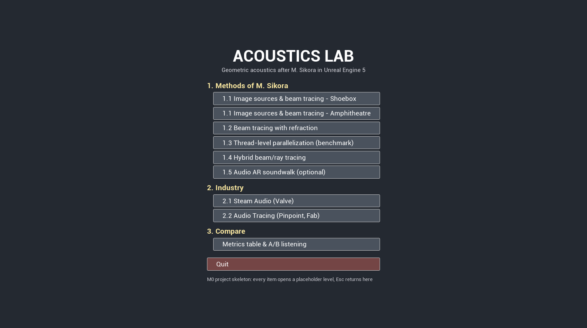
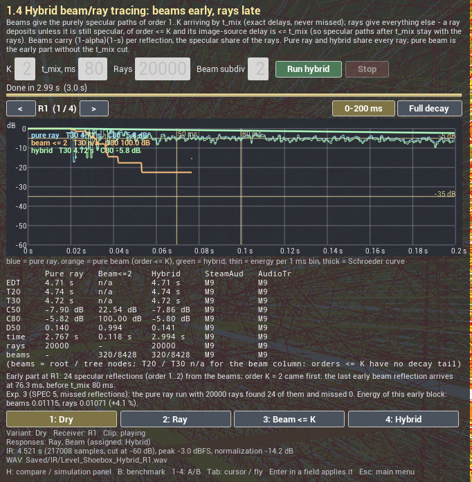
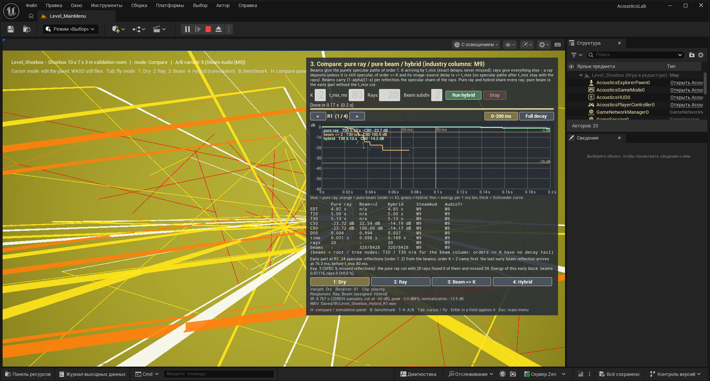
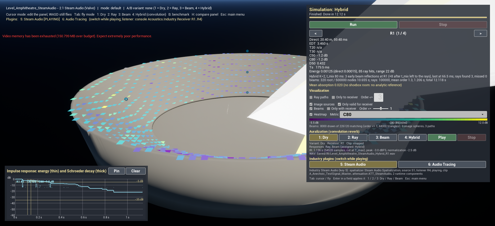
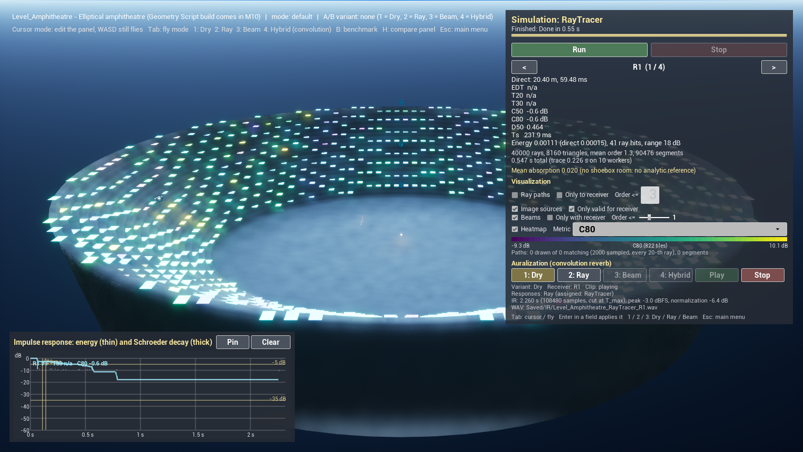
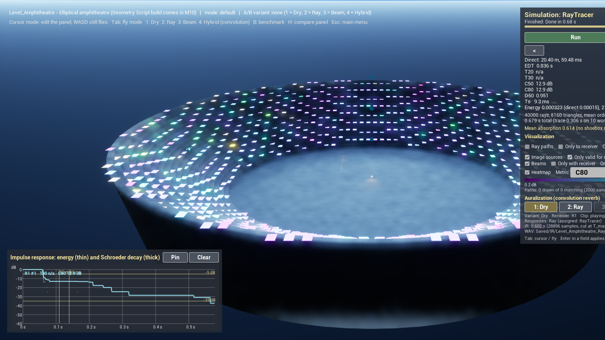
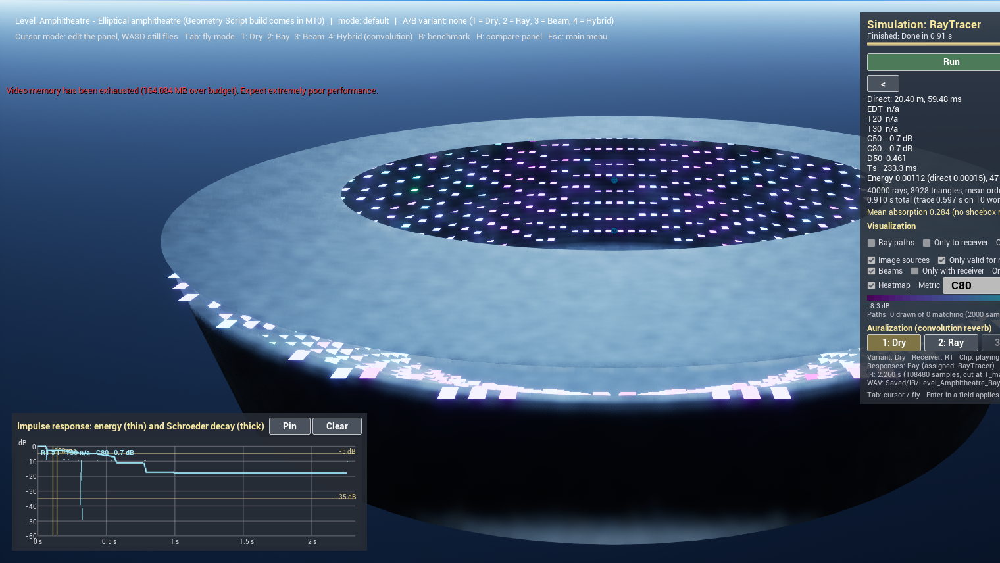

# AcousticsLab

**A test bench in Unreal Engine 5 for the geometric-acoustics methods of Marjan Sikora (FESB, Split)** — stochastic ray tracing, image sources, triangular beam tracing with beam division, beam tracing with refraction, thread-level parallelization and hybrid beam/ray tracing — implemented in C++, drawn in the 3D scene, made audible by convolution, and placed next to two production tools on the same positions: Steam Audio (Valve, running) and Audio Tracing (Pinpoint, prepared; it needs a GPU with hardware ray tracing).

The aim is to understand the methods by building them and to be able to show them: every method is a mode of the application where you see the rays or beams, the impulse response and the room-acoustic metrics, and hear the result. It is a learning and demonstration project, not a scientific result.


*Beam tracer in the 10 × 7 × 3 m validation room: the beams of orders 2–3 that contain receiver R1 (orange, red), the simulation panel, and the impulse response with the discrete early arrivals.*

**→ Reviewer's guide: [docs/guide](docs/guide/README.md) · 10-minute tour: [docs/guide/walkthrough.md](docs/guide/walkthrough.md)**

## Methods and where to find them

| Method | Paper and section | Milestone | Where in the app | Status |
|---|---|---|---|---|
| Project skeleton: menu, levels, input, tests | — | M0 | main menu; all levels | done |
| Scene extraction, materials, BVH | infrastructure (S2 §3.2.1 uses a BSP tree) | M1 | every level; `LevelSetup` → Log Extracted Scene | done |
| Stochastic ray tracing + room metrics (EDT, T20, T30, C50, C80, D50, Ts), Sabine / Eyring validation | reference method compared in S2 §4.2; metrics as in S6 | M2 | 1.1 Shoebox → Solver `RayTracer` | done |
| Visualization: ray paths, receiver-grid heatmaps, IR plot with Schroeder curve | — | M3 | all solver modes | done |
| Auralization: IR synthesis, WAV export, convolution reverb, A/B keys | listening side of S4–S5 | M4, M8 | keys 1–4, Auralization block | done (Dry, Ray, Beam, Hybrid) |
| Image sources (order ≤ 3) | classical reference for early reflections | M5 | 1.1 Shoebox → Solver `ImageSource` | done |
| Triangular beam tracing with beam division, beam tree, receiver query | **S1**; S2 §3.2.2, §3.3.1–3.3.5, Eq. 5 | M5 | 1.1 Shoebox → Solver `BeamTracer` | done |
| Beam tracing with refraction: Snell, total internal reflection, R/T by impedances, refracted apex; pool and acoustic lens | **S2** §3.1, §3.3.4, §4.4 | M6 | 1.2 Beam tracing with refraction | done |
| Thread-level parallelization of the beam-tree build, BVH on/off, speed-up benchmark | **S3** | M7 | 1.3 Thread-level parallelization (benchmark); key B in scene levels | done ([M7](docs/milestones/M7.md)) |
| Hybrid beam/ray tracing: beams for the early specular part, rays for the rest; three-curve comparison panel; missed-reflection count | **S4** | M8 | 1.4 Hybrid beam/ray tracing, 3. Compare; key H in scene levels, key 4 | done ([M8](docs/milestones/M8.md)) |
| Steam Audio and Audio Tracing on the same positions, runtime switch, click-response measurement into the Compare table | — | M9 | 2.1 / 2.2 Industry; keys 5 / 6 | Steam Audio done, on the amphitheatre since M10 (experiment E6); Audio Tracing prepared, not yet heard — needs hardware ray tracing ([M9](docs/milestones/M9.md)) |
| Amphitheatre (empty / audience / velarium), cavea heatmap, soundwalk with on-demand responses and ambient sources, experiments E1–E6 of SPEC §5 | S4, **S5** | M10 | 1.1 Amphitheatre; 1.5 Audio AR soundwalk | done ([M10](docs/milestones/M10.md)) |

Papers (full citations in [docs/guide/references.md](docs/guide/references.md)):
S1 Sikora, Mateljan, Bogunović, *Beam Division in Acoustic Simulation of Non-Homogenous Environments*, Automatika 52(4), 2011 ·
S2 Sikora, Mateljan, Bogunović, *Beam Tracing with Refraction*, Archives of Acoustics 37(3), 2012 ·
S3 Sikora, Mateljan, *A method for speeding up beam-tracing simulation using thread-level parallelization*, Engineering with Computers 30(4), 2014 ·
S4 Sikora, Russo, Mateljan, *Hybrid Beam/Ray Tracing Simulation Method*, Euronoise 2018 ·
S5 Sikora, Russo, Đerek, Jurčević, *Soundscape of an Archaeological Site Recreated with Audio Augmented Reality*, ACM TOMM 14(3), 2018 ·
S6 Đerek, Sikora, Pauković, Kraljević, *Acoustic Analysis of Various Purposes Rooms Using Measurements and Simulations*, SoftCOM 2021.

## What is validated

41 automation tests, all green on the final M10 build. Highlights:

- **Ray tracer vs Sabine / Eyring** in a 10 × 7 × 3 m room ($V$ = 210 m³, $S$ = 242 m², 20 000 rays, diffuse walls): T30 within **+2.4 … +8.8 %** of Eyring for α = 0.1 / 0.2 / 0.3 (criterion 20 %); the concrete room in the editor gives T30 4.72 s vs Eyring 4.59 s (+2.9 %). [Table](docs/guide/04-room-acoustic-metrics.md#shoebox-against-sabineeyring-test-acousticslabcoresolversshoeboxsabine)
- **Beam tracer vs image sources**: the same early reflections up to order 3 at four receivers, **delays within 0.1 ms, energies within 1 %**, with no escaped or unresolved beam pieces. [Details](docs/guide/07-image-sources-and-beam-tracing.md#validation)
- **Refraction**: Snell angles to 1e-9°, critical angle air → water 13.40°, $R + T = 1$ for every medium pair, the transmitted arrival under water at $h_{air}/c_{air} + h_{water}/c_{water}$ within 0.1 ms, and on S2's acoustic lens (scaled × 10) a focal receiver with more than twice the energy of receivers 0.3 m off the axis. [Details](docs/guide/08-refraction.md#validation)
- **Hybrid**: T30 of the hybrid equals the pure ray tracer's to the millisecond, the early specular energy of beams and rays agrees within 1–2 %, nothing is counted twice; with fewer than about 16 000 rays the pure ray tracer misses some of the 24 early reflections of order ≤ 2 (250 rays: 20 missed at R1), the hybrid never does. [Details](docs/guide/10-hybrid.md#results)
- **How many rays** (E2): a closed room is stable at 10 000–20 000 rays, an open amphitheatre needs ≥ 100 000–200 000; on the amphitheatre even 100 000 rays miss one of 13 early reflections at the front row (E3), the beams none. [Experiments](docs/guide/12-amphitheatre-and-soundwalk.md#experiment-e2--how-many-rays-spec-52)
- **Diffuse-field limit** (experiment E1): over α = 0.05 … 0.5 the ray-traced T30 stays within +0.3 … +12.8 % of Eyring with Lambert walls; with nearly specular walls it is +4 … +58 % above, as expected for a non-diffuse field. [Table](docs/guide/12-amphitheatre-and-soundwalk.md#experiment-e1--shoebox-t30-against-sabine--eyring-over-α-spec-51)
- **Determinism**: ray, beam and hybrid results are bit-identical for any thread count and with BVH on or off.

All tests: [validation at a glance](docs/guide/README.md#validation-at-a-glance).

## Quick start

**Requirements**: Windows 10/11, Unreal Engine **5.8.3**, Visual Studio 2022 (17.14, MSVC, Windows SDK 10.0.22621), a DX12 GPU. Engine plugins used: GeometryScripting, ProceduralMeshComponent, EnhancedInput, AudioCapture, Synthesis, and for editor automation ModelingToolsEditorMode, PythonScriptPlugin, ModelContextProtocol, AllToolsets, MCPClientToolset. Optional, only for the industry levels: **Steam Audio 4.8.1** — run `Tools/Plugins/install_steam_audio.ps1` once (it downloads the release and puts its plugin sources into `Plugins/SteamAudio`, built with the project); **Audio Tracing** from Fab (install to the engine from the Epic launcher; it needs a GPU with hardware ray tracing — see [11](docs/guide/11-industry-comparison.md)). The project opens and builds without either.

**Build** (from the project folder; adjust the engine path):

```bat
"C:\Program Files\Epic Games\UE_5.8\Engine\Build\BatchFiles\Build.bat" -projectfiles -project="%CD%\AcousticsLab.uproject" -game -engine
"C:\Program Files\Epic Games\UE_5.8\Engine\Build\BatchFiles\Build.bat" AcousticsLabEditor Win64 Development -Project="%CD%\AcousticsLab.uproject" -WaitMutex -FromMsBuild
```

**Tests** (headless):

```bat
"C:\Program Files\Epic Games\UE_5.8\Engine\Binaries\Win64\UnrealEditor-Cmd.exe" "%CD%\AcousticsLab.uproject" -ExecCmds="Automation RunTests AcousticsLab" -unattended -nopause -nosplash -NullRHI -testexit="Automation Test Queue Empty" -log -log=AutomationTests.log
```

or in the editor: Tools → Session Frontend → Automation → filter `AcousticsLab` → Start Tests.

**Run**: open `AcousticsLab.uproject`; it starts in `Level_MainMenu`. Use **Play → Standalone Game** for the menu (in PIE the editor takes Esc). To work on one scene, open `Content/Maps/Level_Shoebox` or `Level_Refraction` and press Play.

**In a scene**: the simulation panel is top right (cursor mode), the impulse-response plot bottom left. **Run** starts the selected solver, **Stop** cancels it; `<` / `>` select the receiver; **Tab** toggles cursor / fly (WASD + mouse, E/Q up/down); **1 / 2 / 3 / 4** play the dry clip / the ray-traced / beam-traced / hybrid room; **H** toggles the comparison panel (hybrid), **B** the benchmark panel; **5 / 6** switch to Steam Audio / Audio Tracing in the industry levels; **Esc** returns to the menu. Details: [overview and controls](docs/guide/01-overview-and-controls.md).

The menu:




```
ACOUSTICS LAB
1. Methods of M. Sikora
   1.1 Image sources & beam tracing - Shoebox        Level_Shoebox
   1.1 Image sources & beam tracing - Amphitheatre   Level_Amphitheatre
   1.2 Beam tracing with refraction                  Level_Refraction
   1.3 Thread-level parallelization (benchmark)      Level_Shoebox, benchmark panel
   1.4 Hybrid beam/ray tracing                       Level_Shoebox, comparison panel
   1.5 Audio AR soundwalk (optional)                 Level_Amphitheatre, walk the rows
2. Industry
   2.1 Steam Audio (Valve)                           Level_Amphitheatre_SteamAudio
   2.2 Audio Tracing (Pinpoint, Fab)                 Level_Amphitheatre_AudioTracing (needs RTX)
3. Compare
   Metrics table & A/B listening                     Level_Shoebox, comparison panel
Quit
```

## Gallery

| | | |
|---|---|---|
|  |  |  |
| Ray paths that reach R1 within four reflections (colour = reflection order) | Direct-SPL heatmap over a 10 × 7 receiver grid | Image sources and the valid paths to R1 |
|  |  |  |
| Beams to an underwater receiver refracted at the water surface | S2's acoustic lens (× 10): beams converging in a rubber sphere in glycerol | Convolution auralization, receiver R3 |
|  |  |  |
| Hybrid: pure ray (blue), pure beam ≤ 2 (orange), hybrid (green) and the metrics table | Compare with 20 rays: the rays miss all 24 early reflections, the beams do not | Steam Audio on the baked amphitheatre, with a hybrid run of the bench in the panel |
|  |  |  |
| Amphitheatre, empty stone: C80 over the 20 rows | With audience (α 0.7): C80 about +10 dB on every row | With the velarium ring at 18 m |

More screenshots in the guide; the ones still to take are listed in [SCREENSHOTS_TODO](docs/guide/SCREENSHOTS_TODO.md).

## Known simplifications

From the specification (SPEC §6) and the deviations recorded in the milestone documents:

- **Energy model**: energies, no phase or interference; broadband (one frequency band; the data layout is ready for six octave bands).
- **No diffraction**, and **no scattering in the beam tracer** (as in S2); the ray tracer reflects diffusely with the scattering coefficient $s$ (Lambert).
- **Refracted beam apex** = least-squares point of the three refracted guide rays (S2 averages the three pairwise intersections); the reflected beam keeps the exact mirrored apex. Shown in the panel whenever refraction is on.
- **R and T** by impedances at normal incidence for every angle; total internal reflection decided by the beam axis; interface materials without absorption.
- **Only the beam tracer knows media**: the ray tracer and the image-source solver treat the water surface and the lens as ordinary walls.
- **Beam division** in a plane across the beam (convex polygons, Sutherland–Hodgman, fan triangulation) with candidates from a BVH frustum query, instead of the paper's BSP ordering and triangle–triangle clipping; the covered regions are the same. Emission by a (subdivided) icosahedron as in S2; no octree over finished beams.
- **The lens of S2 is scaled × 10** (sphere radius 0.5 m) and traced to order 3 (the paper: order 4).
- **Shoebox settings**: `MaxOrder` 500 and `T_max` 6 s in `Level_Shoebox` (SPEC defaults 200 / 3 s are too short for the concrete room's 4.6 s reverberation).
- **Sabine / Eyring criterion** asserted for diffuse walls; specular walls give T30 13–37 % above Eyring (a non-diffuse shoebox, reported).
- **Directional source** of the lens = emission mask (beams inside a cone), not a directivity pattern.
- **Auralization**: a synthetic placeholder clip until a real anechoic recording is added; the listener is the selected receiver (the clip is not spatialized); per-response loudness normalization.
- **Geometry** is read from render data: editor, PIE and standalone-from-editor work; a packaged build would need meshes with CPU access.
- **Hybrid** = two solvers combined in the histogram and split by path class (early specular ≤ K and ≤ t_mix from beams, the rest from rays), not S4's conversion of each beam into one ray; its beams are omnidirectional and do not refract. Validated on the shoebox.
- **Amphitheatre** is idealised: bare stepped rows (no seats, openings or façade), audience as a material swap, velarium as a flat ring, open top. The empty stone amphitheatre has no T30: its response is a few strong specular echoes off the concave risers, not a decay (experiment E5b); EDT and C80 are the meaningful numbers there.
- **Soundwalk**: the response of the nearest precomputed cell (2 m grid), heard without head direction; the ambient sources use engine 3D panning, not the room responses.
- **Industry levels** hold the empty stone amphitheatre baked into static meshes; plugin responses are compared through a recorded click (no impulse-response API). Steam Audio, with its default real-time settings, hears the empty cavea almost dry (C80 23–32 dB vs about −1 dB from the bench, E6). Audio Tracing is prepared but has not been heard: the development machine (GTX 1050 Ti) has no hardware ray tracing.
- **Menu modes** (`?mode=`): `Benchmark` (1.3) opens the benchmark panel, `Hybrid` (1.4) and `Compare` (3) the comparison panel; the others are informational. The panel's last settings carry over between levels within a session.

## Roadmap

- **M7 — thread-level parallelization (S3)**, done: one beam subtree per root beam on a dedicated `FQueuedThreadPool`, merged in root order (bit-identical for any thread count), BVH on/off, benchmark panel with CSV export and speed-up chart; on a 6-core / 12-thread laptop about 4× on the shoebox and the lens scene. [docs/milestones/M7.md](docs/milestones/M7.md)
- **M8 — hybrid beam/ray (S4)**, done: beams for the early specular part, rays for the rest, split by path class; comparison panel with three IR curves, a metrics table and the missed-reflection count; key 4, key H. [docs/milestones/M8.md](docs/milestones/M8.md)
- **M9 — industry**, done for Steam Audio: Steam Audio 4.8.1 built from source, two industry levels with a runtime switch (keys 5 / 6), click-response measurement into the Compare table; Audio Tracing prepared for an RTX machine. Also: Stop now cancels long ray runs within about a second. [docs/milestones/M9.md](docs/milestones/M9.md)
- **M10 — amphitheatre**, done: the elliptical amphitheatre (65 × 40 m arena, 20 rows, 15 m) built from dynamic meshes, audience / velarium toggles, a 856-point heatmap over the cavea, the soundwalk (menu 1.5), the industry levels rebuilt on the amphitheatre, experiments E1–E6 of SPEC §5 with tables and CSVs in `docs/results`, a full menu pass. [docs/milestones/M10.md](docs/milestones/M10.md)
- **Open**: Audio Tracing on an RTX machine (its levels and keys are ready), Steam Audio settings for open-air spaces, a larger default beam budget for the hybrid on the amphitheatre, a real anechoic recording instead of the synthetic clip.

## Repository layout

- `Source/AcousticsCore` — pure C++ solvers and results (meters, seconds, `double`), no engine types; automation tests in `Private/Tests`.
- `Source/AcousticsLab` — game module: scene extraction, asynchronous runs, visualizers, audio, UMG panels.
- `Content/Maps` — `Level_MainMenu`, `Level_Shoebox`, `Level_Refraction`, `Level_Amphitheatre`, `Level_Amphitheatre_SteamAudio`, `Level_Amphitheatre_AudioTracing`.
- `Tools/` — editor scripts (content creation and PIE verification through the editor's MCP server), the anechoic test-signal generator, the Steam Audio installer (`Tools/Plugins`).
- `Plugins/SteamAudio` — created by the installer, not in the repository.
- `docs/guide` — the reviewer's guide · `docs/results` — experiment CSVs · `docs/milestones` — what each milestone did, deviations, build and test logs · [`docs/SPEC.md`](docs/SPEC.md) — the specification (Russian).
