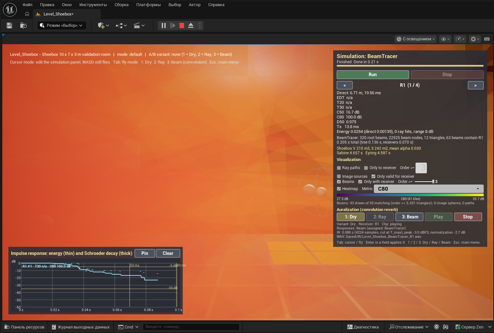
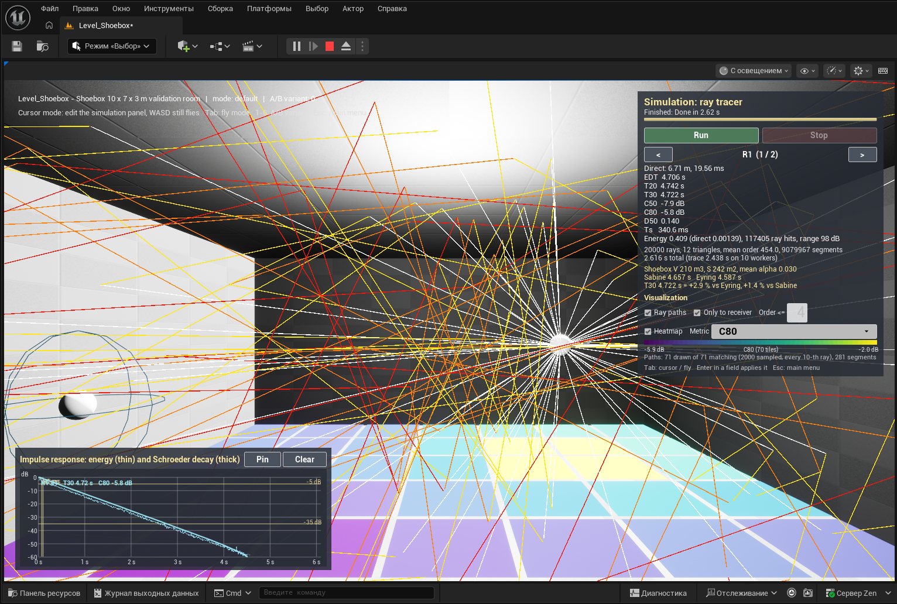
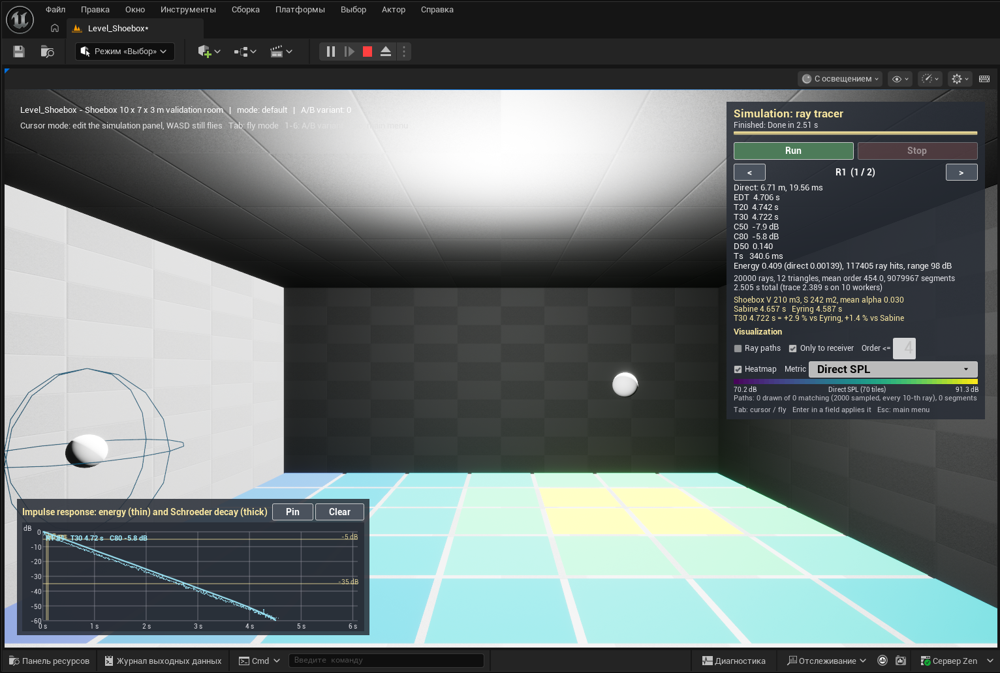
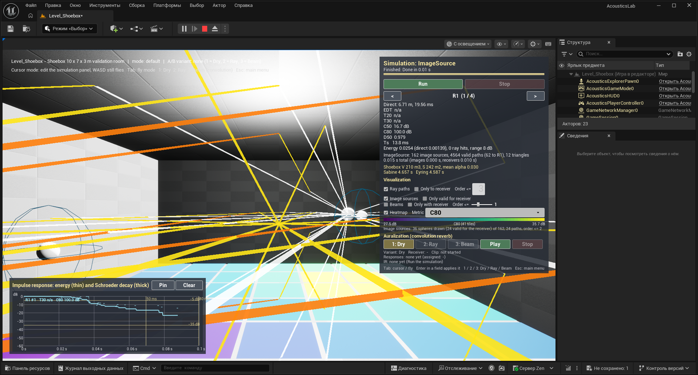
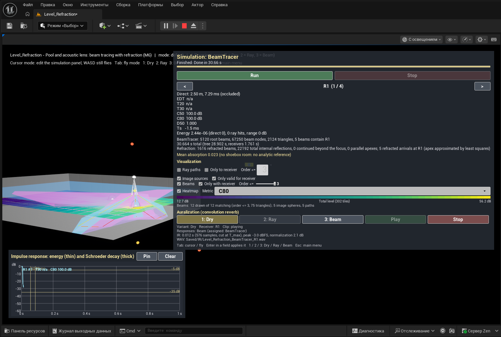
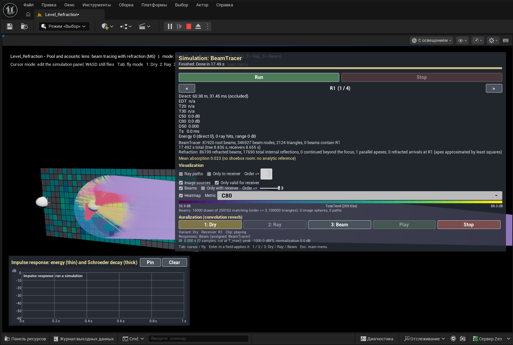
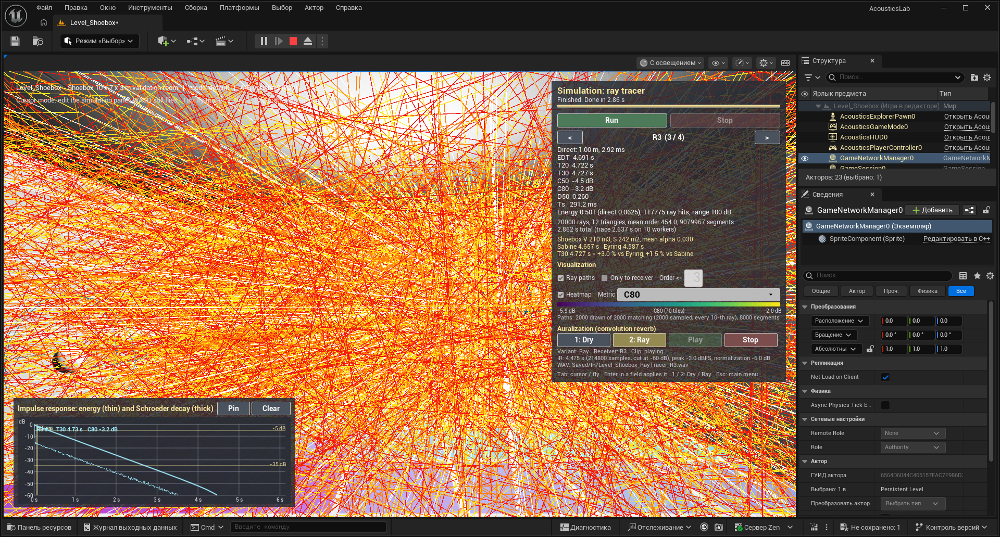

# AcousticsLab

**A test bench in Unreal Engine 5 for the geometric-acoustics methods of Marjan Sikora (FESB, Split)** — stochastic ray tracing, image sources, triangular beam tracing with beam division, beam tracing with refraction, thread-level parallelization and hybrid beam/ray tracing — implemented in C++, drawn in the 3D scene, and made audible by convolution; later to be compared on the same geometry with two production tools, Steam Audio (Valve) and Audio Tracing (Pinpoint).

The aim is to understand the methods by building them and to be able to show them: every method is a mode of the application where you see the rays or beams, the impulse response and the room-acoustic metrics, and hear the result. It is a learning and demonstration project, not a scientific result.



*Beam tracer in the 10 × 7 × 3 m validation room: the beams of orders 2–3 that contain receiver R1 (orange, red), the simulation panel, and the impulse response with the discrete early arrivals.*

**→ Reviewer's guide: [docs/guide](docs/guide/README.md) · 10-minute tour: [docs/guide/walkthrough.md](docs/guide/walkthrough.md)**

## Methods and where to find them

| Method | Paper and section | Milestone | Where in the app | Status |
|---|---|---|---|---|
| Project skeleton: menu, levels, input, tests | — | M0 | main menu; all levels | done |
| Scene extraction, materials, BVH | infrastructure (S2 §3.2.1 uses a BSP tree) | M1 | every level; `LevelSetup` → Log Extracted Scene | done |
| Stochastic ray tracing + room metrics (EDT, T20, T30, C50, C80, D50, Ts), Sabine / Eyring validation | reference method compared in S2 §4.2; metrics as in S6 | M2 | 1.1 Shoebox → Solver `RayTracer` | done |
| Visualization: ray paths, receiver-grid heatmaps, IR plot with Schroeder curve | — | M3 | all solver modes | done |
| Auralization: IR synthesis, WAV export, convolution reverb, A/B keys | listening side of S4–S5 | M4 | keys 1–3, Auralization block | done (Dry, Ray, Beam) |
| Image sources (order ≤ 3) | classical reference for early reflections | M5 | 1.1 Shoebox → Solver `ImageSource` | done |
| Triangular beam tracing with beam division, beam tree, receiver query | **S1**; S2 §3.2.2, §3.3.1–3.3.5, Eq. 5 | M5 | 1.1 Shoebox → Solver `BeamTracer` | done |
| Beam tracing with refraction: Snell, total internal reflection, R/T by impedances, refracted apex; pool and acoustic lens | **S2** §3.1, §3.3.4, §4.4 | M6 | 1.2 Beam tracing with refraction | done |
| Thread-level parallelization of the beam-tree build, BVH on/off, speed-up benchmark | **S3** | M7 | 1.3 Thread-level parallelization (benchmark); key B in scene levels | done ([M7](docs/milestones/M7.md)) |
| Hybrid beam/ray tracing | **S4** | M8 | 1.4 Hybrid beam/ray tracing | planned |
| Steam Audio and Audio Tracing on the same amphitheatre; Compare table | — | M9 | 2. Industry, 3. Compare | planned |
| Amphitheatre (empty / audience / velarium), soundwalk, experiments of SPEC §5 | S4, **S5** | M10 | 1.1 Amphitheatre, 1.5 Audio AR soundwalk | planned |

Papers (full citations in [docs/guide/references.md](docs/guide/references.md)):
S1 Sikora, Mateljan, Bogunović, *Beam Division in Acoustic Simulation of Non-Homogenous Environments*, Automatika 52(4), 2011 ·
S2 Sikora, Mateljan, Bogunović, *Beam Tracing with Refraction*, Archives of Acoustics 37(3), 2012 ·
S3 Sikora, Mateljan, *A method for speeding up beam-tracing simulation using thread-level parallelization*, Engineering with Computers 30(4), 2014 ·
S4 Sikora, Russo, Mateljan, *Hybrid Beam/Ray Tracing Simulation Method*, Euronoise 2018 ·
S5 Sikora, Russo, Đerek, Jurčević, *Soundscape of an Archaeological Site Recreated with Audio Augmented Reality*, ACM TOMM 14(3), 2018 ·
S6 Đerek, Sikora, Pauković, Kraljević, *Acoustic Analysis of Various Purposes Rooms Using Measurements and Simulations*, SoftCOM 2021.

## What is validated

30 automation tests, all green on the M7 build. Highlights:

- **Ray tracer vs Sabine / Eyring** in a 10 × 7 × 3 m room ($V$ = 210 m³, $S$ = 242 m², 20 000 rays, diffuse walls): T30 within **+2.4 … +8.8 %** of Eyring for α = 0.1 / 0.2 / 0.3 (criterion 20 %); the concrete room in the editor gives T30 4.72 s vs Eyring 4.59 s (+2.9 %). [Table](docs/guide/04-room-acoustic-metrics.md#shoebox-against-sabineeyring-test-acousticslabcoresolversshoeboxsabine)
- **Beam tracer vs image sources**: the same early reflections up to order 3 at four receivers, **delays within 0.1 ms, energies within 1 %**, with no escaped or unresolved beam pieces. [Details](docs/guide/07-image-sources-and-beam-tracing.md#validation)
- **Refraction**: Snell angles to 1e-9°, critical angle air → water 13.40°, $R + T = 1$ for every medium pair, the transmitted arrival under water at $h_{air}/c_{air} + h_{water}/c_{water}$ within 0.1 ms, and on S2's acoustic lens (scaled × 10) a focal receiver with more than twice the energy of receivers 0.3 m off the axis. [Details](docs/guide/08-refraction.md#validation)
- **Determinism**: ray and beam results are bit-identical for any thread count and with BVH on or off.

All tests: [validation at a glance](docs/guide/README.md#validation-at-a-glance).

## Quick start

**Requirements**: Windows 10/11, Unreal Engine **5.8.3**, Visual Studio 2022 (17.14, MSVC, Windows SDK 10.0.22621), a DX12 GPU. Engine plugins used: GeometryScripting, ProceduralMeshComponent, EnhancedInput, AudioCapture, Synthesis, and for editor automation ModelingToolsEditorMode, PythonScriptPlugin, ModelContextProtocol, AllToolsets, MCPClientToolset. The Steam Audio and Audio Tracing plugins will be added in M9.

**Build** (from the project folder; adjust the engine path):

```bat
"C:\Program Files\Epic Games\UE_5.8\Engine\Build\BatchFiles\Build.bat" -projectfiles -project="%CD%\AcousticsLab.uproject" -game -engine
"C:\Program Files\Epic Games\UE_5.8\Engine\Build\BatchFiles\Build.bat" AcousticsLabEditor Win64 Development -Project="%CD%\AcousticsLab.uproject" -WaitMutex -FromMsBuild
```

**Tests** (headless):

```bat
"C:\Program Files\Epic Games\UE_5.8\Engine\Binaries\Win64\UnrealEditor-Cmd.exe" "%CD%\AcousticsLab.uproject" -ExecCmds="Automation RunTests AcousticsLab" -unattended -nopause -nosplash -NullRHI -testexit="Automation Test Queue Empty" -log -log=AutomationTests.log
```

or in the editor: Tools → Session Frontend → Automation → filter `AcousticsLab` → Start Tests.

**Run**: open `AcousticsLab.uproject`; it starts in `Level_MainMenu`. Use **Play → Standalone Game** for the menu (in PIE the editor takes Esc). To work on one scene, open `Content/Maps/Level_Shoebox` or `Level_Refraction` and press Play.

**In a scene**: the simulation panel is top right (cursor mode), the impulse-response plot bottom left. **Run** starts the selected solver; `<` / `>` select the receiver; **Tab** toggles cursor / fly (WASD + mouse, E/Q up/down); **1 / 2 / 3** play the dry clip / the ray-traced room / the beam-traced room; **Esc** returns to the menu. Details: [overview and controls](docs/guide/01-overview-and-controls.md).

The menu:

```
ACOUSTICS LAB
1. Methods of M. Sikora
   1.1 Image sources & beam tracing - Shoebox        Level_Shoebox
   1.1 Image sources & beam tracing - Amphitheatre   Level_Amphitheatre (placeholder, M10)
   1.2 Beam tracing with refraction                  Level_Refraction
   1.3 Thread-level parallelization (benchmark)      Level_Shoebox (panel in M7)
   1.4 Hybrid beam/ray tracing                       Level_Shoebox (panel in M8)
   1.5 Audio AR soundwalk (optional)                 Level_Amphitheatre (M10)
2. Industry
   2.1 Steam Audio (Valve)                           placeholder (M9)
   2.2 Audio Tracing (Pinpoint, Fab)                 placeholder (M9)
3. Compare
   Metrics table & A/B listening                     Level_Shoebox (panel in M8–M9)
Quit
```

## Gallery

| | | |
|---|---|---|
|  |  |  |
| Ray paths that reach R1 within four reflections (colour = reflection order) | Direct-SPL heatmap over a 10 × 7 receiver grid | Image sources and the valid paths to R1 |
|  |  |  |
| Beams to an underwater receiver refracted at the water surface | S2's acoustic lens (× 10): beams converging in a rubber sphere in glycerol | Convolution auralization, receiver R3 |

More screenshots in the guide; the ones still to take are listed in [SCREENSHOTS_TODO](docs/guide/SCREENSHOTS_TODO.md).

## Known simplifications

From the specification (SPEC §6) and the deviations recorded in the milestone documents:

- **Energy model**: energies, no phase or interference; broadband (one frequency band; the data layout is ready for six octave bands).
- **No diffraction**, and **no scattering in the beam tracer** (as in S2); the ray tracer reflects diffusely with the scattering coefficient $s$ (Lambert).
- **Refracted beam apex** = least-squares point of the three refracted guide rays (S2 averages the three pairwise intersections); the reflected beam keeps the exact mirrored apex. Shown in the panel whenever refraction is on.
- **R and T** by impedances at normal incidence for every angle; total internal reflection decided by the beam axis; interface materials without absorption.
- **Only the beam tracer knows media**: the ray tracer and the image-source solver treat the water surface and the lens as ordinary walls.
- **Beam division** in a plane across the beam (convex polygons, Sutherland–Hodgman, fan triangulation) with candidates from a BVH frustum query, instead of the paper's BSP ordering and triangle–triangle clipping; the covered regions are the same. Emission by a (subdivided) icosahedron as in S2; no octree over finished beams.
- **The lens of S2 is scaled × 10** (sphere radius 0.5 m) and traced to order 3 (the paper: order 4).
- **Shoebox settings**: `MaxOrder` 500 and `T_max` 6 s in `Level_Shoebox` (SPEC defaults 200 / 3 s are too short for the concrete room's 4.6 s reverberation).
- **Sabine / Eyring criterion** asserted for diffuse walls; specular walls give T30 13–37 % above Eyring (a non-diffuse shoebox, reported).
- **Directional source** of the lens = emission mask (beams inside a cone), not a directivity pattern.
- **Auralization**: a synthetic placeholder clip until a real anechoic recording is added; the listener is the selected receiver (the clip is not spatialized); per-response loudness normalization.
- **Geometry** is read from render data: editor, PIE and standalone-from-editor work; a packaged build would need meshes with CPU access.
- **Menu modes** (`?mode=`) are displayed but do not yet switch panels, except `Benchmark` (1.3), which opens the benchmark panel; the panel's last settings carry over between levels within a session.

## Roadmap

- **M7 — thread-level parallelization (S3)**, done: one beam subtree per root beam on a dedicated `FQueuedThreadPool`, merged in root order (bit-identical for any thread count), BVH on/off, benchmark panel with CSV export and speed-up chart; on a 6-core / 12-thread laptop about 4× on the shoebox and the lens scene. [docs/milestones/M7.md](docs/milestones/M7.md)
- **M8 — hybrid beam/ray (S4)**: beams for the early part, rays for the late part; three overlaid IR curves; key 4.
- **M9 — industry**: the amphitheatre with Steam Audio and with Audio Tracing, keys 5 / 6, optional click-response recording for a Compare table.
- **M10 — amphitheatre and polish**: the elliptical amphitheatre with audience / velarium options, soundwalk mode, the experiments of SPEC §5 with tables, a full menu pass.

## Repository layout

- `Source/AcousticsCore` — pure C++ solvers and results (meters, seconds, `double`), no engine types; automation tests in `Private/Tests`.
- `Source/AcousticsLab` — game module: scene extraction, asynchronous runs, visualizers, audio, UMG panels.
- `Content/Maps` — `Level_MainMenu`, `Level_Shoebox`, `Level_Refraction`, `Level_Amphitheatre`, `Level_Amphitheatre_SteamAudio`, `Level_Amphitheatre_AudioTracing`.
- `Tools/` — editor scripts (content creation and PIE verification through the editor's MCP server), the anechoic test-signal generator.
- `docs/guide` — the reviewer's guide · `docs/milestones` — what each milestone did, deviations, build and test logs · [`docs/SPEC.md`](docs/SPEC.md) — the specification (Russian) · [`docs/PROMPTS.md`](docs/PROMPTS.md) — milestone prompts · [`CLAUDE.md`](CLAUDE.md) — rules for the AI coding assistant used to build the project.
