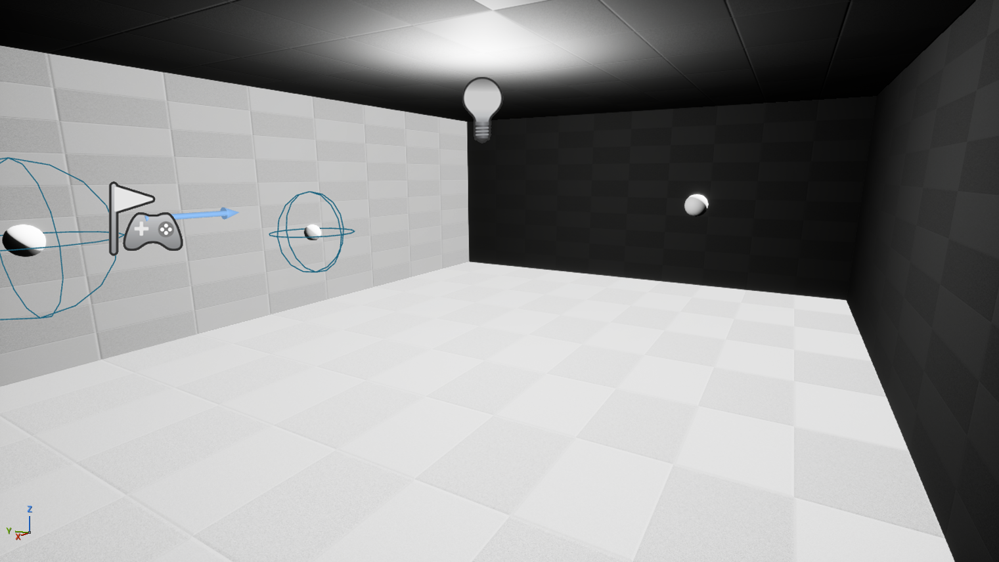

# 2. Geometry, scene extraction and the BVH

[← Guide index](README.md) · Milestone M1 (media and interfaces added in M6) · Status: **done**

All solvers work on the same plain-C++ scene: a list of triangles in meters with a material per triangle (and, for refraction, a medium on each side), plus a bounding-volume hierarchy for fast queries. This page explains how that scene is taken from an Unreal level and what the shared geometry code does. It is infrastructure, not a method of the papers, but the papers' methods depend on it: beam division (S1) needs frustum queries, and S3's second source of speed-up is a spatial subdivision.

Code: `Source/AcousticsCore/Public/Geometry/` (`AcousticTriangle`, `AcousticMaterialProps`, `Medium`, `RayIntersection`, `Frustum`, `BVH`, `AcousticScene`, `PolygonClipping`); `Source/AcousticsLab/Public/Scene/AcousticSceneExtractorComponent.h`.

## Two modules, one boundary

- `AcousticsCore` is pure C++ (depends on `Core` only): no `UWorld`, no actors, no Slate. Solvers are pure functions of (scene, source, receivers, settings) → result, in **meters and seconds**, `double` precision. This makes them testable headless and identical in the editor and in tests.
- `AcousticsLab` (the game module) collects the scene from the level, converts **centimeters → meters** (only here and in the visualizers), runs the solvers in a background task and draws the result.

## Scene extraction

`UAcousticSceneExtractorComponent` (on the `LevelSetup` actor of every level) collects:

- every `StaticMeshComponent`, `InstancedStaticMeshComponent` (one copy per instance) and `DynamicMeshComponent` whose component **or actor** has the tag `Acoustic`;
- triangles from the render data LOD 0 (static meshes) or the dynamic mesh, transformed to world space, converted to meters;
- the winding converted to the core convention (front normal $(V_1 - V_0) \times (V_2 - V_0)$; UE uses the opposite order), with mirrored transforms handled;
- the material: tag `AcMat:<name>` on the component or actor → the material asset library of the level → the C++ preset table → default **Concrete**, with a warning at each fallback;
- interfaces between media (M6): a component or actor tagged `Interface` gives interface triangles; the media on the two sides are named by `AcMediumFront:<name>` (the side the face normal points to) and `AcMediumBack:<name>`. Without medium tags the defaults are front Air / back Water, with a warning.

**Log Extracted Scene** (Details → Acoustics on `LevelSetup`) prints the statistics and draws the triangle edges and normals in the viewport for 10 s. For the shoebox: `12 triangles (0 degenerate skipped), 242.000 m^2, 1 materials`.

*`Level_Shoebox` in the editor: the 10 × 7 × 3 m room built from six single-sided quads (visible from outside), source S1 and the receivers with their 0.5 m spheres.*

## Materials and media

Materials are DataAssets `DA_AcMat_*` under `Content/Acoustics/Materials/` with the same values in a C++ table (`AcousticMaterialPresets`) used as a fallback:

| Preset | Absorption α | Scattering s | Note |
|---|---|---|---|
| Concrete | 0.03 | 0.10 | default |
| Plaster | 0.05 | 0.10 | |
| Wood | 0.10 | 0.15 | |
| Audience | 0.70 | 0.60 | seated people |
| WaterSurface | 0.01 | 0.05 | interface flag on |
| Absorber | 0.90 | 0.20 | |
| Interface | 0 | 0 | interface flag on; the lens sphere (M6): energy split by impedances only |

The energy reflection factor of a surface is $1 - \alpha$; $s$ is the probability that a ray is reflected diffusely (Lambert) instead of specularly. Coefficients are stored as arrays of `NumBands` values (1 in this version).

Media (M6) carry the speed of sound $c$ and the density $\rho$; the impedance is $Z = \rho c$:

| Medium | c, m/s | ρ, kg/m³ | Used in |
|---|---|---|---|
| Air | 343 | 1.2 | default (medium 0) |
| Water | 1480 | 1000 | pool |
| Glycerol | 1920 | 1260 | lens scene of S2 |
| Rubber | 900 | 930 | lens scene of S2 |

## The BVH and the geometric primitives

- **Ray–triangle:** Möller–Trumbore with a back-face flag.
- **BVH:** binary tree, split at the median of the longest centroid axis, leaves of 4–8 triangles, iterative nearest-child-first traversal. Queries: `IntersectRay` (closest hit), `QueryAABB`, `QueryFrustum` (candidates inside a triangular beam: three side planes plus the apex plane). Every query has a brute-force twin, used by the tests and by the `bUseBVH = false` benchmark of M7.
- **Polygon clipping** (M5, for beam division): convex polygons in a plane, Sutherland–Hodgman clipping against a convex clip polygon, the complement split into convex pieces, fan triangulation.

Tests: `AcousticsLab.Core.Geometry.RayTriangle`; `BvhMatchesBruteForce` (10 000 random rays on 4 000 random triangles plus the shoebox: same hits as brute force); `BvhQueriesMatchBruteForce` (AABB and frustum queries); `ShoeboxScene` (the core shoebox helper); `ShoeboxExtraction` (a transient world with the room actor → exactly 12 triangles, 242 m² ± 0.1, inward normals, material resolution through `AcMat:Wood`); `ClipPolygon` (inside, outside, partial, edge-touching, partition property).

## The levels

| Level | Content (built so far) |
|---|---|
| `Level_Shoebox` | `ShoeboxRoom` 10 × 7 × 3 m, Concrete, floor at z = 0, centred in XY; source `S1` (−3, −1.5, 1.5) m; receivers `R1` (3, 1.5, 1.5), `R2` (0, 2.5, 1.2), `R3` (−2, −1.5, 1.5) — 1 m in front of the source, `R4` (4.3, 2.8, 1.0) — far corner; `ReceiverGrid` G: 10 × 7 tiles of 1 m at 1.2 m height; `SimulationManager` |
| `Level_Refraction` | pool 20 × 10 × 3 m with a water surface at 2 m, and 60 m away the acoustic lens of S2 scaled ×10; see [8. refraction](08-refraction.md) |
| `Level_Amphitheatre`, `…_SteamAudio`, `…_AudioTracing` | `Level_Amphitheatre`: the amphitheatre built from dynamic meshes by `AAmphitheatreActor` (M10, [12](12-amphitheatre-and-soundwalk.md)); the two industry levels still hold the M9 arena-floor stand-in |

`AShoeboxRoomActor` exposes `Room Size Meters` and `Material Name`; changing them rebuilds the walls and the Sabine/Eyring reference follows.

## How to check it in the editor

1. Open `Level_Shoebox`, select `LevelSetup` → Details → Acoustics → **Log Extracted Scene**. Output Log (`LogAcoustics`): 12 triangles, 242.000 m², material 0 "Concrete" α 0.030 s 0.100; the viewport shows the edges and cyan normals pointing into the room.
2. Select `ShoeboxRoom`, set `Material Name = Wood` or change the size, log again: area and material follow.
3. Content Browser → `Acoustics/Materials`: six `DA_AcMat_*` assets.

## Differences from the SPEC

- The six walls are single-sided engine planes (two triangles each), so the room is exactly 12 triangles and can be inspected from outside. The engine plane has no "Allow CPU Access"; uncooked builds (editor, PIE, standalone from the editor) always keep CPU buffers, a packaged build would need a custom mesh with the flag (SPEC §6 accepts the editor-only limitation).
- The extractor also accepts the `Acoustic` tag on the actor and instanced meshes; materials exist both as assets and as a C++ table.
- The water-surface coefficients and the shoebox positions are this project's choices (SPEC fixes positions only for the amphitheatre).
