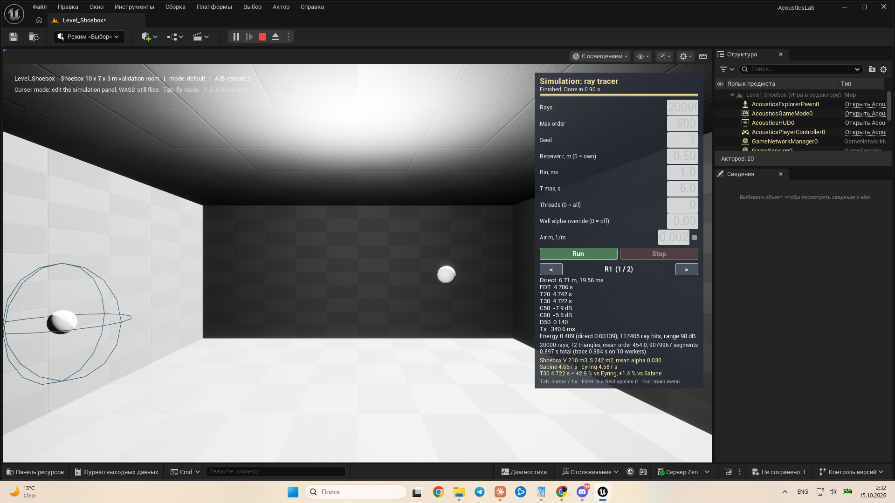

# 3. Stochastic ray tracing

[← Guide index](README.md) · Milestone M2 (path sampling M3) · Status: **done**

Menu: **1.1 Image sources & beam tracing - Shoebox** opens `Level_Shoebox`; the **Solver** combo at the top of the panel selects `RayTracer` (the level's saved default). The panel title then reads `Simulation: RayTracer`.

The stochastic ray tracer is the reference against which the deterministic methods of the papers are compared: S2 compares beam tracing with ray tracing, and S4 uses rays for the late part of the hybrid response. It is also what validates the whole pipeline (scene → histogram → metrics) against Sabine and Eyring.

Code: `Source/AcousticsCore/Public/Solvers/RayTracer.h` (`FRayTracer`, `FRayTracerSettings`), `Solvers/AcousticRandom.h`.

## Algorithm (SPEC §2.2)

1. **Emission.** $N$ rays (20 000 by default), directions uniform on the sphere by the Fibonacci lattice; each ray carries $E_0 = 1/N$.
2. **Propagation.** The ray flies to the nearest triangle (BVH query); time accumulates as $t \mathrel{+}= d/c$ with $c$ = 343 m/s.
3. **Reflection.** At the hit, $E \leftarrow E\,(1 - \alpha)$. With probability $s$ the new direction is diffuse (cosine-weighted Lambert lobe around the normal), otherwise specular:

   $$
   \mathbf{d}' = \mathbf{d} - 2 (\mathbf{d} \cdot \mathbf{n})\, \mathbf{n}
   $$


4. **Air absorption** (optional): $E \leftarrow E\, e^{-m d}$ with $m$ = 0.002 1/m for the broadband version.
5. **Receivers** are transparent spheres of radius $r$ = 0.5 m. If a ray segment enters a sphere, its current energy is added to that receiver's histogram at the entry time; the ray continues unchanged.
6. **Termination**: $E < 10^{-6} E_0$, $t > T_{max}$, or order > `MaxOrder`.
7. **Direct sound** is added analytically, $E_{direct} = r^2 / (4 d^2)$ at $t = d/c$ if the line of sight is free (one occlusion test). Order-0 ray segments therefore deposit nothing, otherwise the direct sound would be counted twice. The analytic value agrees with the ray count in expectation: a sphere of cross-section $\pi r^2$ at distance $d$ intercepts the fraction $\pi r^2 / (4 \pi d^2)$ of the emitted energy.

### Determinism and threads

Rays are processed in fixed chunks of 1024 with one histogram per chunk (since M9 the chunk is enlarged for very large runs so that there are at most 128 chunks — it depends on the ray count only, so runs up to 131 072 rays are unchanged and results stay independent of the thread count); chunks are summed in index order, and every ray has its own PCG32 random stream seeded from (seed, ray index). The result is therefore **bit-identical for any number of threads** (test `ThreadCountInvariance`) and reproducible for a given seed (test `Deterministic`: same seed → identical histogram, another seed → different).

### Path samples for drawing

The solver keeps up to 2000 complete ray paths for the visualizer. They are **every S-th ray** with $S = \max(1, N / 2000)$, not the first 2000: the first 2000 of 20 000 Fibonacci directions all lie within 37° of +Z. Sampling depends only on the ray index, so it is deterministic and does not change the histogram (test `PathSampling`). See [5. visualization](05-visualization.md).

## Panel settings (ray tracer)

| Field on the panel | Setting | Default in `Level_Shoebox` | What changing it shows |
|---|---|---|---|
| Rays | `NumRays` | 20 000 | fewer rays → noisier late decay and grid heatmaps; more rays → smoother, slower (200 000 shows the progress bar and Stop) |
| Max order | `MaxOrder` | 500 (SPEC default 200) | below ~300 in the concrete room the rays stop before −35 dB and T30 becomes `n/a` |
| Seed | `Seed` | 1 | another seed → a statistically equivalent but different result; same seed → identical |
| Receiver r, m (0 = own) | `ReceiverRadius` | 0.50 | larger spheres catch more rays (less noise, more temporal smearing); 0 uses each receiver actor's own radius |
| Bin, ms | `BinMs` | 1.0 | histogram resolution |
| T max, s | `TMax` | 6.0 (SPEC default 3) | length of the histogram; must exceed the decay of interest |
| Threads (0 = all) | `NumThreads` | 0 | result is identical for any value, only the time changes |
| Wall alpha override (0 = off) | manager `WallAbsorptionOverride` | 0 | replaces α of every extracted material — the quick Sabine/Eyring check |
| Air m, 1/m + checkbox | `AirAbsorptionPerMeter`, `bAirAbsorption` | 0.002, off | shortens the tail of long paths |

A field applies on **Enter** or when it loses focus; text that does not parse becomes 0 and every value is clamped to the range of the setting (the field then shows the clamped value). **Run** starts the solver in a background task; **Stop** cancels between chunks. The settings of the last run are remembered for the session and applied to the next level opened, whichever it is ([details](01-overview-and-controls.md#the-simulation-panel)): after a run in `Level_Refraction` (Max order 200, T max 1 s) come back to the shoebox and T30 is `n/a` until you set Max order 500 and T max 6 again.

## What the panel prints

```
20000 rays, 12 triangles, mean order 454.0, 9079967 segments
0.897 s total (trace 0.884 s on 10 workers)
```

plus the metrics of the selected receiver ([4. metrics](04-room-acoustic-metrics.md)), the number of ray hits on it, and in the shoebox the Sabine/Eyring reference.



*`Level_Shoebox`, ray tracer, 20 000 rays (M2 build: the panel later gained the solver/source selectors, the beam fields and the visualization and auralization blocks): R1 at 6.71 m (direct 19.56 ms), EDT 4.706 s, T20 4.742 s, T30 4.722 s, C50 −7.9 dB, C80 −5.8 dB, D50 0.140; reference Sabine 4.657 s, Eyring 4.587 s, T30 +2.9 % vs Eyring.*

## Validation

- `AcousticsLab.Core.Solvers.RayTracerPrimitives` — Fibonacci directions, reflection, Lambert sampling, segment–sphere intersection.
- `AcousticsLab.Core.Solvers.ShoeboxSabine` — T30 within 20 % of Eyring for α = 0.1 / 0.2 / 0.3 with diffuse walls; measured deviations +2.4 … +8.8 % (table in [4. metrics](04-room-acoustic-metrics.md)).
- `Deterministic`, `ThreadCountInvariance`, `PathSampling` — see above.
- `AcousticsLab.Core.Solvers.RayTracerCancel` (M9) — a 5 M-ray run cancelled after 0.3 s returns "cancelled" (no result) in under 2 s, with at most 128 chunks. The solver runs at background priority and checks for cancellation every 64 rays, so **Stop** works within about a second and the editor keeps drawing during long runs.

## Differences from the SPEC

- `Level_Shoebox` uses `MaxOrder` 500 and `TMax` 6 s instead of 200 / 3 s, because the concrete room has $T_{60} \approx 4.6$ s.
- The diffuse/specular decision uses band 0 (one band in this version); with six bands one geometric ray cannot follow a per-band choice — noted in `RayTracer.h` for the band extension.
- `NumThreads` is honoured through `ParallelFor` work items; the dedicated thread pool with an exact thread count comes with M7 for the beam tracer.
- The ray tracer and the image-source solver treat interface triangles (water surface, lens sphere) as ordinary walls: refraction is implemented in the beam tracer only.
