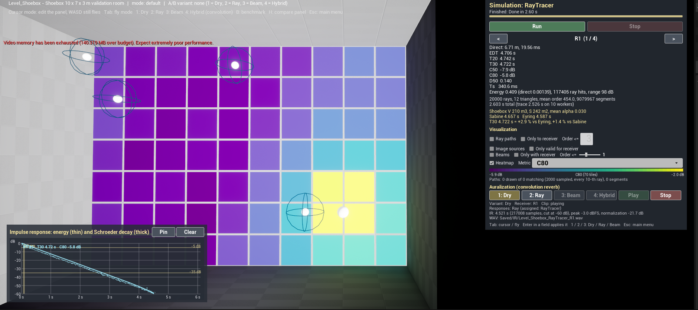

# 5. Visualization: ray paths, heatmaps, impulse-response plot

[← Guide index](README.md) · Milestone M3 (image-source and beam views M5, media colours M6) · Status: **done**

The point of the bench is that every method is **seen**, not only computed: the rays and beams in the room, the spatial distribution of a metric over a grid of receivers, and the impulse response with its decay curve. This page covers the views shared by all solvers; the image-source spheres and the beam frustums are described with their solvers in [7. image sources and beam tracing](07-image-sources-and-beam-tracing.md) and [8. refraction](08-refraction.md).

Code: `Source/AcousticsLab/Public/Visualization/` (`RayPathVisualizerComponent`, `HeatmapComponent`, `ImageSourceVisualizerComponent`, `BeamVisualizerComponent`), `Scene/ReceiverGrid.h`, `UI/IRPlotWidget.h`, `UI/HeatmapLegendWidget.h`.

## Colour code shared by all views

One palette for the **reflection order** is used by ray paths, image-source spheres and beams in the first medium:

| Order | Colour |
|---|---|
| 0 (direct) | white |
| 1 | yellow |
| 2 | orange |
| 3 and more | red |

Beams in a second medium (water, rubber — see [8. refraction](08-refraction.md)) use a cold palette: cyan, blue, violet, magenta for orders 0, 1, 2, 3+. Heatmaps use the **viridis** colour map (dark violet = low, yellow = high); tiles without a valid value are dark grey.

## Ray paths

The ray tracer keeps up to 2000 complete paths, every S-th ray with $S = \max(1, N/2000)$ so the sample covers the whole emission sphere ([3. ray tracing](03-stochastic-ray-tracing.md)). They are drawn as translucent lines (`ULineBatchComponent`):

- colour by the reflection order of the segment (table above);
- opacity by the energy at the start of the segment: 1 at 0 dB, falling linearly to 0.08 at −40 dB (`EnergyRangeDb` 40, `MinOpacity` 0.08);
- at most `MaxDrawOrder` reflections per path (3 by default) and at most 200 000 segments. In the concrete room the mean order is ≈ 450; 2000 full paths would be 900 000 lines of noise.

**Only to receiver** keeps a path only if it enters the selected receiver within `MaxDrawOrder` reflections and cuts it at the entry point on the receiver sphere, so you see the paths that make up the early response of that receiver.

| | |
|---|---|
|  |  |
| 2000 sampled paths, order ≤ 3 (8000 segments) over the C80 heatmap; IR plot of R1 bottom-left | "Only to receiver", order ≤ 4: 71 of 2000 paths reach R1 within four reflections and end on its sphere |

## Receiver grid and heatmap

`AReceiverGrid` places a regular grid of receivers (`NumTilesX × NumTilesY`, `TileSizeMeters`, `ReceiverHeightMeters`, radius 0.5 m; receivers named `G[x,y]`). They are ordinary solver receivers, so every tile has its own histogram and metrics. `UHeatmapComponent` draws one flat 1 × 1 m tile per receiver (instanced mesh, the colour in per-instance custom data) coloured by the selected metric:

| Metric (panel combo) | Meaning | Valid when |
|---|---|---|
| Direct SPL | $L = L_W + 10\log_{10}\dfrac{E_{direct}}{\pi r^2} = L_W - 11 - 20\log_{10} d$ for $L_W$ = 100 dB | line of sight is free |
| C80 | clarity, dB ([4. metrics](04-room-acoustic-metrics.md)) | there is early and late energy |
| T30 | decay time, s | decay ≥ 45 dB |
| EDT | early decay time, s | decay ≥ 20 dB |
| Total level | $L_W + 10\log_{10}\dfrac{\sum E}{\pi r^2}$, all arrivals | set on the grid's `Heatmap → Metric` (not in the panel combo); used by the refraction demo |

The range is automatic (min…max of the valid tiles); the legend under the combo shows the colour bar, the range and the number of valid tiles.

In `Level_Shoebox` (grid 10 × 7 at 1.2 m, 20 000 rays): C80 −5.87 … −1.97 dB, T30 4.70 … 4.75 s (nearly uniform, as expected in a shoebox), direct SPL 70.2 … 91.3 dB — a span of 21.1 dB = $20\log_{10}(8.75/0.77)$ for the farthest and the nearest tile.

| | |
|---|---|
|  |  |
| T30: 4.70 … 4.75 s | Direct SPL for $L_W$ = 100 dB: 70.2 … 91.3 dB, yellow around the source |

*C80 over the 70 floor receivers seen from above (ray tracer, 20 000 rays, ray paths off): −5.9 … −2.0 dB, clearer (yellow) near the source; the panel shows R1 (T30 4.72 s, +2.9 % vs Eyring), bottom left the Schroeder decay of R1. The red line at the top is the engine's video-memory warning on the 4 GB development GPU.*

## Impulse-response plot

Bottom-left panel, "Impulse response: energy (thin) and Schroeder decay (thick)":

- the energy per bin in dB relative to the maximum, $10\log_{10}(E/E_{max})$, thin line (maximum per pixel column);
- the Schroeder curve $L(t)$, thick line;
- grid every 10 dB, floor −60 dB; time axis from the usable decay;
- markers: horizontal lines at −5 and −35 dB (the T30 fit range), vertical lines at direct arrival + 50 ms and + 80 ms (the C50/C80 limits);
- legend per curve: receiver, T30, C80.

Three curve slots: slot 0 (light cyan) is always the selected receiver; **Pin** copies it into slot 1 (orange), then slot 2 (green), alternating; **Clear** empties the pinned slots. Pin R1, switch to R3 or change the wall absorption and run again to compare two decays on one plot. (The hybrid comparison of M8 will use the same three slots for ray / beam / hybrid.)

## Panel: the "Visualization" block

| Control | Default | What it does |
|---|---|---|
| Ray paths | on | show / hide the ray paths |
| Only to receiver | off | only paths entering the selected receiver, cut at its sphere |
| Order <= (field) | 3 | max reflections drawn per path |
| Image sources | on | show / hide image-source spheres and their paths |
| Only valid for receiver | on | only images that give a valid path to the selected receiver |
| Beams | on | show / hide beam frustums |
| Only with receiver | off | only beams containing the selected receiver, plus their ancestors |
| Order <= (slider) | 1 | max beam order drawn (the slider range follows the tree depth) |
| Heatmap | on (if the level has a grid) | show / hide the tiles |
| Metric | C80 | Direct SPL, C80, T30, EDT |

A text line under the legend counts what is drawn, for example `Paths: 2000 drawn of 2000 matching (2000 sampled, every 10-th ray), 8000 segments` or `Beams: 93 drawn of 93 matching (order <= 3, 651 triangles); 0 image spheres, 0 paths`.

The receiver selector `< R1 (1 / 4) >` at the top of the panel drives the "only …" filters, the IR plot and the auralization at once.

## Checks

`AcousticsLab.Core.Solvers.PathSampling` (sample count = min(MaxPaths, NumRays), coverage of both hemispheres, histogram unchanged for MaxPaths 0 / 100 / 5000, identical paths for 1 and 4 workers, per-path invariants), `AcousticsLab.Core.Metrics.LevelHelpers`, `AcousticsLab.Core.Visualization.Helpers` (viridis, metric sampling, order colours, opacity, hit lookup).

## Differences from the SPEC

- Paths are sampled with a stride instead of "the first N rays", and drawn up to order 3 by default (both are properties; the panel edits the order).
- The viridis colour is evaluated in C++ (a polynomial fit) and passed to an unlit material, so the tiles and the legend use one table; SPEC §3.6 put the gradient in the material. The tiles look paler than textbook viridis because the emissive colour goes through the tonemapper.
- The legend prints one decimal, so a narrow range such as 4.70 … 4.75 s reads "4.7 … 4.7".
