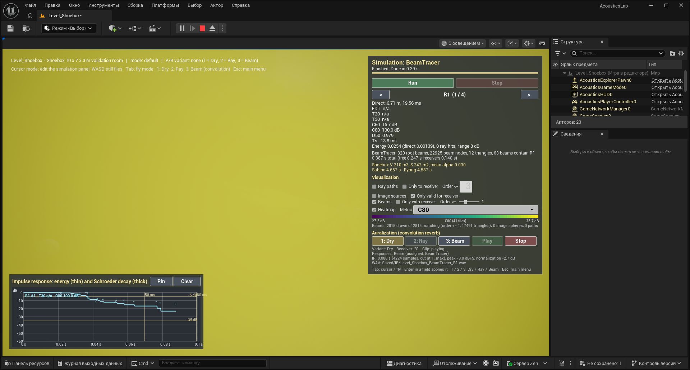
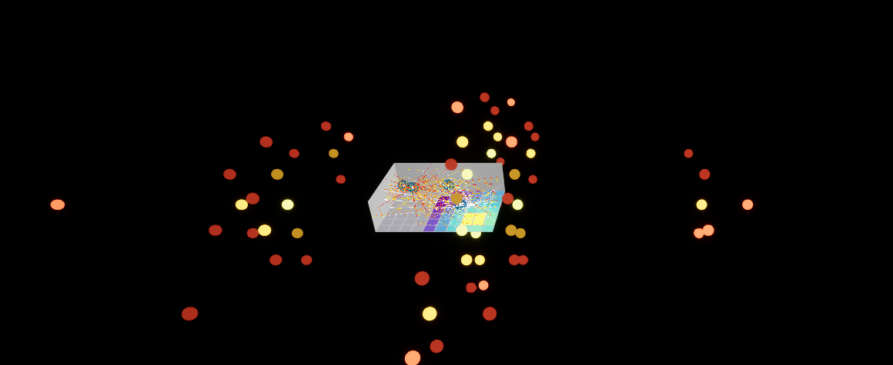

# 7. Image sources and triangular beam tracing with beam division

[← Guide index](README.md) · Milestone M5 · Status: **done**

Menu: **1.1 Image sources & beam tracing - Shoebox** (`Level_Shoebox`). In the panel, the **Solver** combo switches between `ImageSource` and `BeamTracer`.

Sources: S1 — M. Sikora, I. Mateljan, N. Bogunović, *Beam Division in Acoustic Simulation of Non-Homogenous Environments*, Automatika 52(4), 2011 ([PDF](https://hrcak.srce.hr/file/116412)), the algorithms and data structures of beam division; and the description of the same beam-tracing pipeline in S2 — *Beam Tracing with Refraction*, Archives of Acoustics 37(3), 2012: beams §3.2.2, initial beams §3.3.1, beam division §3.3.3, generation of results §3.3.5, intensity §3.1.1. The image-source method is the classical deterministic reference for the early reflections (SPEC §2.4) and the mathematical basis of beam tracing: every beam's apex is an image source.

This is the core of the bench. Both solvers compute the **early, specular part** of the response exactly, and the test `BeamVsImageSource` checks that they agree.

Code: `Source/AcousticsCore/Public/Solvers/ImageSourceSolver.h`, `Solvers/BeamTracer.h`, `Geometry/PolygonClipping.h`; visualizers `ImageSourceVisualizerComponent`, `BeamVisualizerComponent`.

## Image-source solver

1. **Surfaces.** Coplanar triangles are grouped into surfaces (plane + triangles), so a wall made of two triangles produces one image per order, not two.
2. **Images.** The image of a point $\mathbf{S}$ in the plane $(\mathbf{n}, \mathbf{p}_0)$ of a surface is

   $$
   \mathbf{S}' = \mathbf{S} - 2\,\big((\mathbf{S} - \mathbf{p}_0) \cdot \mathbf{n}\big)\,\mathbf{n}
   $$

   and for order $k$ a sequence of surfaces $(P_{i_1}, \dots, P_{i_k})$ is mirrored in turn. Sequences are enumerated breadth-first up to the order limit, with no immediate repeats and only if the previous image lies in front of the next surface. In the shoebox this gives 6 / 30 / 126 images for orders 1 / 2 / 3, **162 in total** (24 of the 150 third-order sequences, such as floor–wall–floor, are geometrically impossible).
3. **Validity by back-tracing.** For each receiver $\mathbf{R}$: the segment $\mathbf{R} \to \mathbf{S}'_k$ must cross plane $k$ inside one of that surface's triangles and must not be occluded (BVH); from the crossing point continue towards $\mathbf{S}'_{k-1}$, and so on down to the real source.
4. **Contribution** of a valid image at distance $d' = |\mathbf{R} - \mathbf{S}'_k|$:

   $$
   t = \frac{d'}{c}, \qquad E = \prod_{j=1}^{k} (1 - \alpha_{i_j}) \cdot \frac{r^2}{4 d'^2}
   $$

   with optional air absorption; the direct sound is analytic as in the ray tracer.

The cost grows exponentially with the order, so the order is a panel field (default 3).

## Beam tracer

### Beams and emission

A **beam** is an apex (the source or an image of it) plus three guide rays that span a triangular cross-section. It is traced as one object: visibility is encoded in the beam itself, so there are no missed reflections, unlike sparse stochastic rays (the argument of S2 and S4).

Emission: as in S2 §3.3.1 the initial beams are the faces of an icosahedron around the source (20 beams with equilateral cross-sections). The bench optionally subdivides it: $20 \cdot 4^L$ beams for subdivision level $L$ (0 → 20 as in the paper, 2 → 320, 3 → 1280, 6 → 81 920), rotated by a fixed angle so that no beam edge lies in a coordinate plane. Test `BeamEmission`: the beams' solid angles sum to $4\pi$ (relative 1e-9).

### Beam division (the core of S1; S2 §3.3.3)

The paper's procedure: transform the triangles that a beam meets into "beam space" (the propagation direction as an axis), project them perspectively onto a plane orthogonal to that axis, remove hidden parts in 2D by subtracting occluding triangles from occluded ones in visibility order, and project the visible pieces back — each becomes a divided beam with the original apex. The bench follows the same structure:

For each beam node:

1. **Candidates.** `FBVH::QueryFrustum` returns the triangles inside the beam's frustum; they are cut in 3D to the apex plane, the plane of the last reflection and the beam's own side planes.
2. **Projection.** The beam cross-section and every candidate are projected onto a reference plane perpendicular to the beam axis (gnomonic projection from the apex). The cross-section is kept as a list of convex polygons — the part of the beam not yet claimed by any surface.
3. **Nearest first.** Candidates are processed from near to far. Each one is clipped against the remaining pieces with **Sutherland–Hodgman**: the intersection is the part of the beam that hits this triangle; the difference is decomposed into convex pieces (one per clip edge) that continue to the next candidate. A centre ray through the BVH guards the near-to-far order in non-convex scenes, and every claimed overlap is additionally cut by any other candidate that is nearer over that overlap (a fix found by the pool scene in M6).
4. **Child beams.** The covered part is fan-triangulated; each triangle becomes a child beam: apex mirrored about the triangle's plane, guide rays reflected, energy factor multiplied by $(1 - \alpha)$.
5. **Escaped pieces.** Pieces that no candidate covers leave the scene (counted, drawn as beams of 10 m length unless hidden). Pieces thinner than 1e-9 (reference-plane units) are dropped as artefacts of the clipping arithmetic.

### The beam tree

Node = {apex, three guide directions, plane of the last reflection, plane of the hit, order, accumulated factor per band, triangle sequence, parent}. The tree is built breadth-first, once per source, up to `MaxBeamOrder` (default 3) and a node budget (`MaxBeamNodes`, 500 000). The number of nodes grows quickly with the order — in the concrete shoebox at level 2 and order 3: 320 root beams, 22 925 nodes — which is the weakness that motivates parallelization (S3, [9](09-parallelization.md)) and the hybrid method (S4, [10](10-hybrid.md)).

### Receivers: a query, not a trace

A receiver at $\mathbf{R}$ is inside a node if it lies inside the three side half-spaces, **behind the plane of the last reflection** and **before the plane of the hit** that ends the beam. If so, the path is valid by construction — no back-tracing as in the image-source method:

$$
d' = |\mathbf{R} - \mathbf{apex}|, \qquad t = \frac{d'}{c}, \qquad E = \prod_j (1 - \alpha_j) \cdot \frac{r^2}{4 d'^2}
$$

This is the energy form of S2's Eq. (5), $I = I_0\,(r_1^2 / r_2^2)\,e^{-\gamma (r_2 - r_1)}$, with $r_2$ the distance from the (virtual) apex to the receiver. A receiver lying exactly on the shared boundary of two beams would be counted twice; duplicates are removed by the sequence of reflecting surfaces.

Because the tree does not depend on the receivers, moving a receiver only repeats the query — S2's argument that a stored beam set gives results at new receiver positions without a new trace (§3.1.1, §5): all point receivers and all grid tiles are answered from one tree, and the test `BeamTreeDeterminism` checks that a run with one receiver gives exactly the same answer as the run with all of them. S2 puts the finished beams into an octree so that a receiver only tests the beams of its leaf (§3.3.5); the bench tests every node of the tree for every receiver (a linear scan, 2–3 s for the 508 receivers of the refraction level) — a beam octree is a possible improvement.

## What you see

| View | Image-source solver | Beam tracer |
|---|---|---|
| Spheres | image sources, coloured by order (yellow 1, orange 2, red 3), 12 cm; with "Only valid for receiver" only the images that give a valid path to the selected receiver, otherwise invalid ones are dimmed | the apexes of the beams that contain the selected receiver |
| Polylines | source → reflection points → selected receiver for every valid path | the same, from the containing beams |
| Frustums | — | translucent beams (apex or start polygon → cross-section on the hit triangle), one mesh per order, coloured by order; "Only with receiver" shows the beams containing the receiver **and their ancestors**, so you can follow a path back to the source |
| IR plot | discrete early arrivals | discrete early arrivals |

The panel prints, for example:

```
ImageSource: 162 image sources, 4564 valid paths (62 to R1), 12 triangles
0.015 s total (images 0.000 s, receivers 0.010 s)

BeamTracer: 320 root beams, 22925 beam nodes, 12 triangles, 63 beams contain R1
0.205 s total (tree 0.136 s, receivers 0.070 s)
```

Both solvers model only the early response (up to the order limit), so the metric block shows `n/a` for EDT/T20/T30 and C80 clamped at 100 dB — there is no late energy ([4. metrics](04-room-acoustic-metrics.md)).

| | |
|---|---|
|  |  |
| Image sources (order ≤ 2) and the paths to R1: 162 images, 4564 valid paths over the 74 receivers | Beam tracer, only the beams containing R1, orders 2–3 (orange 2, red 3) converging on the R1 sphere; IR plot with the discrete early arrivals |



*All beams of order ≤ 1 (2815 frustums at a very low opacity): from inside the room the translucent layers add up to a uniform tint — a picture of the beam budget, not an analysis view.*



*Image sources of orders 1–3 seen from outside and above the room ("Only valid for receiver" off, spheres enlarged for the view): the mirrored lattice around the 10 × 7 × 3 m room, coloured by order (yellow 1, orange 2, red 3); inside the room the paths into the receivers and the floor heatmap.*

## Panel settings

| Field | Setting | Default | Range | What changing it shows |
|---|---|---|---|---|
| Solver | manager `Solver` | `RayTracer` in `Level_Shoebox` | `RayTracer`, `ImageSource`, `BeamTracer` | which solver **Run** starts |
| Image sources: order (<= 3) | `ImageSourceOrder` | 3 | 0–6 accepted | orders 4–6 work but grow exponentially (budget `MaxImageSources` 200 000 with a warning) |
| Beams: subdivision (0=20, 2=320, 6=81920) | `SubdivisionLevel` | 2 | 0–7 | more root beams → narrower beams, more nodes; the early reflections found stay the same (the test checks levels 0, 1, 2) |
| Beams: max order | `MaxBeamOrder` | 3 | 0–10 | depth of the tree; node count grows roughly geometrically |
| Visualization → Image sources / Only valid for receiver | — | on / on | | see above |
| Visualization → Beams / Only with receiver / Order <= slider | — | on / off / 1 | | see above |

Details panel only: `MaxBeamNodes` (500 000; the tree is marked truncated when reached), `MaxImageSources` (200 000), `bUseBVH`, and on `SimulationManager → BeamVisualizer` `MinDrawOrder` (hide the wide root and first-order beams the camera sits in), `Opacity` 0.22, `HighlightOpacity` 0.55, `bDrawEscapedBeams`, `MaxBeamsPerOrder` 4000.

## Validation

- `AcousticsLab.Core.Solvers.BeamVsImageSource` — the acceptance test of SPEC §4: shoebox (α 0.1, specular), receivers R1–R4, (subdivision level, order) = (0, 2), (2, 2), (1, 3), (2, 3). The beam tree must be complete (no escaped or unresolved pieces); the number of reflections per order must be equal; every image-source reflection must have a beam reflection with the same order and image position; **delays within 0.1 ms, energies within 1 %**, total energy within 1 %, path points within 1e-6 m; exactly one order-0 beam contains each receiver.
- `ImageSourceShoebox` — 162 images; at R1 the six first-order images at distances $\sqrt{54}, \sqrt{85}, \sqrt{109}$ m (two each) with energy $0.9 \cdot r^2/(4d^2)$ and delay $d/343$; histogram total = direct + reflections; a blocking panel occludes the direct sound to one receiver while it still receives first-order paths.
- `ReceiverInsideBeam` — inside / outside / behind the reflection plane / beyond the hit plane, duplicate filter.
- `BeamTreeDeterminism` — two builds bit-identical, brute-force candidates = BVH candidates, single-receiver runs = the combined run.
- `BeamEmission`, `ClipPolygon` (2000 random triangle pairs: inside + outside area = subject area, all pieces convex).

## How to run it

1. Open `Level_Shoebox`, Play, Solver = `ImageSource`, **Run**. Tick **Image sources** (and untick **Ray paths** if a previous ray run is drawn): spheres and paths to R1 appear. `<` / `>` switch the receiver — instantly, no rerun.
2. Solver = `BeamTracer`, **Run** (≈ 0.2 s at level 2, order 3). Tick **Beams** and **Only with receiver**, move the **Order <=** slider to 3: the beams that bring sound to R1 and their parents.
3. Press **Pin**, switch the Solver back to `RayTracer`, **Run**: the IR plot shows the beam arrivals (pinned) against the ray-traced decay. Keys **2** / **3** play the two responses.
4. Raise **Beams: subdivision** to 3 and run again: the node count rises, the list of arrivals at R1 does not change.

## Differences from the papers and from the SPEC

- **Visibility order and clipping.** S2 orders the triangles by traversing a BSP tree built per entity and clips with its own triangle–triangle routine that classifies the pair with cheap tests first; the result is non-overlapping triangles. The bench gets candidates from a BVH frustum query, sorts them by distance, guards the order with a centre ray and an explicit "nearer over the overlap" cut, clips convex polygons with Sutherland–Hodgman and fan-triangulates the covered convex pieces — so one hit region can give several child beams. The covered regions are the same.
- **Emission**: the paper's icosahedron, optionally subdivided (level 0 is the paper's 20 beams).
- **Termination**: S2 stops a beam on an intensity or beam-volume threshold; the bench uses a fixed maximum order plus a node budget.
- **Receiver**: a point for the containment test, as in S2; the radius only enters the energy $r^2/(4d^2)$. No beam octree (see above).
- **Surfaces** (coplanar triangle groups) are used for image enumeration and for duplicate removal, not individual triangles.
- **Scattering and diffraction** are not simulated — as in S2, which states this in its abstract and lists diffraction and diffuse reflection as future work (§5). In the bench the diffuse part of the response is the ray tracer's job, and S4 ([10](10-hybrid.md)) is the papers' route to it.
- **Reflection detection.** S2 §4.1 checks how many of the exact shoebox reflections the beam tracer finds (up to order 5). The bench's analogue is `BeamVsImageSource`: up to order 3 the beam tracer must find exactly the image-source set (0 escaped or unresolved pieces).
- The direct sound is analytic in both solvers; order-0 beam containment is used only for the receiver test and the drawing.
