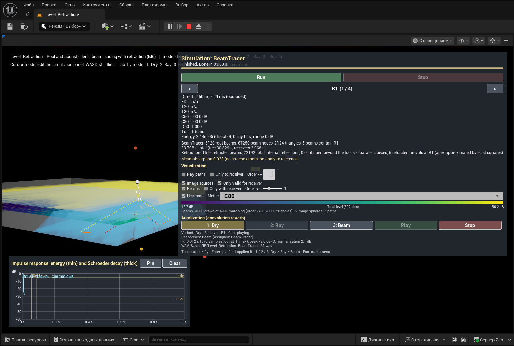

# 8. Beam tracing with refraction: the pool and the acoustic lens

[← Guide index](README.md) · Milestone M6 · Status: **done**

Menu: **1.2 Beam tracing with refraction** (`Level_Refraction`). The level holds two scenes 60 m apart; the **Source** combo in the panel selects which one is simulated (`Pool` or `Lens`).

Source: S2 — M. Sikora, I. Mateljan, N. Bogunović, *Beam Tracing with Refraction*, Archives of Acoustics 37(3), 2012 ([PDF](https://journals.pan.pl//Content/101603/PDF/07_paper.pdf)): beams that are reflected **and** refracted at the boundary between two media, the energy split between the two, and the validation of the method on an acoustic lens.

Code: `Source/AcousticsCore/Public/Solvers/BeamTracer.h` (`bRefraction`, `RefractDirection`, `LeastSquaresApex`), `Geometry/Medium.h`; `Source/AcousticsLab/Public/Levels/RefractionDemoActor.h`.

## Media and interfaces

The scene carries a list of media (speed of sound $c$, density $\rho$, impedance $Z = \rho c$): Air 343 m/s / 1.2 kg/m³, Water 1480 / 1000, Glycerol 1920 / 1260, Rubber 900 / 930. An **interface** triangle knows the medium on its front and back side (tags `Interface`, `AcMediumFront:<name>`, `AcMediumBack:<name>`, see [2. geometry](02-geometry-and-scene.md)); the source knows the medium it sits in (`AAcousticSource::MediumName`).

## What happens to a beam at an interface

A beam node whose cross-section hits an interface triangle spawns **two** children:

**1. The reflected beam** — as in [7](07-image-sources-and-beam-tracing.md): apex mirrored about the interface plane, same medium, energy factor × $R$ (× 1 beyond the critical angle). The material absorption of an interface is ignored; the split is by impedances only:

$$
R = \left(\frac{Z_2 - Z_1}{Z_2 + Z_1}\right)^2, \qquad T = 1 - R
$$

Here $R$ is the **energy** reflection factor: S2 writes the pressure coefficient $(Z_{II} - Z_I)/(Z_{II} + Z_I)$ (Eq. 4, with an angle-dependent impedance) and uses its square for the reflected and $1 - R^2$ for the transmitted intensity (Eq. 2–3). The bench uses the normal-incidence value for every angle (SPEC §2.6). Air → water: $R$ = 0.99889, so only about 0.1 % of the energy enters the water; glycerol → rubber: $R$ = 0.2364.

**2. The refracted beam** — unless the beam is totally reflected:

- The three guide rays are refracted by **Snell's law** at the points where they cross the interface (the parent's cross-section on the triangle is the child's start triangle):

  $$
  \frac{\sin\theta_2}{\sin\theta_1} = \frac{c_2}{c_1}
  $$

  (S2 Eq. 7; the edge rays of the reflected beam are mirrored).
- **Total internal reflection.** Going into a faster medium there is a critical angle $\theta_c = \arcsin(c_1/c_2)$ (S2 Eq. 8) — 13.40° from air into water. Beyond it only the reflected beam is created (S2 §3.3.4, Algorithm 2, which tests the incoming angle of the divided beam). The bench evaluates that angle on the beam's **axis**; guide rays of a refracting beam that individually lie beyond $\theta_c$ are clamped to a refraction angle of $\arcsin(0.999) \approx 87.4°$ so the beam stays usable.
- **The apex.** Snell's law is non-linear, so after refraction the three edge rays no longer meet in one point (S2 §3.1.2, Fig. 4; analysed in Sikora et al. 2010, "The effect of refraction as a non-linear transformation on beam tracing simulation of sound propagation"). S2 refocuses the beam by intersecting the three pairs of edge rays and taking the mean of the three intersection points. The bench instead takes the point that minimizes the sum of squared distances to the three refracted guide lines $(\mathbf{o}_i, \mathbf{d}_i)$:

  $$
  \Big(\sum_i (\mathbf{I} - \mathbf{d}_i \mathbf{d}_i^{\mathsf T})\Big)\,\mathbf{X} = \sum_i (\mathbf{I} - \mathbf{d}_i \mathbf{d}_i^{\mathsf T})\,\mathbf{o}_i
  $$

  (a 3 × 3 solve; nearly parallel lines put the apex far behind the start triangle and are counted). **This is a known approximation** and the panel says so whenever refraction is on.
- **Energy continuity.** The child's factor is

  $$
  f_{refr} = f_{parent} \cdot T \cdot \left(\frac{r_1}{r_{in}}\right)^2
  $$

  where $r_{in}$ is the distance from the parent's apex to the barycentre of the start triangle and $r_1$ the distance from the new apex to the same point. The energy density at the barycentre just behind the interface is then $T$ times the incoming one, whatever the fitted apex is. This is S2's working formula, Eq. (5): the intensity $I_0$ is stored at the barycentre of the beam's starting triangle and spread as $(r_1/r_2)^2$ from the virtual source (S2's exact form, Eq. 6, uses the point where the ray towards the receiver crosses the starting triangle; Appendix A bounds the difference).
- **Converging beams.** A refracted beam can converge (its apex lies ahead of the start triangle — the lens). The node is then the part between the start triangle and the focus; if it reaches the focus without hitting anything, it continues beyond it as a diverging beam of the same order.
- **Delays** are summed per medium along the path, $t = \sum_k |\text{segment}_k| / c(\text{medium}_k)$; the spreading distance for $r^2/(4 d'^2)$ stays the apex distance.
- **Order** counts reflections and refractions alike.

## Scene 1: the pool

`ARefractionDemoActor` builds a pool 20 × 10 × 3 m (concrete floor and four walls, open at the top) with a water surface at 2 m as an interface (front Air, back Water). Source `Pool` in the air 1.5 m above the water at (−6.67, 0, 3.5) m; receivers `R1` 1 m under water straight below the source and `R2` at (−2, 1.5, 1.0) m; a receiver grid `P` of 18 × 8 tiles (1 m) at 1 m under the surface, coloured by **Total level**.

What to look for: beams above the water keep the order palette (white, yellow, orange, red); beams under the water are cyan / blue / violet / magenta. Beams that meet the surface at an incidence angle above 13.4° — everywhere outside a narrow cone below the source (radius ≈ 1.5 m · tan 13.4° ≈ 0.36 m on the surface for direct beams) — are only reflected: no cyan child. The underwater heatmap is brightest below the source.

Run with the level settings (beam tracer, level 4, order 3): 5120 root beams, 67 250 nodes, **1616 refracted beams, 22 192 total internal reflections**, about 30 s on this machine (the lens sphere's 2112 triangles are in the same scene and make the division expensive; the receiver queries for all 508 receivers take 2–3 s). `R1` receives 5 refracted arrivals; its direct sound is occluded by the water surface.

| | |
|---|---|
|  |  |
| Order-1 beams only: yellow = reflected above the water (mostly total internal reflection), cyan = refracted into the water in the cone below the source; the underwater heatmap | Only the beams containing `R1` and their ancestors: the root beam from the source, the refracted beam below the surface (cyan); the polylines bend at the surface |

*The same beams seen from outside the pool wall near the water level (captured after M10): the root beam from the source above the water and the refracted beams to `R1` below the surface; the underwater heatmap on the pool floor.*

## Scene 2: the acoustic lens of S2

In S2 §4.4 the method is validated on an acoustic lens: a rubber sphere of 0.1 m diameter in glycerol, centred 0.75 m from a unidirectional 100 kHz source, traced up to the 4th order and compared with an FEM simulation — both show the primary focus at the back of the sphere (0.7 mm and 1 dB apart) and a weaker secondary focus from two internal reflections; the FEM additionally shows interference and diffraction that the beam method does not model.

The bench rebuilds that scene **scaled × 10**: a rubber sphere of radius 0.5 m (inside: Rubber, 900 m/s; outside: Glycerol, 1920 m/s) centred 7.5 m from a **directional** source `Lens` in glycerol (cone half-angle 4.5°, axis +X). Sound is slower inside the sphere, so the sphere acts as a converging lens with refractive index $n = c_{out}/c_{in} = 2.13$; the paraxial ball-lens focus lies at

$$
\frac{n R}{2 (n - 1)} \approx 0.47\ \text{m}
$$

from the centre, i.e. **inside the back half of the sphere**. A vertical receiver grid `L` (30 × 12 tiles of 0.1 m, the axial plane through the sphere) shows the focal spot; `R3` (radius 0.05 m) sits on the axis 0.35 m behind the centre, `R4` behind the sphere.

Run (Source = `Lens`, subdivision level 6, order 3): 110 of the 81 920 root beams lie inside the cone; 346 927 nodes, **86 199 refracted beams**, 17 690 total internal reflections, about 17 s. The `L` heatmap (Total level, 269 tiles with energy, 56.9 … 88.0 dB) peaks on the axis inside the back half of the sphere.

*Lens scene, all non-escaped beams up to order 3: the glycerol beams of the source cone enter the sphere; inside it the refracted beams converge towards the back; the vertical heatmap shows the level rising along the axis. (In this capture the selected receiver is the pool's R1, which the lens source does not reach — hence the empty metric block and IR plot.)*

*Lens scene (subdivision 6: 81 920 root beams, 346 927 beam nodes, 2.7 s), seen from beside the sphere with **R3** selected (7.85 m from the source, near the focus): the beams converge inside the rubber sphere towards its back, the yellow lines are the 212 beam paths that reach R3 ("212 beams contain R3 … 212 refracted arrivals"), and the vertical heatmap through the axis shows the level around the sphere. The source side is to the right, under the panel.*

## Panel settings (refraction)

| Control | Setting | Default in `Level_Refraction` | Notes |
|---|---|---|---|
| Solver | manager `Solver` | `BeamTracer` | refraction exists only in the beam tracer |
| Source | manager `SourceId` | `Pool` | `Lens` switches to the lens scene (set the subdivision to 6 for it) |
| Beams: refraction at interfaces | `bRefraction` | on | off: the water surface and the sphere become ordinary reflecting walls (no cyan beams, no refraction counters) |
| Beams: subdivision | `SubdivisionLevel` | 4 | lens: 6 (only beams inside the 4.5° cone are traced, 110 of 81 920) |
| Beams: max order | `MaxBeamOrder` | 3 | S2 goes to order 4 |
| T max, s | `TMax` | 1.0 | |
| Receiver r, m | `ReceiverRadius` | 0 (each receiver's own radius: 0.5 m in the pool, 0.05 / 0.1 m at the lens) | |

Details only: `MaxBeamNodes` 2 000 000; the grids' `Heatmap → Metric = Total level` (the panel's Metric combo offers Direct SPL / C80 / T30 / EDT only — choosing one of them here replaces Total level until the level is reloaded).

When refraction is on, the panel shows this note:

> Refracted beam apex = least-squares fit of the 3 refracted guide rays (approximation: a refracted beam has no exact apex, Sikora 2012 sec. 3.1.2 / Sikora 2010). Energy split R / T by impedances at normal incidence; beyond the critical angle only the reflected beam.

and a counter line after a run: `Refraction: N refracted beams, N total internal reflections, N continued beyond the focus, N parallel apexes; N refracted arrivals at R1 (apex approximated by least squares)`.

## Validation

- `AcousticsLab.Core.Geometry.Snell` — air → water at 5° gives 22.11° = asin(1480/343 · sin 5°); water → air at 30° gives 6.65° and the path is reversible; critical angle air → water **13.4006°** (±1e-3°), 13° refracts, 14° is totally reflected, ±1e-6° around the critical angle flips the result; glycerol → rubber bends towards the normal.
- `AcousticsLab.Core.Geometry.LeastSquaresApex` — concurrent lines give the exact point; skew lines give the least-squares minimum; parallel lines report the fallback.
- `AcousticsLab.Core.Solvers.RefractionEnergy` — $R + T = 1$ for all 16 medium pairs; on an air/water surface every reflected child has factor $R$ (or 1 beyond the critical angle), every refracted child $T (r_1/r_{in})^2$; refracted parents arrive below 13.40°, totally reflected parents above it; a receiver 2 m under water below a source 1.5 m above the surface receives the transmitted arrival at **1.5/343 + 2/1480 s within 0.1 ms** and with energy within 25 % of the paraxial estimate; a receiver above the water gets the mirror reflection with full energy (incidence 50.2°, beyond the critical angle).
- `AcousticsLab.Core.Solvers.RefractedBeamTreeDeterminism` — pool 20 × 10 × 3 m with refraction: two builds bit-identical, brute force = BVH, single receivers = combined run; every arrival at the underwater receiver went through the surface, with a delay between the all-air and all-water values.
- `AcousticsLab.Core.Solvers.LensFocus` — the scaled lens (level 6, order 3, cone 4.5°): fewer than 1 % of the root beams are emitted; the receiver at the focus gets **more than twice** the energy of receivers 0.3 m off the axis and more than a receiver in front of the sphere; all its arrivals are refracted beams in rubber.

## How to run it

1. Menu → **1.2 Beam tracing with refraction** (or open `Level_Refraction` in the editor and Play). Play starts near the pool. If another level was run earlier in the same session, its settings were carried over: set the values of the table above first. Press **Run** (≈ 30 s; the progress bar moves). Tick **Beams**, set the **Order <=** slider to 1: yellow reflected beams above the surface, cyan refracted beams below it near the source. Tab → fly with WASD/mouse to look from below the water.
2. Tick **Only with receiver**, slider to 3: the 5 beam chains that reach `R1`, bending at the surface.
3. Untick **Beams: refraction at interfaces**, **Run** again: no cyan beams; the water surface is a mirror.
4. Tick refraction again, **Source** = `Lens`, **Beams: subdivision** = 6, **Run** (≈ 17 s). Fly to the lens (60 m along +Y): the cone, the sphere, the focal spot on the vertical heatmap. Select `R3` with `<` / `>`: its arrivals are refracted ones only.

## Differences from S2 and from the SPEC

- **Apex of a refracted beam**: least-squares point of the three refracted guide lines instead of S2's mean of the three pairwise intersections; the reflected beam keeps the exact mirrored apex.
- **R and T** are the normal-incidence impedance values for every angle (S2's impedance depends on the incidence angle); interface materials have no absorption, and the media have no attenuation $\gamma$ of their own.
- **Total internal reflection** is decided per beam by its axis, with the guide rays clamped at 87.4°.
- **The lens is scaled × 10** (sphere radius 0.5 m, 7.5 m from the source): beams a few centimetres wide would need subdivision levels beyond 7. Order 3 instead of the paper's 4; the sphere is a latitude–longitude mesh of 2112 triangles (the paper's has 224 equilateral ones); there is no FEM reference — the check is the position of the focal spot (`LensFocus` test and the heatmap).
- **Directional source** = an emission mask (root beams whose axis lies inside the cone), not a directivity pattern; the direct sound outside the cone is treated as occluded.
- **Only the beam tracer** knows media: the ray tracer and the image-source solver treat the water surface and the sphere as ordinary walls. Air absorption, when enabled, is applied in every medium.
- **Metrics under water**: C50/C80/Ts are referenced to the geometric direct path in air, which in water is not the first arrival; read this demo through the arrivals and the Total-level heatmap ([4. metrics](04-room-acoustic-metrics.md)).
- Both scenes share one level, 60 m apart; the pool run pays for the lens geometry (a split of the level is a possible improvement).
