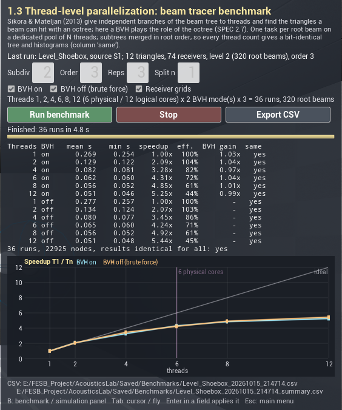

# 9. Thread-level parallelization of beam tracing

[← Guide index](README.md) · Milestone M7 · Status: **done**

Menu: **1.3 Thread-level parallelization (benchmark)** opens `Level_Shoebox` with the benchmark panel instead of the simulation panel. In any scene level, **B** switches between the two panels (the benchmark then uses the source and the refraction setting of the simulation panel).

Source: S3 — M. Sikora, I. Mateljan, *A method for speeding up beam-tracing simulation using thread-level parallelization*, Engineering with Computers 30(4), 679–688, 2014 (online 2013; DOI [10.1007/s00366-013-0316-z](https://doi.org/10.1007/s00366-013-0316-z)). The full text is not open access; this chapter relies on the abstract and on S2's description of the simulation.

Code: `Source/AcousticsCore/Public/Solvers/ParallelBeamTracer.h`, `Private/Solvers/BeamTreeBuild.h`, `Public/Solvers/BeamBenchmark.h`, `Public/Results/BenchmarkResult.h`; `Source/AcousticsLab/Private/UI/BenchmarkWidget.cpp`, `Simulation/AcousticsBenchmarkLibrary.h`.

## What S3 does (from the abstract)

The beam-tracing simulation of S2 consists of three algorithms. Two are iterative and are parallelized with a known technique; the paper's main contribution is the multithreaded version of the third, the **recursive generation of the octree** — in S2 §3.3.5 the octree holds the finished beams so that a receiver only tests the beams of its leaf. On three platforms the speed-up was significant, and linear when all threads ran on the same processor.

## What the bench parallelizes

**Independent subtrees.** A root beam and everything it spawns by division, reflection and refraction never touch another root's nodes. The beam-tree build of M5/M6 (breadth-first over the whole tree) was split into:

1. a shared, read-only context — emission directions, the triangle → surface map, the emitted roots, escape length and limits;
2. `BuildRootSubtree(root)` — the M5/M6 division, reflection and refraction code applied breadth-first to one root's subtree, with local node indices, its own counters and budget;
3. `MergeSubtrees` — order by order, root by root, parents remapped: node for node the same tree as the sequential breadth-first build;
4. receiver queries — one task per receiver; each receiver's histogram is filled by exactly one thread, in node order.

**Thread pool with an exact thread count.** `FParallelBeamTracer(N)` owns a dedicated `FQueuedThreadPool` with exactly $N$ threads (UE's `ParallelFor` does not take a thread count). $N$ work items pull tasks from an atomic counter — one task = one root beam (dynamic load balancing), then one task = one receiver — and the caller waits on an event. The regular beam-tracer runs of the simulation panel use the same pool (`Threads (0 = all)`: 0 = all logical cores, 1 = inline).

**Deterministic by construction.** There is no floating-point reduction across threads: subtrees are merged in root order (integers and node copies only) and each histogram has a single writer. The parallel result is therefore **bit-identical to the sequential M5/M6 tracer for any thread count**, not only reproducible among parallel runs. Every benchmark run computes a fingerprint (FNV-1a over the tree and every histogram) and compares it with the first run.

**BVH on/off.** `bUseBVH` switches every triangle search — frustum candidates, centre/depth rays, the direct-sound occlusion test — to brute force over all triangles; results must be identical, only slower.

> **Octree vs BVH.** The benchmark panel's note says that a BVH "plays the role of the octree" of S3. Strictly, the BVH here accelerates the search for the scene **triangles** a beam can hit (S2 orders triangles with a BSP tree), while the octree of S2/S3 is built over the finished **beams** for the receiver lookup. The bench has no beam octree (receivers are tested against every node, see [7](07-image-sources-and-beam-tracing.md)), so S3's main contribution — parallel octree generation — has no counterpart; what is parallelized is the tree build (the iterative part) and the receiver queries.

## The benchmark

`FBeamBenchmark::Run`: the matrix *thread counts × {BVH on, off} × repetitions* on the current level, one pool per thread count created before the timed runs, a warm-up run, repetitions interleaved so background drift spreads over all cells. Per run: total, tree build and receiver-query time, node count, fingerprint. Per cell: mean / min / max / standard deviation, speed-up

$$
S_n = \frac{T_1}{T_n} \quad\text{(from the means and from the minima)}, \qquad E_n = \frac{S_n}{n}, \qquad \text{BVH gain} = \frac{T^{\,off}_n}{T^{\,on}_n}
$$

CSV of the runs and of the summary in `Saved/Benchmarks/<Level>_<timestamp>.csv` / `_summary.csv`. Thread list: 1, 2, 4, 6, 8, 12 — powers of two, the physical core count (6) and the logical count (12) of the development laptop.

## Panel

*The panel after a run with its defaults on `Level_Shoebox` (level 2, order 3, 22 925 nodes): 36 runs in 4.8 s, all results identical; speed-up 5.25× at 12 threads with the BVH, 5.44× brute force (BVH gain ≈ 1.0 with 12 triangles).*

| Control | Meaning |
|---|---|
| Subdiv, Order | subdivision level and maximum beam order (defaults from the simulation manager: 2 and 3 in the shoebox) |
| Reps | repetitions per cell (3) |
| Split n | splits every scene triangle into $n^2$ coplanar triangles (same room, more triangles) to show the effect of the BVH; 1 = off |
| BVH on / BVH off (brute force) | which BVH modes to run |
| Receiver grids | include the grid receivers in the queries |
| thread line | the thread list and the number of runs, e.g. "Threads 1, 2, 4, 6, 8, 12 (6 physical / 12 logical cores) x 2 BVH mode(s) x 3 = 36 runs" |
| **Run benchmark**, **Stop**, **Export CSV** | start / cancel the matrix; the CSVs are also written automatically when it finishes |
| status | "Run k of 36: n threads, BVH on/off, repetition r", then "Finished: N runs in t s" |
| table | threads, BVH, mean s, min s, speed-up, efficiency, BVH gain, same (fingerprint equal to the first run) |
| chart | speed-up vs threads for BVH on (cyan) and off (orange), the ideal line, the physical-core marker |

## Results (development laptop)

Intel Core i7-8750H (6 cores / 12 threads, 2.2 GHz base, turbo to 4.1 GHz), 15.9 GB RAM, 2.7 GB free; headless runner (`Tools/Benchmark/run_m7_benchmark.py`, editor closed), 3 repetitions, one warm-up. Each run = tree build + all receiver queries of the level. **All 144 timed runs produced the same fingerprint per scene.** Full tables with min, build/query split and efficiency: [M7.md](../milestones/M7.md#benchmark-headless-toolsbenchmarkrun_m7_benchmarkpy-all-15102026); CSVs in `docs/milestones/M7_benchmark/`.

Speed-up $T_1/T_n$ from the means (BVH on / off):

| Scene | Triangles | Beams | 2 threads | 4 | 6 | 8 | 12 | $T_1$ (BVH on) |
|---|---|---|---|---|---|---|---|---|
| A. Shoebox, level 4, order 4, 74 receivers | 12 | 5120 roots, 130 300 nodes | 2.26 / 1.93 | 2.59 / 2.90 | 3.26 / 3.19 | 3.68 / 3.85 | **4.18** / 4.04 | 1.49 s |
| B. Shoebox split 8 × 8, level 2, order 2 | 768 | 320 roots | 1.53 / 2.18 | 2.25 / 2.75 | 2.42 / 3.95 | 2.45 / 4.56 | 2.89 / **4.80** | 3.23 s |
| C. Refraction, source Lens, level 6, order 3 | 2124 | 110 roots in the cone | 1.76 / 1.53 | 3.02 / 2.63 | 3.76 / 3.41 | **4.31** / 3.42 | 4.24 / 3.34 | 11.56 s |
| D. Refraction, source Pool, level 2, order 3 | 2124 | 320 roots | 1.00 / 0.92 | 1.01 / 0.96 | 1.00 / 1.05 | 0.97 / 0.99 | 0.99 / 1.02 | 13.66 s |

BVH gain (brute-force time / BVH time) at 1 thread: A 0.82×, B 2.06×, C 1.75×, D 1.15×.

### Reading the numbers

- **Thread scaling.** Where the work is spread over many root beams (A, C) the speed-up grows monotonically to about 4× (5× from the minima) on 6 physical cores.
- **Where it stops.** (1) Beyond 6 threads the extra threads are hyperthreads sharing the same execution units, so 8 and 12 add 10–30 % at best; a laptop CPU also lowers its turbo clock with all cores busy, so even 6 threads are not 6×. (2) Serial parts — scene context and emission, the merge of the subtrees, result fingerprinting — cap the speed-up (Amdahl). (3) **The critical path is the largest subtree.** In D one root beam of the omnidirectional pool source sees the 2112-triangle lens sphere 60 m away; dividing that beam against thousands of candidates is one indivisible ~12 s task, so 1 to 12 threads all take 13–14 s. This is the limit of a decomposition by root beams; tasks per child beam (or splitting the division of one beam across threads) would be needed.
- **BVH gain.** With 12 triangles the BVH is slower than testing all of them (0.8–0.96×); with 768 triangles it gains about 2× single-threaded and with 2124 triangles about 2×. The gain is smaller than for ray tracing because the triangle search is only part of the work — the polygon clipping of the division and the receiver queries do not depend on it. Brute force scales better (B: 4.8× vs 2.9×) because its extra work is perfectly parallel arithmetic, so the two sources of speed-up do not multiply.
- **Determinism** holds in every run, with and without refraction.

**On the amphitheatre** (M10, experiment E4; 8 160 triangles, R1–R4, tree budget 2 M nodes, bit-identical for every thread count):

| level / order | nodes | 1 thread | 12 threads | speed-up | BVH off, 1 thread | BVH gain |
|---|---|---|---|---|---|---|
| 2 / 2 | 1.21 M | 38.5 s (min 27.8) | 9.8 s (min 8.3) | 3.9× (best 4.0× at 8) | 109.1 s | 2.8× |
| 3 / 1 | — | 6.9 s | 1.48 s | 4.7× | 19.0 s | 2.7× |

The order-2 tree is memory-bound and stops scaling at 8 threads. Unlike the 12-triangle shoebox, the triangle search matters here: the BVH gives 2.7–2.8×. A tree cut by the node budget depends on the scheduling once the subtrees exceed twice the budget (logged as a warning); the benchmark options therefore expose `MaxBeamNodes`.

## Validation

- `AcousticsLab.Core.Solvers.BeamThreadCountInvariance` — shoebox and a pool with refraction: the sequential tracer vs 1 / 2 / 4 / 12 pool threads and a second run on the same pool give a bit-identical tree, per-order counts, counters, histograms, arrivals and containing nodes; a node budget of 2/3 of the tree gives the same truncated tree for 1 and 4 threads, equal to the breadth-first prefix of the full tree.
- `AcousticsLab.Core.Solvers.BvhToggleInvariance` — shoebox, shoebox split 3 × 3, pool with refraction: BVH on/off identical with 1 and 4 threads; tessellation keeps triangle count, area and inward normals.
- `AcousticsLab.Core.Solvers.BenchmarkMatrix` — thread lists, a 2 × 2 × 2 matrix, summary, CSV, cancel.
- The ray tracer's `ThreadCountInvariance` (since M2) covers the stochastic solver.

## How to run it

1. Menu → **1.3 Thread-level parallelization (benchmark)**. The benchmark panel opens top right (cursor mode).
2. **Run benchmark** with the defaults (≈ 5 s): the table and the chart fill in run by run; "results identical for all: yes".
3. For the larger table set **Subdiv** 4, **Order** 4 (scene A); for the BVH effect **Split n** 8 with Subdiv 2 / Order 2 (scene B).
4. In `Level_Refraction` press **B**, choose the source in the simulation panel first (Pool or Lens; Lens with subdivision 6), then run the benchmark there (scenes C and D take minutes).
5. Headless, with the editor closed: `UnrealEditor-Cmd.exe <project> -run=pythonscript -script="<project>/Tools/Benchmark/run_m7_benchmark.py all" -unattended -nopause -nosplash -NullRHI` (tables appended to `Saved/Benchmarks/m7_tables.md`).

## Differences from S3 and from the SPEC

- **What is parallelized**: the beam-tree build and the receiver queries; S3's main contribution, the parallel recursive generation of the beam octree, has no counterpart because the bench has no beam octree.
- **Spatial structure**: a BVH over the scene triangles (SPEC §2.7 calls it the analogue of the octree; see the note above).
- **No per-thread histograms with a reduction**: merging in root order with one writer per histogram gives bit-identity with the sequential tracer, which is stronger than SPEC §2.7 asked.
- **Dynamic scheduling** of root beams instead of fixed groups.
- **Node budget**: each subtree stops at `MaxBeamNodes` and the merged tree keeps the first `MaxBeamNodes` nodes in breadth-first order (well defined for any thread count); only a memory guard at 2 × the budget makes the truncation depend on scheduling (warned in the log).
- **Heavier scenes** than the shoebox (the amphitheatre of SPEC §5 experiment 4 comes in M10): the 8 × 8 split shoebox and the two sources of `Level_Refraction`.
