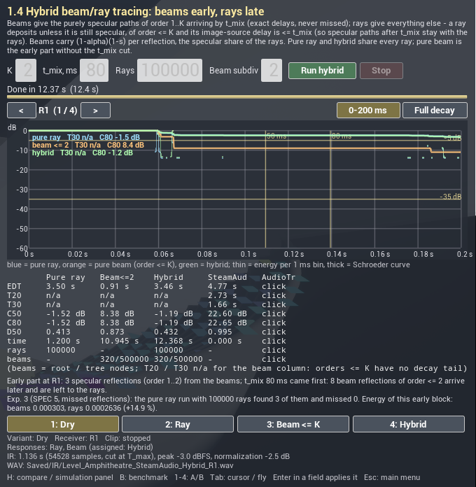
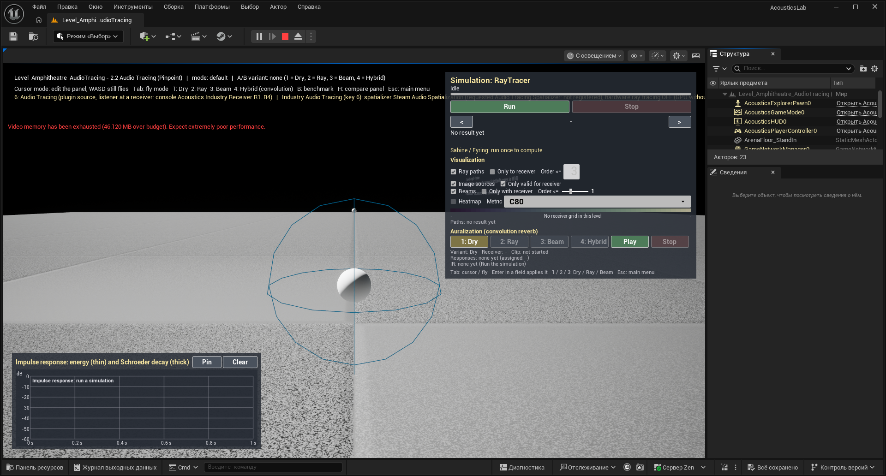

# 11. Industry comparison: Steam Audio and Audio Tracing

[← Guide index](README.md) · Milestones M9, M10 · Status: **done for Steam Audio, on the amphitheatre since M10; Audio Tracing prepared, needs an RTX machine** ([M9.md](../milestones/M9.md), [M10.md](../milestones/M10.md#industry-levels-on-the-new-geometry))

Menu: **2. Industry → 2.1 Steam Audio (Valve)** (`Level_Amphitheatre_SteamAudio`) and **2.2 Audio Tracing (Pinpoint, Fab)** (`Level_Amphitheatre_AudioTracing`). The two levels are identical except for which plugin starts; in both, keys **5** / **6** switch between the plugins during play. **3. Compare** opens the comparison panel of [10](10-hybrid.md), whose industry columns are filled from the plugins' click measurements.

## What it demonstrates

The same scene, the same source and receiver positions, rendered by two production tools next to the methods of the papers:

- **Steam Audio** (Valve, open source, Apache 2.0) — geometry and material components on the meshes, binaural rendering (HRTF), real-time reflections.
- **Audio Tracing** (Pinpoint, free on Fab) — reflections traced on the GPU's hardware ray-tracing scene (needs DXR and Lumen).

The point is to show where the production tools are strong (real time, ease of setup, binaural output, hardware ray tracing) and where the methods of the papers add something (exact early reflections without misses, refraction between media, a deterministic early response).

## State on the development machine

| | Steam Audio | Audio Tracing |
|---|---|---|
| Version | **4.8.1** (11.02.2026), [release](https://github.com/ValveSoftware/steam-audio/releases/tag/v4.8.1) | Fab listing: "Unreal Engine 5.6 – 5.8" |
| Installation | `Tools/Plugins/install_steam_audio.ps1`: downloads `steamaudio_unreal_4.8.1.zip`, checks its SHA-256, copies the Unreal plugin **sources** into `Plugins/SteamAudio` (git-ignored); built from source for UE 5.8.3 (no 5.8 binaries exist). The project copy overrides the deprecated Steam Audio 2.0-beta that ships inside the engine. | Installed from the Epic launcher (Fab library → Install to Engine 5.8). Its licence does not allow redistribution, so it is not in the repository. **Not installed** on the development machine when M9 was finished (16.10.2026). |
| Hardware | any | **hardware ray tracing required**; the development machine's GTX 1050 Ti reports D3D12 RaytracingTier 0, and UE 5.8 enables ray tracing only from tier 1.1 → the plugin cannot trace or be heard here. Listening is planned on an RTX machine. |
| In `AcousticsLab.uproject` | enabled, **optional** (a checkout without the plugin still opens and builds) | to be added as optional when installed |
| Verified in PIE | yes (spatializer, source, listener, click measurement) | level and switching only; the plugin itself not yet |

**Project settings** (`Config/DefaultEngine.ini`): spatialization = Steam Audio Spatialization (default), reverb = Steam Audio Reverb, occlusion = Steam Audio Occlusion, source data override = Audio Tracing (left empty until it is installed); hardware ray tracing and Lumen GI / reflections on (inactive on the GTX 1050 Ti). The Sikora levels are unaffected: their clip is 2D and goes through the bench's own convolution submix ([6](06-auralization.md)).

**One configuration for both plugins.** Both want the project's spatialization slot. UE 5.8 keeps every registered spatializer and can switch at runtime (`UGameplayStatics::SetActiveSpatialPluginByName`), so instead of the two configuration profiles foreseen as a fallback (SPEC §6) each industry actor switches the spatializer when its plugin is activated and restores the level-start one at EndPlay. The other slots do not collide.

## The scene and the positions

The positions come from one data asset, `DA_AmphitheatrePositions` (SPEC §3.4), shared with the amphitheatre of M10: an elliptical arena 65 × 40 m (semi-axes 32.5 × 20 m), 20 rows (row $r$ lies $(r - 0.5)\cdot 0.8$ m beyond the arena ellipse, ear height $r \cdot 0.75 + 1.1$ m).

| id | where | position (m, arena centre = origin) | distance to S1 |
|---|---|---|---|
| S1 | arena centre, 1.6 m high | (0, 0, 1.6) | — |
| R1 | row 1, minor axis | (0, 20.4, 1.85) | 20.4 m |
| R2 | row 10, minor axis | (0, 27.6, 8.6) | 28.5 m |
| R3 | row 20 (last), minor axis | (0, 35.6, 16.1) | 38.4 m |
| R4 | row 10, major axis (side sector) | (40.1, 0, 8.6) | 40.7 m |

**Geometry.** At M9 the levels held a stand-in (a 100 × 80 m arena floor). Since M10 they hold **the amphitheatre of [12](12-amphitheatre-and-soundwalk.md), baked into static meshes** (`SM_Amphitheatre_Floor`, `SM_Amphitheatre_Cavea`): Steam Audio exports only the static meshes of `AStaticMeshActor`s, so the content script converts the dynamic meshes and removes the builder actor from the copy. The exported Steam Audio scene grew from 1.4 KB (the floor plane) to 181 KB. The industry levels show the **empty stone** cavea (the reference condition); the audience / velarium toggles exist only in `Level_Amphitheatre`. Materials are mapped from the bench's presets: Stone (α = 0.02, s = 0.2) → `SAM_Stone`, absorption 0.02 in Steam Audio's three bands, scattering 0.2 (at M9: Concrete α 0.03, s 0.1); for Audio Tracing a reflection factor of 1 − α and the same scattering, applied once the plugin is installed. Steam Audio's simulation settings are its defaults (real time: 1.0 s impulse response, 4 bounces, 4096 rays).

## How it works

- `AIndustryAudioActor` (one class for both plugins, `EIndustryPlugin`): at BeginPlay it selects its plugin's spatializer and console variables, owns an audio component at the source position (the anechoic test clip, routed to the master submix with the plugin's attenuation asset), puts the audio listener on the selected receiver (`SetAudioListenerOverride`, facing the source) and adds the plugin's runtime components (Steam Audio Source / Listener) from soft class paths — no compile-time dependency on either plugin.
- An editor button *Prepare Level* adds the per-mesh components (Steam Audio Geometry, Audio Tracing Sound Material) to every actor tagged `Acoustic`, with the material taken from its `AcMat:` tag; Steam Audio's static geometry is exported to `/Game/Industry/SteamAudio/`.
- Content is generated by `Tools/Editor/create_m9_content.py` (Python commandlet, rerunnable).
- **Runtime switch**: both levels hold a Steam Audio and an Audio Tracing actor. The level's own plugin starts; **5** / **6** switch to the other plugin while playing (the other source stops, the spatializer follows, the listener receiver is kept); **1–4** return to the bench's convolution variants. In `Level_Shoebox` keys 5 / 6 only log "only in the industry levels".

## On screen

- **HUD line 3** (yellow): `Plugins: 5: Steam Audio [PLAYING] 6: Audio Tracing`; "GAME PAUSED" in red when the PIE world is paused (then no key reaches the game).
- **Simulation panel**, block **Industry plugins**: buttons **5: Steam Audio** / **6: Audio Tracing** (highlighted while playing) and the active plugin's state: spatializer, source, listener receiver, warnings such as "hardware ray tracing OFF" or "spatializer not registered".
- **Comparison panel** (H), columns **SteamAud** / **AudioTr**: the metrics of the last click measurement of each plugin; a plugin not yet measured shows "click".

*`Level_Amphitheatre_SteamAudio` on the baked cavea (M10): Steam Audio playing (HUD line 3, block Industry plugins), and in the same level a hybrid run of the bench (R1: C80 −1.2 dB, EDT 3.46 s) with its C80 heatmap over the cavea. At M9 the level had only the floor: [M9_steamaudio_pie.png](../milestones/img/M9_steamaudio_pie.png).*

## Comparing responses: the click measurement

Neither plugin exposes its impulse response, so the comparison is indirect (SPEC §3.8): `UClickResponseRecorder` plays a one-sample click at 48 kHz through the plugin source, records the master submix (`USoundSubmix::StartRecordingOutput / StopRecordingOutput`), and `FClickResponse` turns the recording into an energy histogram from the onset with the direct sound placed at $d/c$; the same metrics as for the bench's solvers follow ([4](04-room-acoustic-metrics.md)). WAVs go to `Saved/IR/<Level>_<Plugin>Click_R*.wav`.

First measurement, at M9 on the **stand-in arena floor** (all four receivers):

| R | distance | direct ($d/c$) | direct energy | T30 | C80 |
|---|---|---|---|---|---|
| R1 | 20.4 m | 59.48 ms | 0.137 | 0.127 s | 74.0 dB |
| R2 | 28.5 m | 83.01 ms | 0.0651 | 0.118 s | 72.1 dB |
| R3 | 38.4 m | 112.07 ms | 0.0260 | 0.112 s | 70.3 dB |
| R4 | 40.7 m | 118.68 ms | 0.0211 | 0.133 s | 69.9 dB |

**These numbers were a pipeline check, not an acoustic result**: with only the floor to reflect there is no reverberant tail (C80 around 70 dB). The measurement on the amphitheatre is experiment E6 below.

The editor mutes PIE when its window is not focused; the recorder lifts that for the measurement (`bAllowBackgroundAudio`, `FApp::UnfocusedVolumeMultiplier`) and restores it afterwards.

## Experiment E6 — the bench against Steam Audio on the cavea

SPEC §5.6, PIE of `Level_Amphitheatre_SteamAudio` (baked cavea, empty stone): a hybrid run in the panel (100 000 rays + beams ≤ 2, subdivision level 2; the panel run took 12 s) and the click measurement of Steam Audio (real-time reflections, recorded master submix). Audio Tracing cannot run on the development GPU.

| receiver | metric | pure ray | beam ≤ 2 | hybrid | Steam Audio (click) |
|---|---|---|---|---|---|
| R1 (20.4 m) | EDT | 3.50 s | 0.91 s | 3.46 s | 4.77 s |
| R1 | C50 / C80 | −1.5 / −1.5 dB | 8.4 / 8.4 dB | −1.2 / −1.2 dB | 22.6 / 22.6 dB |
| R1 | D50 | 0.41 | 0.87 | 0.43 | 0.99 |
| R1 | T20 / T30 | n/a | n/a | n/a | 2.74 / 1.69 s |
| R2 (28.5 m) | C80 / D50 | −1.9 dB / 0.39 | 10.4 dB / 0.92 | −1.9 dB / 0.39 | 24.1 dB / 1.00 |
| R3 (38.4 m) | C80 / D50 | −2.5 dB / 0.36 | 5.1 dB / 0.76 | −2.5 dB / 0.36 | 28.5 dB / 1.00 |
| R4 (40.7 m) | C80 / D50 | −0.6 dB / 0.47 | 100 dB (no late part) / 1.00 | −0.6 dB / 0.47 | 31.9 dB / 1.00 |

Reading: **Steam Audio hears the empty amphitheatre as almost dry** (C80 23–32 dB, D50 ≈ 1; its T20 / T30 fits rest on a tail 50–60 dB below the direct sound, and EDT is undefined or absurd at R2–R4). The bench's ray tracer and hybrid hear the late specular echoes of the concave risers ([12, E5b](12-amphitheatre-and-soundwalk.md#e5b--why-the-empty-amphitheatre-has-no-t30)) and give C80 ≈ −2 … −1 dB. The ~25 dB difference is beyond tuning: Steam Audio runs with its default real-time settings (rays, duration, bounces) and its own energy model, and the echoes in the bench's result come from a few specular paths that a coarse stochastic budget does not resolve. The comparison is recorded as measured; the subjective A/B is in the level (keys 5 / 2 / 4). The hybrid's beam tree is truncated at the default budget of 500 000 nodes here (1.21 M needed), so its beam column is incomplete.

*The comparison panel (H) in `Level_Amphitheatre_SteamAudio` after a hybrid run and the Steam Audio click measurement (retaken after the M10 follow-up), R1: pure ray / beam ≤ 2 / hybrid against **SteamAud** (EDT 4.77 s, C80 22.65 dB, D50 0.995); **AudioTr** still shows "click" (not measured — no hardware ray tracing here). The split line reports 3 early specular reflections at R1 before t_mix = 80 ms, all found by 100 000 rays.*

## How to run / listen

1. Main menu → **2.1 Steam Audio** (or open `Level_Amphitheatre_SteamAudio` and Play). With headphones: the anechoic test signal from the arena centre, binaural, in the empty stone cavea.
2. Console: `Acoustics.Industry.Receiver R3` moves the listener to the last row (quieter, later), `R4` to the side sector; `Acoustics.Industry.State` prints the state.
3. **5** / **6** switch plugins, **1–4** go back to the bench's own variants.
4. `Acoustics.Industry.MeasureClick` (about 22 s): clicks at R1..R4 with the active plugin, metrics in the log and in the comparison panel (H).

**Audio Tracing on an RTX machine** (M9.md, "How to verify / listen", step 4): install the plugin into UE 5.8 from the Epic launcher; add it to `AcousticsLab.uproject` as an optional plugin; set `SourceDataOverridePlugin` in `Config/DefaultEngine.ini`; check the `TRACING_*` constants in `Tools/Editor/create_m9_content.py` against its headers; rerun the script with the phases `assets steam tracing` (editor closed); open `Level_Amphitheatre_AudioTracing`, Play — the log must show the switch to the Audio Tracing spatializer and no "ray tracing OFF" warning; then listen at R1..R4, switch 5 / 6 for a direct A/B, and run `Acoustics.Industry.MeasureClick` with each plugin active.

## Validation

| Test | What it checks |
|---|---|
| `AcousticsLab.Core.Audio.ClickResponse` | synthetic click: onset, direct sound at $d/c$, direct energy, T20 / T30 within 5 %; silence and zero channels refused |
| `AcousticsLab.Core.Levels.AmphitheatrePositions` | source at the arena centre 1.6 m high; R1 on the minor axis at 20.4 m, 1.85 m high; R3 ear height 20 rises + 1.1 m; rows rise and recede; R4 in the side sector |
| `AcousticsLab.Core.Industry.ComponentSpec` | plugin components from class paths: a missing plugin yields no component and an explanation; property values reach the component; unknown properties are reported |

In PIE (scripted, `Tools/Editor/verify_m9_pie.py`, `verify_m9_switch.ps1`): Steam Audio spatializer switched, Source + Listener components created, listener at R1 facing the source (20.4 m), clip playing through `ATT_SteamAudio`; the Audio Tracing level reports "spatializer not registered" and "hardware ray tracing is not available" and plays the source 2D (not an Audio Tracing result); the switch sequence 6 → 5 → 1 → 6 works.

## Known limitations

- **Audio Tracing has not been heard or measured yet**: plugin not installed on the development machine, and its GPU has no hardware ray tracing. Everything on the bench side is prepared; the RTX steps are above.
- **Steam Audio hears the empty cavea almost dry** (E6), about 25 dB more clarity than the bench's tracers; its settings have not been tuned for open-air spaces (more rays, a longer response).
- **Empty stone cavea only** in the industry levels (baked static meshes, no audience / velarium toggles).
- **Indirect comparison**: plugin responses come from a recorded click on the master submix (binaural, plugin processing included), not from an impulse-response API.
- Steam Audio runs with its default real-time settings (1 s, 4 bounces).
