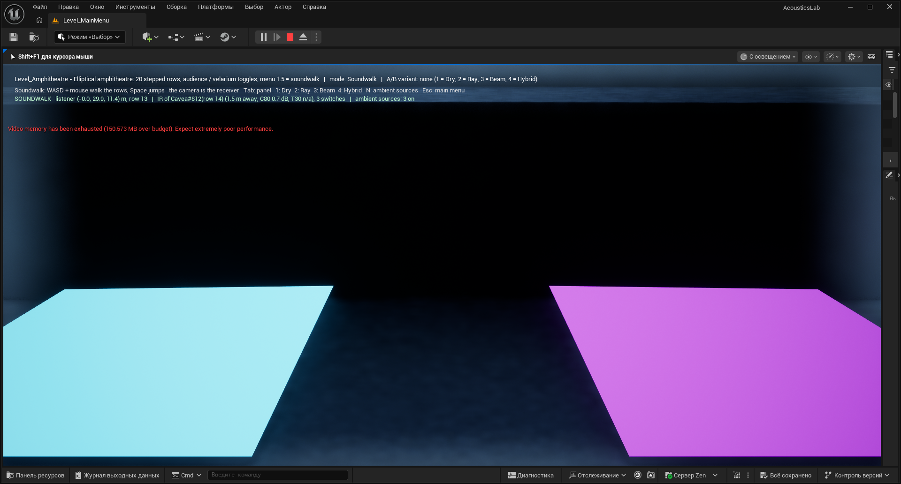

# 12. Amphitheatre and soundwalk

[← Guide index](README.md) · Milestone M10 · Status: **done** ([M10.md](../milestones/M10.md)); open: Audio Tracing on the amphitheatre (needs an RTX machine), Steam Audio settings for open-air spaces, a larger beam budget for the hybrid there.

Menu: **1.1 Image sources & beam tracing - Amphitheatre** (`Level_Amphitheatre`) and **1.5 Audio AR soundwalk (optional)** (`Level_Amphitheatre?mode=Soundwalk`).

Sources: S4 (the hybrid method, motivated by long reverberation in large spaces) and S5 — M. Sikora, M. Russo, J. Đerek, A. Jurčević, *Soundscape of an Archaeological Site Recreated with Audio Augmented Reality*, ACM TOMM 14(3), 2018 (DOI [10.1145/3230652](https://doi.org/10.1145/3230652)): a smartphone audio-AR system that uses location and orientation to play the synthesized soundscape of a medieval Croatian site through headphones, evaluated by an in-situ soundwalk; and the earlier Sikora, Grčić, Russo, *A tool for soundscape auralization of ancient archaeological sites* (7th Congress of the Alps Adria Acoustics Association, Ljubljana, 2016, [record](https://www.bib.irb.hr/838151)): a game-engine tool that places virtual sound sources in a site and auralizes the result on location.

| empty | audience | velarium |
|---|---|---|
|  |  |  |

*`Level_Amphitheatre` in PIE after a ray-tracer run (40 000 rays at the time of these shots; the level now runs 100 000), C80 heatmap over the cavea grid, panel with the metrics of R1. With the audience the rows turn from about 0 dB to about +10 dB.*

## The scene

An elliptical amphitheatre in the spirit of the one in Salona, built procedurally by `AAmphitheatreActor` (`Source/AcousticsLab/Public/Levels/AmphitheatreActor.h`) from three dynamic meshes (`UDynamicMeshComponent`, GeometryCore's `FDynamicMesh3`, the mesh type under Geometry Script). The geometry is built by pure functions (`AmphitheatreGeometry::Build{Floor,Cavea,Velarium}Mesh`), so it is tested without a world.

| Part | Geometry | Material |
|---|---|---|
| **ArenaFloor** | the arena ellipse, semi-axes 32.5 × 20 m (65 × 40 m), facing up | `Stone` (α 0.02, s 0.20; limestone) |
| **Cavea** | one closed shell swept around the arena, 96 segments: 20 rows, row $k$ has a riser at offset $(k-1)\cdot 0.8$ m and a tread at height $k \cdot 0.75$ m; back wall at 16 m offset (top row at 15 m); "offset $o$" = the ellipse with semi-axes $(32.5 + o,\ 20 + o)$; 8 064 triangles | `Stone`, or `Audience` (α 0.7) with **Audience** on |
| **Velarium** | a closed 0.1 m ring over the cavea at 18 m, open over the arena; drawn translucent | `Absorber` (α 0.9); empty mesh when **Velarium** is off |

Normals are wound per face (treads up, risers toward the arena, back wall outward); the meshes are tagged `Acoustic` and enter the solvers through the usual scene extraction ([2](02-geometry-and-scene.md)): 8 160 triangles, 8 928 with the velarium. The curved rows are plain triangle meshes, which the beam and ray tracers handle directly.

**Positions** come from `DA_AmphitheatrePositions` with the same offset rule, so the receivers sit 1.1 m above their treads: S1 at the arena centre 1.6 m high, R1 row 1 (20.4 m from S1), R2 row 10, R3 row 20, R4 row 10 on the major axis (table in [11](11-industry-comparison.md#the-scene-and-the-positions)).

**Cavea grid**: 856 receivers on a 2 m plan grid clipped to the cavea, each on its row's tread (row found by bisection on the offset ellipses), 1.1 m above it.

**Toggles**: select the `Amphitheatre` actor and tick **Audience** / **Velarium**, or in PIE `Acoustics.Amphitheatre.Audience 1|0`, `Acoustics.Amphitheatre.Velarium 1|0`, then **Run** again.

**Ray count**: the level runs **100 000 rays** with the grid on BeginPlay (about 1 s on the development machine). With 860 receivers the ray tracer limits its per-chunk histogram memory by the receiver count (budget 512 MB, 16–128 chunks, still independent of the thread count).

## How to run it

1. Main menu → **1.1 Image sources & beam tracing - Amphitheatre** (or open `Level_Amphitheatre`, Play). The ray tracer runs on start; the camera starts above the cavea looking at the arena.
2. The heatmap colours the rows (C80 by default; **Metric** in the panel); `<` / `>` switch R1–R4 for the metric block, the IR plot and listening (keys 1–2).
3. Toggle audience / velarium (above), **Run**, compare.
4. Headless experiments (editor closed): `UnrealEditor-Cmd.exe <project> -run=pythonscript -script="<project>/Tools/Experiments/run_m10_experiments.py" -unattended -nopause -nosplash -NullRHI` (E1, E5), the same with `run_m10b_experiments.py e5b e2 e3` (E2, E3, E5b), and `Tools/Benchmark/run_m7_benchmark.py amphitheatre` (E4). Tables: [`docs/results/m10b_tables.md`](../results/m10b_tables.md) and the CSVs in [`docs/results/`](../results/).

## Soundwalk (menu 1.5)

A desktop analogue of the S5 soundwalk: instead of a phone on site, you walk through the model, and what you hear follows where you stand.

- **The walker** (`AAcousticsWalkerPawn`): a character with the ears 1.6 m above the feet, walking at 3 m/s, one 0.75 m riser per step, **Space** jumps. It starts on the R2 seat (row 10) facing the arena. Falling off the top row puts it back on its seat.
- **The camera is the receiver** (`USoundwalkComponent`): every 0.1 s it finds the receiver of the last result nearest to the camera — one of the 856 cavea cells or R1–R4 — and when the cell changes (0.3 m hysteresis, at most one switch per 0.25 s) the auralization switches to it.
- **Nothing is traced again** (SPEC §2.5.7): the source does not move, so the stored histogram of every cell stays valid. The response of a cell is synthesized on demand from its histogram the first time it is needed (about 1.5 ms; the 32 most recent are cached). With the first result the walk switches from Dry to the solver's response.
- **Ambient sources** (as in the S5 soundscape and the 2016 tool): crowd murmur (row 12, opposite side), birds (above the top rows), wind (top of the back wall) — looping 3D sounds with engine panning and distance falloff; **N** toggles them. They are **not** convolved with the room responses (each would need its own simulation run). The clips are synthetic placeholders.
- **Screen**: the walk starts without the panel and with the mouse captured; **Tab** shows the panel and the cursor. A green HUD line shows the listener position and row, the cell whose response is heard, its distance and C80 / T30, the number of switches and the ambient state, e.g.
  `SOUNDWALK  listener (-0.0, 29.9, 11.4) m, row 13 | IR of Cavea#812(row 14) (1.5 m away, C80 0.7 dB, T30 n/a), 3 switches | ambient sources: 3 on`.
- **Keys**: WASD + mouse walk, Space jump, **1** Dry, **2** Ray, **N** ambient, **Tab** panel, Esc menu (standalone).

Checked in PIE with real input: walking up and down the rows switched through 13 cells (rows 2 → 19) in one walk, each response synthesized on demand.

*Soundwalk in PIE: the walker on row 13 hears the response of cell Cavea#812 (row 14, 1.5 m away); the coloured planes are the heatmap tiles of the neighbouring cells.*

## Experiment E5 — empty / audience / velarium (SPEC §5.5)

Ray tracer, 200 000 rays, source S1. R1–R4 are point receivers; "row" values are means over the grid points of the row. T30 "n/a" = the Schroeder curve does not reach −35 dB within 3 s or the fit gives more than 10 s. CSV: [`docs/results/E5_amphitheatre_rows.csv`](../results/E5_amphitheatre_rows.csv).

| condition | R1 C80 / T30 | R2 C80 / T30 | R3 C80 / T30 | R4 C80 / T30 | triangles | trace, s |
|---|---|---|---|---|---|---|
| empty | −1.8 dB / n/a | −2.0 dB / n/a | −2.3 dB / n/a | 6.6 dB / n/a | 8160 | 3.3 |
| audience | 10.8 dB / 1.06 s | 9.3 dB / n/a | 10.7 dB / n/a | 10.5 dB / n/a | 8160 | 2.9 |
| velarium | −1.9 dB / n/a | −2.0 dB / n/a | −2.1 dB / n/a | 5.8 dB / n/a | 8928 | 5.5 |
| audience + velarium | 10.4 dB / 1.05 s | 9.1 dB / 1.1 s | 10.5 dB / 1.1 s | 10.0 dB / 1.11 s | 8928 | 5.2 |

Per row (C80 dB / T30 s; selected rows, all 20 in [M10.md](../milestones/M10.md#e5--amphitheatre-empty--audience--velarium-spec-55-200-000-rays-source-s1-at-the-arena-centre-16-m)):

| row | empty | audience | velarium | audience + velarium |
|---|---|---|---|---|
| 1 | 1.1 / n/a | 10.4 / 1.01 | 0.9 / 4.12 | 10.0 / 1.00 |
| 5 | −0.1 / n/a | 10.0 / 1.17 | −0.2 / 3.84 | 9.7 / 1.06 |
| 10 | 0.2 / n/a | 10.2 / 1.05 | 0.1 / 4.43 | 10.0 / 1.04 |
| 15 | −0.4 / n/a | 10.5 / 1.20 | −0.0 / 3.99 | 10.5 / 1.07 |
| 20 | 0.6 / n/a | 10.6 / 0.95 | 0.6 / 5.90 | 10.4 / 1.25 |

Reading:

- **The audience is the dominant change**: C80 rises from about 0 dB to about 10.5 dB on every row, T30 becomes about 1.0–1.2 s.
- **The empty stone cavea has no T30** — explained by E5b below: its response is a few strong specular echoes, not a decay.
- **The velarium alone changes little**: the flat ring at 18 m only catches rays that leave the cavea upwards. Together with the audience it changes C80 by 0.0–0.5 dB.
- R4 (side sector, major axis) has a higher C80 than R1–R3 in the empty case (6.6 dB vs about −2 dB).

### E5b — why the empty amphitheatre has no T30

1 000 000 rays, R1–R4 (C80 / EDT):

| case | R1 | R2 | R3 | R4 |
|---|---|---|---|---|
| as in E5: order ≤ 200, T max 3 s, s 0.2 | −0.8 dB / 4.33 s | −1.9 / 5.29 | −1.9 / 4.16 | 3.7 / 4.28 |
| order ≤ 2000 (T max 3 s or 8 s) | identical | | | |
| stone s 0.5 | 2.9 / 2.15 | 2.1 / 2.32 | 1.2 / 1.83 | 4.1 / 2.52 |
| stone s 0.8 | 5.8 / 1.31 | 4.5 / 1.59 | 1.9 / 1.78 | 5.8 / 1.41 |

The order cap and the histogram length change nothing, and 100 000 rays trace in 0.2 s: the energy is **not trapped** — most rays leave over the top after a few reflections. The response at a seat is sparse: 20–110 ray hits per receiver, 37–47 % of the energy within 50 ms and 25–32 % at 200–500 ms in a handful of strong late arrivals — specular reflections off the 20 concave risers that focus back toward the rows. The Schroeder curve is a staircase, never a straight −35 dB decay, so T30 is correctly "n/a", and an EDT of 4–5 s says the same. More scattering of the stone breaks up the focusing (EDT 1.3–1.8 s at s = 0.8). Real worn steps, seats and the podium would scatter more than s = 0.2; the preset keeps the SPEC value and the effect is documented.

## Experiment E2 — how many rays (SPEC §5.2)

Five seeds per ray count N:

- **Shoebox** (closed room, α 0.1, s 0.2): T30 is within ±0.02 s of the 200 000-ray value already at 1 000 rays and within ±0.003 s from 20 000; C80 needs more — standard deviation 0.4–0.5 dB at 1 000 rays, 0.1–0.2 dB at 10 000–20 000, 0.03 dB at 200 000.
- **Amphitheatre with audience** (open, receivers 20–40 m away): below 20 000 rays most seeds see **no late energy at all** (C80 at the 100 dB cap); C80 settles at 50 000–100 000 rays (sd 1–2 dB at R1 / R2, 2–4 dB at R3 / R4); T30 needs ≥ 100 000 rays at R1 (1.00 ± 0.05 s at 200 000) and stays undefined at R2 / R3 for most seeds even at 200 000.

Rule of thumb: a closed room needs 10 000–20 000 rays, an open amphitheatre ≥ 100 000–200 000 per point receiver — the receiver sphere catches about $N r^2 / (4d^2)$ of the rays.

## Experiment E3 — missed early reflections on the amphitheatre (SPEC §5.3)

Hybrid with K = 2 ([10](10-hybrid.md)). With $t_{mix}$ = 80 ms after the emission only R1 (20.4 m) has early reflections — R2–R4 (28–40 m) receive everything later — so this table uses $t_{mix}$ = 200 ms. Beams: 1.21 M nodes in about 7 s on 12 threads.

| rays | R1 found / missed (of 13) | R2 (of 1) | R3 (of 1) | R4 (of 3) |
|---|---|---|---|---|
| 100 | 0 / 13 | 0 / 1 | 0 / 1 | 0 / 3 |
| 1 000 | 2 / 11 | 0 / 1 | 0 / 1 | 0 / 3 |
| 10 000 | 4 / 9 | 1 / 0 | 0 / 1 | 1 / 2 |
| 100 000 | 12 / 1 | 1 / 0 | 1 / 0 | 3 / 0 |

Even 100 000 rays miss one of the 13 early specular reflections at the front row, and the early energy of the rays is 60–140 % of the beams' (few hits per reflection) — the argument of S2 / S4 for beams in the early part, in numbers.

## Experiment E4 — parallel speed-up on the amphitheatre (SPEC §5.4)

Beam tracer through the M7 thread pool ([9](09-parallelization.md)), 8 160 triangles, R1–R4, tree budget 2 M nodes; results bit-identical for every thread count.

| level / order | nodes | 1 thread | 12 threads | speed-up | BVH off, 1 thread | BVH gain |
|---|---|---|---|---|---|---|
| 2 / 2 | 1.21 M | 38.5 s (min 27.8) | 9.8 s (min 8.3) | 3.9× (best 4.0× at 8) | 109.1 s | 2.8× |
| 3 / 1 | — | 6.9 s | 1.48 s | 4.7× | 19.0 s | 2.7× |

The machine has 6 physical / 12 logical cores; the order-2 tree (1.2 M nodes) is memory-bound and stops scaling at 8 threads. Unlike the 12-triangle shoebox (BVH gain about 1.1×), the triangle search matters here: the BVH gives 2.7–2.8×.

## Experiment E6 — the bench against Steam Audio (SPEC §5.6)

See [11](11-industry-comparison.md#experiment-e6--the-bench-against-steam-audio-on-the-cavea): on the empty stone cavea Steam Audio hears the amphitheatre almost dry (C80 23–32 dB), the bench's ray tracer and hybrid about −2 … −1 dB.

## Experiment E1 — shoebox T30 against Sabine / Eyring over α (SPEC §5.1)

Shoebox 10 × 7 × 3 m, 20 000 rays, mean of R1 / R2 compared with the formulas ([4](04-room-acoustic-metrics.md)). CSV: [`docs/results/E1_shoebox_alpha.csv`](../results/E1_shoebox_alpha.csv).

| α | Sabine, s | Eyring, s | s = 1 (Lambert): T30 vs Eyring | s = 0.1 (nearly specular): T30 vs Eyring |
|---|---|---|---|---|
| 0.05 | 2.794 | 2.724 | +0.3 % | +4.1 % |
| 0.10 | 1.397 | 1.326 | +2.7 % | +12.5 % |
| 0.20 | 0.699 | 0.626 | +5.0 % | +29.2 % |
| 0.30 | 0.466 | 0.392 | +8.0 % | +36.3 % |
| 0.50 | 0.279 | 0.202 | +12.8 % | +57.7 % |

With Lambert walls — the diffuse field that Sabine and Eyring assume — the ray tracer stays within +0.3 … +12.8 % of Eyring, and between Sabine and Eyring for α ≤ 0.3. With nearly specular walls the decay is slower than both formulas and the gap grows with α: grazing rays along the long walls meet the absorbing surfaces less often than the diffuse-field mean free path $4V/S$ assumes. This is the known limit of the formulas, not a solver error (the same observation as in M2).

## Validation

| Test | What it checks |
|---|---|
| `AcousticsLab.Core.Amphitheatre.CaveaMesh` | 96 × 42 × 2 = 8 064 triangles, closed shell, height 0–15 m, outer semi-axes 48.5 × 36 m, volume and face areas exact to 1e-6, all riser triangles face the arena; arena floor of 96 up-facing triangles; velarium ring closed at 18 m |
| `AcousticsLab.Core.Amphitheatre.RowsAndGrid` | row lookup on 20 rows × 5 azimuths; 856 grid points, every row populated, every point on its tread; R1–R4 on their rows 1.1 m above the tread; the soundwalk's nearest-cell search from each seat |
| `AcousticsLab.Core.Amphitheatre.ActorExtraction` | the actor through the real scene extractor: 8 160 Stone triangles, area, top at 15 m; audience → cavea Audience; velarium → +768 Absorber triangles; off again → 8 160 |
| `AcousticsLab.Core.Solvers.RayTracerCancel` (extended) | 74 receivers keep 128 chunks; 860 receivers get fewer chunks within the memory budget |

A full menu pass in the editor opened every entry with its mode, without crash, ensure or `LogAcoustics` error.

## Known issues

- **Empty amphitheatre: T30 undefined** — explained by E5b; EDT and C80 are the meaningful numbers there.
- **Per-cell metrics are grainy** at 100 000 rays (E2: C80 sd 1–4 dB for one receiver sphere); the per-row means of E5 smooth this.
- **Hybrid on the amphitheatre** with the default node budget (500 000) truncates the beam tree (1.21 M nodes needed at level 2 / order 2) and then depends on the scheduling; raise `MaxBeamNodes` in the manager settings for hybrid runs there.
- The soundwalk's ambient sources are not auralized with the room responses (engine 3D panning only).
- `LogSynthesis: Invalid impulse sample rate: 0` at every level start (the convolution preset before the first response) is harmless. The 4 GB GTX 1050 Ti reports video memory about 150 MB over budget in the amphitheatre levels (red line in the screenshots).

## Differences from the papers and simplifications

- **Idealised cavea**: rows are offset ellipses with equal growth of both semi-axes (not true parallel curves), bare steps — no seats, vomitoria, podium wall or outer façade.
- **Audience** = a material swap of the whole cavea shell (α 0.7), no extra volume of people; **velarium** = a flat absorbing ring at 18 m, not a sloped tensile roof.
- **Open air**: rays leaving over the top are lost (no sky or ground beyond the cavea).
- Energy model, one band, no diffraction (as everywhere in the bench).
- **Soundwalk**: S5 runs on a phone on site with location and orientation; here a desktop walk through the model, with the response of the nearest precomputed cell (2 m grid) and the listener not spatialized (the response is heard as a whole, without head direction).
