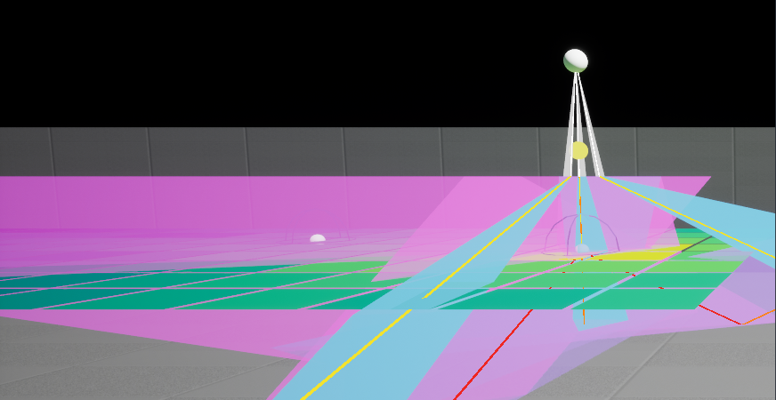
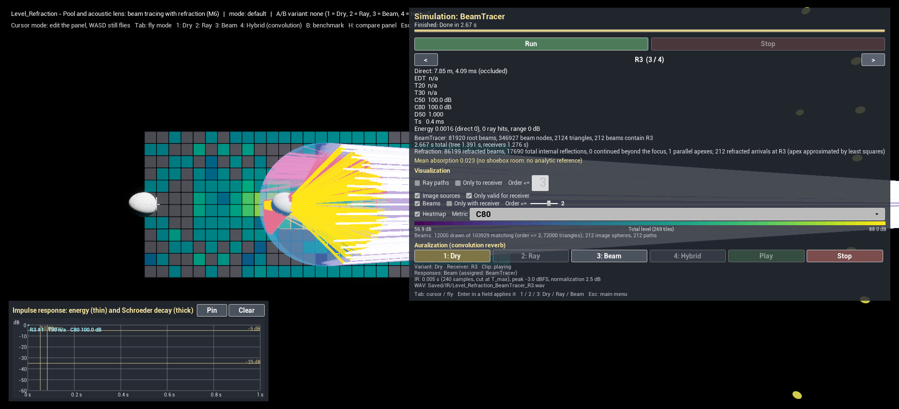

# A 10-minute walkthrough

[← Guide index](README.md)

A guided tour of what the bench shows today (milestones M0–M10), in the order a reviewer would want to see it. Each step names what to press, what to look at, and where the details are. Times are on the development machine (10 worker threads).

**Before you start:** open `AcousticsLab.uproject` in Unreal Engine 5.8.3 (build instructions in the [README](../../README.md#quick-start)). Headphones help in steps 5, 10 and 12. Keys: **Tab** switches between the panel (cursor) and flying (WASD + mouse, E/Q up/down); **Esc** returns to the menu in Standalone mode.

> **Known issue in the current build (16.10.2026), affects steps 4–7:** the simulation panel does not show its settings rows — the **Solver** and **Source** combos and the fields (Rays, Max order, Beams: subdivision, refraction checkbox, Hybrid K / t_mix …). The widget builds them only while it has no input fields yet, and the visualization's "Order <=" field is created first (`SimulationHUDWidget.cpp`). Until it is fixed, choose the solver and its settings on the `SimulationManager` actor in the editor (Details → `Solver`, `Settings`, `Source Id`) before **Play**; **Run**, the receiver selector, the metrics, the visualization and auralization blocks work. The benchmark panel (B) and the comparison panel (H, with its own K / t_mix / Rays / Beam subdiv fields) are not affected.

---

## 1. The menu (30 s)

Play as **Standalone Game**. The menu mirrors the structure of the work: **1. Methods of M. Sikora** (one entry per paper), **2. Industry** (Steam Audio, Audio Tracing), **3. Compare** (the hybrid comparison panel with the industry columns). 1.1 Amphitheatre is step 11, 1.5 soundwalk step 12. Esc comes back.

→ Choose **1.1 Image sources & beam tracing - Shoebox**.

## 2. The validation room and the ray tracer (2 min)

`Level_Shoebox` is a 10 × 7 × 3 m concrete room (α = 0.03, s = 0.1) with a source S1, four receivers R1–R4 (spheres of 0.5 m) and a 10 × 7 grid of receivers on the floor.

1. In the panel (top right) press **Run**. In about 1–3 s: `20000 rays, 12 triangles, mean order 454.0, 9079967 segments`.
2. Read the metric block for R1: EDT ≈ 4.71 s, T30 ≈ 4.72 s, C80 ≈ −5.8 dB; and the yellow reference: Sabine 4.66 s, Eyring 4.59 s, **T30 +2.9 % vs Eyring**. The pipeline (geometry → rays → histogram → Schroeder curve → regression) agrees with the analytic reverberation time.
3. The room fills with ray paths: white = direct, yellow = 1st, orange = 2nd, red = 3rd reflection; fainter = less energy. Tick **Only to receiver**: only the paths that enter R1 within three reflections remain.
4. Bottom left, the impulse response of R1: the energy per millisecond (thin) and the Schroeder decay (thick), with the −5/−35 dB fit range and the 50/80 ms marks.

Details: [3. ray tracing](03-stochastic-ray-tracing.md), [4. metrics](04-room-acoustic-metrics.md) (with the Sabine/Eyring table for α = 0.1–0.3: deviations +2.4 … +8.8 % for diffuse walls).

## 3. Heatmaps over a receiver grid (1 min)

The floor tiles are 70 receivers. Change **Metric**: **C80** (−5.9 … −2.0 dB, clearer near the source), **T30** (4.70 … 4.75 s — nearly uniform, as a shoebox should be), **Direct SPL** (falls by 6 dB per doubling of distance). Untick **Ray paths** to see the tiles clearly.

Details: [5. visualization](05-visualization.md).

## 4. Image sources and beams — the early reflections (2 min)

1. **Solver** = `ImageSource`, **Run** (≈ 0.02 s): `162 image sources` (orders 1–3), spheres coloured by order, polylines source → walls → R1 for every valid path. Press `>`: the paths switch to R2 instantly.
2. **Solver** = `BeamTracer`, **Run** (≈ 0.2 s): `320 root beams, 22925 beam nodes`. Tick **Beams** and **Only with receiver**, slider **Order <=** to 3: the translucent beams that contain R1, and their parent beams back to the source. The receiver test is a point-in-beam query — no back-tracing — so all 74 receivers are answered from one beam tree.
3. The two solvers find the same reflections: the test `BeamVsImageSource` requires equal sets of paths with **delays within 0.1 ms and energies within 1 %**.
4. The IR plot shows discrete early arrivals; T30 is `n/a` and C80 = 100 dB because these solvers model only the early part — the motivation for the hybrid method (S4, step 9).

Details: [7. image sources and beam tracing](07-image-sources-and-beam-tracing.md) — including how the beam division of S1/S2 (projection onto a plane across the beam, clipping, child beams with mirrored apexes) is done here.

## 5. Listening (1 min)

1. After the beam run the anechoic clip plays (variant **Dry**). Press **3**: the clip through the beam response of R1 — direct sound plus discrete early echoes.
2. **Solver** = `RayTracer`, **Run**, press **2**: the full concrete room, a 4.7 s tail. Press **1** to compare with the dry clip — the switch is instantaneous.
3. Press `>` to **R3** (1 m from the source): onsets become sharp and close; `>` again to **R4** (8.5 m, far corner): distant and diffuse. No solver rerun is needed — every receiver's response was synthesized after the run.

Responses are also written to `Saved/IR/Level_Shoebox_<Solver>_<Receiver>.wav` (48 kHz float).

Details: [6. auralization](06-auralization.md).

## 6. Refraction: the pool (2 min)

Esc → **1.2 Beam tracing with refraction**. The level's manager uses the beam tracer; source `Pool` is 1.5 m above a water surface in a 20 × 10 × 3 m pool.

> The panel carries the settings of the last run over to the next level of the same session (one shared set). Coming from the shoebox, set them for this level before running: tick **Beams: refraction at interfaces**, **Beams: subdivision** = 4, **Beams: max order** = 3, **T max, s** = 1, **Receiver r, m (0 = own)** = 0. (Opening `Level_Refraction` first, or directly in the editor, uses the level's saved values.)

1. **Run** (≈ 30 s). Result line: `Refraction: 1616 refracted beams, 22192 total internal reflections …`.
2. **Beams** on, slider to 1: above the water the reflected beams (yellow); under the water the refracted beams (cyan) only in a narrow cone below the source — beyond 13.4° incidence (the critical angle air → water) sound is totally reflected. The underwater heatmap is brightest below the source.
3. **Only with receiver**, slider to 3: the beam chains that reach R1 under the water bend at the surface.
4. The panel note states the one approximation of this mode: the apex of a refracted beam is the least-squares point of its three refracted guide rays (a refracted beam has no exact apex, S2 §3.1.2).

## 7. Refraction: the acoustic lens of S2 (1.5 min)

1. **Source** = `Lens`, **Beams: subdivision** = 6, **Run** (≈ 17 s). The S2 lens experiment scaled × 10: a rubber sphere (900 m/s) in glycerol (1920 m/s), a 4.5° directional source 7.5 m away.
2. Fly 60 m along +Y (Tab, then WASD) to the lens: the beams enter the sphere and converge towards its back; the vertical heatmap through the axis shows the focal spot inside the back half of the sphere, where the ball-lens formula $nR/(2(n-1)) \approx 0.47$ m puts it.
3. The test `LensFocus` requires the focus receiver to get more than twice the energy of receivers 0.3 m off the axis.

Details: [8. refraction](08-refraction.md).

## 8. Parallel beam tracing (1 min, optional)

Esc → **1.3 Thread-level parallelization (benchmark)**: the beam-tree build of S3 on a thread pool, a benchmark panel with a speed-up chart (about 4× on 6 cores, bit-identical results for any thread count); 1 minute with the default settings ([9](09-parallelization.md)).

## 9. Hybrid: beams early, rays late (1.5 min)

Esc → **1.4 Hybrid beam/ray tracing** (in PIE: `Level_Shoebox`, Play, **H**). The comparison panel opens at the top right.

1. Keep K = 2, t_mix = 80 ms, Rays = 20000, Beam subdiv = 2, press **Run hybrid** (≈ 3 s).
2. **0–200 ms**: the orange steps (pure beam ≤ 2) sit on the blue ray peaks up to 80 ms; the green hybrid follows the beams before t_mix and the rays after. **Full decay**: green and blue Schroeder curves coincide — T30 4.72 s for both.
3. The line under the table: 24 early specular reflections at R1, all found by 20 000 rays; early energy beams vs rays +4.1 %.
4. Set **Rays = 20**, run again: the rays find 0 of the 24 early reflections, the hybrid still has all of them (pure ray C50 −23.7 dB vs hybrid −14.2 dB). This is S4's argument in one number.
5. Keys **1–4**: Dry / pure ray / pure beam ≤ K / hybrid.

Details: [10. hybrid](10-hybrid.md) — including why the split is made per path class and how it differs from S4's beam-to-ray conversion.

## 10. Industry: Steam Audio (1 min)

Esc → **2.1 Steam Audio (Valve)**. With headphones: the test signal from the arena centre, rendered binaurally by Steam Audio 4.8.1 at R1 (20.4 m). HUD line 3 shows the plugin state. Console `Acoustics.Industry.Receiver R3` moves the listener to the last row; keys **1–4** go back to the bench's own convolution, **5** / **6** to the plugins.

The level holds the empty stone amphitheatre of step 11. Press **2** or **4** after a run for the bench's own response at the same seat: Steam Audio sounds much drier (C80 about 23 dB at R1 against about −1 dB from the bench's ray tracer — experiment E6). **Audio Tracing** (2.2) is prepared but needs a GPU with hardware ray tracing; on the development machine (GTX 1050 Ti) it cannot be heard.

Details: [11. industry comparison](11-industry-comparison.md).

## 11. The amphitheatre (1.5 min)

Esc → **1.1 Image sources & beam tracing - Amphitheatre**. An elliptical amphitheatre (arena 65 × 40 m, 20 stone rows up to 15 m); the ray tracer runs on start and the C80 heatmap colours 856 receivers on the rows.

1. Read R1 in the panel (20.4 m from the source in the arena): C80 around 0 dB, T30 n/a — the empty stone cavea answers with a few strong specular echoes off its concave risers, not with a decay (experiment E5b).
2. Console `Acoustics.Amphitheatre.Audience 1`, **Run**: the rows turn to about +10 dB C80, T30 about 1.0–1.2 s. `Acoustics.Amphitheatre.Velarium 1` adds the absorbing ring at 18 m — a small change.

Details and the tables of experiments E1–E6: [12](12-amphitheatre-and-soundwalk.md).

## 12. Soundwalk (1 min)

Esc → **1.5 Audio AR soundwalk**. You stand on row 10 facing the arena; the clip plays through the response of the cavea cell nearest to you. Walk up and down the rows (WASD + mouse, Space jumps): the green HUD line names the cell you hear, its distance and C80, and the sound changes with it — no new simulation, each response comes from the stored result. **N** adds the ambient sources (crowd, birds, wind), **1** / **2** switch Dry / Ray, **Tab** shows the panel.

Details: [12](12-amphitheatre-and-soundwalk.md#soundwalk-menu-15).

## 13. What is next

- **Audio Tracing** listening and measurement on an RTX machine ([11](11-industry-comparison.md#how-to-run--listen)).
