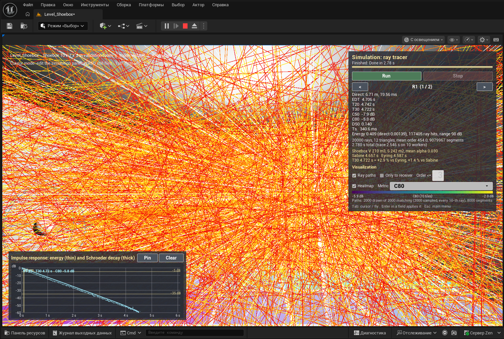
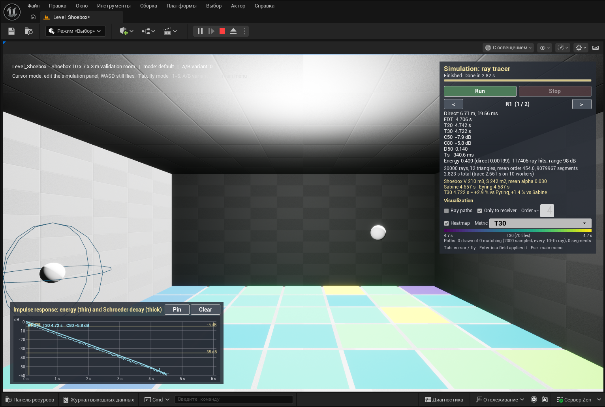

# M3 — visualization: ray paths, receiver-grid heatmap, impulse-response plot

## Plan

1. **Core, path samples** (`Results/SimulationResult.h`, `Solvers/RayTracer.cpp`). `FSimulationResult::Paths` (the SPEC §3.5 name; PROMPTS calls it `PathSamples`) already exists since M2 but keeps the *first* `MaxPathsForVisualization` rays, which on a Fibonacci sphere are all clustered around +Z. M3 samples every `Stride = max(1, NumRays / MaxPaths)`-th ray instead (`FRayTracer::PathSampleStride`, `IsPathSampled`), so the kept paths cover the whole sphere; the choice depends on the ray index only, so it is deterministic and thread-count invariant, and it never touches the histogram. `FPathSample` gains `RayIndex`, `SegmentEnergies` (band 0 relative to E0 at the start of every segment, for the opacity), and `ReceiverHits` (every receiver entry along the path: receiver index, order, entry point, time, energy) so the "only paths reaching the receiver" mode can cut a path at the entry point of the *selected* receiver. `RoomAcoustics` gets `LevelDb` and `DirectSoundLevelDb` (SPL of the direct sound for a source of sound-power level L_W: L_W + 10 log10(E_direct / (π r²)) = L_W − 11 − 20 log10 d).
2. **Core tests** (`Private/Tests/VisualizationTests.cpp`): `AcousticsLab.Core.Solvers.PathSampling` — sample count = min(MaxPaths, NumRays), stride coverage (both hemispheres), histogram / segment count bit-identical for MaxPaths 0 / 100 / 5000, identical paths for 1 and 4 workers, per-path invariants (points = segments + 1, energies non-increasing, first point = source, receiver entry points on the sphere surface); `AcousticsLab.Core.Metrics.LevelHelpers`.
3. **`URayPathVisualizerComponent`** (`AcousticsLab/Visualization/`, on `AAcousticSimulationManager`): owns a `ULineBatchComponent` (translucent hardware lines, persistent: lines with LifeTime ≤ 0 are never expired by `ULineBatchComponent::TickComponent`, `Engine/Private/Components/LineBatchComponent.cpp`). Colors by reflection order (0 white, 1 yellow, 2 orange, 3+ red), alpha from the segment energy (0 dB → 1, −EnergyRangeDb → MinOpacity), toggles `bEnabled`, `bOnlyPathsReachingReceiver`, `ReceiverFilter`, `MaxPaths` (≤ 2000), `MaxDrawOrder`, `MaxDrawSegments` budget, m → cm here only.
4. **`AReceiverGrid` + `UHeatmapComponent`** (`Scene/ReceiverGrid`, `Visualization/HeatmapComponent`): a configurable grid (NumTilesX × NumTilesY, TileSizeMeters, ReceiverHeightMeters, radius) centred on the actor; the grid contributes `FSolverReceiver`s to the run, the manager records per-receiver bindings (point receiver actor or grid tile) so the HUD cycles point receivers only. `UHeatmapComponent : UInstancedStaticMeshComponent` with 1 × 1 m plane tiles, 4 custom data floats per instance (R, G, B, valid), viridis evaluated in C++ (shared with the HUD legend), metric selector `EHeatmapMetric { DirectSPL, C80, T30, EDT }`, auto or fixed range, invalid tiles grey. Material `M_HeatmapTile` (unlit, emissive = `PerInstanceCustomData3Vector` index 0) created through the editor's MCP `MaterialTools`.
5. **`UIRPlotWidget`** (`UI/`): `NativePaint` with `FSlateDrawElement::MakeLines` / `MakeText` (`SlateCore/Public/Rendering/DrawElementTypes.h`): energy per bin in dB (10 log10(E / E_max)), Schroeder curve, markers at −5 / −35 dB and at direct + 50 / 80 ms, up to 3 overlaid curves (`SetCurve(slot, receiver, label, color)`), auto time range from the usable decay. A `UHeatmapLegendWidget` paints the viridis bar with the metric range.
6. **Hook-up**: `AAcousticSimulationManager::FinishRun` pushes the result to the path visualizer and every grid before `OnResultReady`; `USimulationHUDWidget` gets a visualization block (paths / only-to-receiver / max order, heatmap on-off + metric combo + legend) and the IR plot panel (bottom-left of its canvas); the receiver selector drives the path filter and the plot (slot 0 = selected receiver, "Pin" keeps a curve in slot 1 / 2 for comparison).
7. **Content** (through the editor's MCP server): `M_HeatmapTile`, a `ReceiverGrid` actor (10 × 7 tiles, 1 m, receivers at 1.2 m) in `Level_Shoebox`; PIE run, screenshots into `docs/milestones/img/`.
8. Build, tests, this document, commit `M3: visualization`, push.

## Done

- **Core** (`Source/AcousticsCore`): `FPathSample` now carries `RayIndex`, `SegmentEnergies` (band 0 / E0 at the start of every segment), `ReceiverHits` (`FPathReceiverHit`: receiver index, order, entry point on the sphere, arrival time, deposited energy) and `FindReceiverHit(receiver | INDEX_NONE)`; `FSimulationResult::PathSampleStride`. `FRayTracer::PathSampleStride / IsPathSampled / NumPathSamples`: the kept paths are rays 0, S, 2S, … with S = max(1, NumRays / MaxPaths), appended per chunk in ray order, so the sample set is independent of the worker count and of the chunk size and covers the whole emission sphere. `RoomAcoustics::LevelDb` and `DirectSoundLevelDb`.
- **Visualization** (`Source/AcousticsLab/{Public,Private}/Visualization/`): `URayPathVisualizerComponent` (ULineBatchComponent batch rebuilt from the result; order colors white / yellow / orange / red, alpha 1 → MinOpacity 0.08 over EnergyRangeDb 40 dB; `MaxPaths` 2000, `MaxDrawOrder` 10, `MaxDrawSegments` 200 000; receiver mode cuts the path at the entry point of the filtered receiver; counters `NumDrawnPaths / NumMatchingPaths / NumDrawnSegments`), `UHeatmapComponent` (ISM of engine `BasicShapes/Plane` tiles, 4 custom floats per instance, `Viridis(t)` polynomial fit returned in linear color, `MakeSample / SampleValue / MetricLabel / MetricUnits`, auto range over the valid tiles, `InvalidColor` for tiles without a value, `EmptyColor` before a run, material `/Game/Acoustics/Materials/M_HeatmapTile` loaded on demand with the engine basic-shape material as fallback + warning).
- **Scene**: `AReceiverGrid` (GridId, NumTilesX × NumTilesY, TileSizeMeters, ReceiverHeightMeters, ReceiverRadiusMeters, TileZOffsetMeters; receivers named `G[x,y]`; `AppendSolverReceivers`, `ApplyResult`, `ClearResult`, `FindAll`).
- **Simulation**: `AAcousticSimulationManager` gets `PathVisualizer` (default subobject), `bIncludeReceiverGrids`, `FReceiverBinding { Point | GridTile, Actor, TileIndex }` per receiver of the last result (`ReceiverBindings`, `GetPointReceiverIndices`), `CollectSceneActors` appends the grid receivers after the point receivers, `UpdateVisualizers()` runs before `OnResultReady`.
- **UI**: `UIRPlotWidget` (energy per bin as a thin line, max per pixel column; Schroeder curve thick; grid every 10 dB and a "nice" time step; markers −5 / −35 dB and direct + 50 / 80 ms; legend with T30 and C80 per curve; 3 slots), `UHeatmapLegendWidget` (viridis bar + min / max / label), `USimulationHUDWidget` visualization block (Ray paths, Only to receiver, Order ≤ field, Heatmap, Metric combo, legend, counters line) and the impulse-response panel bottom-left with **Pin** / **Clear**; the receiver selector cycles point receivers only and drives the path filter and plot slot 0.
- **Tools**: `Tools/Editor/create_m3_content.py` (material + grid through MCP), `Tools/Editor/capture_window.ps1` (screen capture of the editor window). Notes in `docs/ENV.md`.
- **Tests**: 3 new (14 total, all green): `AcousticsLab.Core.Solvers.PathSampling`, `AcousticsLab.Core.Metrics.LevelHelpers`, `AcousticsLab.Core.Visualization.Helpers` (viridis, metric sampling, order colors, opacity, hit lookup; game module, no world).

## Deviations from SPEC / PROMPTS

- The result field keeps the SPEC §3.5 name `Paths` (PROMPTS: `PathSamples`); the cap is `FSolverSettings::MaxPathsForVisualization` (default `Acoustics::DefaultMaxPathsForVisualization` = 2000).
- Paths are sampled with a stride instead of "the first N rays" (see Plan 1): the first 2000 of 20 000 Fibonacci directions all lie within 37° of +Z, which is useless for a picture. Documented in `SimulationResult.h`.
- The viridis gradient is evaluated in C++ (`UHeatmapComponent::Viridis`, degree-6 polynomial fit of matplotlib's viridis) and the tiles receive the final color in custom data 0–2; the material only passes the color to Emissive (Unlit), so the HUD legend and the tiles use one table and the material needs no HLSL. SPEC §3.6 puts the gradient in the material.
- "Direct SPL" is defined for a source of sound-power level L_W = 100 dB (`UHeatmapComponent::SourcePowerLevelDb`): L = L_W + 10 log10(E_direct / (π r²)) = L_W − 11 − 20 log10 d in free field; occluded receivers show the invalid color.
- The path visualizer draws at most `MaxDrawOrder` = 3 reflections per path by default and never more than 200 000 segments: in the Concrete room the mean order is ≈ 450, 2000 paths of order 10 already paint the whole view red (first PIE run), and 2000 full paths are 900 000 lines of noise. Both limits are properties and the HUD field "Order ≤" edits the first. "Only to receiver" keeps a path only when its first entry into the selected receiver happens within `MaxDrawOrder` reflections: in the shoebox every ray enters R1 about six times (117 000 hits from 20 000 rays), so a filter without the order bound kept 1996 of 2000 paths.
- The PIE copy of a native actor does not rerun `OnConstruction`, and transient component state is not duplicated into it: the first PIE run placed all 70 grid receivers at the grid origin (one color for every tile). Fixed by computing receiver positions from the grid's own settings (`UHeatmapComponent::TileLocalCenter`), saving the tile layout in the component and rebuilding the tiles in `AReceiverGrid::BeginPlay`.
- Grid receivers are ordinary solver receivers (70 for the 10 × 7 shoebox grid); with 20 000 rays the per-chunk histograms take ≈ 70 MB and the receiver test per segment is linear in the receiver count. Fine for M3; a receiver BVH and a fixed-order tree reduction are noted for M7.
- `ULineBatchComponent` lines are translucent (`FLineBatcherSceneProxy` uses `PDI->DrawTranslucentLine`), so the energy opacity works without a material.
- The IR panel and the visualization block are built in C++ like the rest of the HUD (no `WBP_*` Blueprint layouts yet; the `BindWidgetOptional` slots exist).

## Verify in the editor

1. Open `Level_Shoebox`: the new `ReceiverGrid` actor shows 70 dark tiles on the floor (10 × 7, 1 m) and the `SimulationManager` has a `PathVisualizer` component (Details → Acoustics|Paths).
2. Play (PIE). Click **Run**. After "Finished": the room fills with ray paths (white first segments, yellow / orange / red reflections, fading with energy); the floor tiles turn viridis for C80 (legend in the panel shows the range and the number of valid tiles); the bottom-left plot shows the energy of R1 (thin cyan), the Schroeder decay (thick cyan), the −5 / −35 dB lines and the 50 / 80 ms markers; the line under the heatmap legend reports "Paths: N drawn of M matching (2000 sampled, every 10-th ray), K segments".
3. Tick **Only to receiver**: only paths that enter R1 remain and end at its sphere; `<` / `>` switch to R2 (paths and plot follow). Type `3` into "Order ≤" + Enter: early reflections only. Untick **Ray paths** to hide them.
4. Metric combo: Direct SPL (brightest near the source, −6 dB per doubling of distance), T30 (nearly uniform in the shoebox), EDT; untick **Heatmap** to hide the tiles.
5. **Pin** keeps the current curve (orange, then green) in the plot; switch the receiver or change the wall alpha override and Run again to compare; **Clear** removes the pinned curves.
6. Tests: Tools → Session Frontend → Automation → filter `AcousticsLab` → 14 tests pass. Headless: the test command in README, Quick start.

## Checked in PIE (through the editor's MCP server, `Tools/Editor/create_m3_content.py` + PIE runs)

Level_Shoebox, 20 000 rays, Concrete room, `SimulationManager` with `bRunOnBeginPlay` toggled on for the runs (restored to off and saved afterwards):

```
LogAcoustics: Simulation run 1 started: 20000 rays, max order 500, seed 1, r 0.50 m, bin 1.0 ms, T_max 6.0 s, air off (m 0.0020), threads 0, BVH on, paths 2000; 72 receivers (70 grid tiles); scene Scene: 12 triangles, 242.000 m^2, ...
LogAcoustics: RayTracer: 20000 rays, 12 triangles, 9079967 segments, mean order 454.0, 0 escaped, 10 workers, 2.780 s (setup 0.000, trace 2.546, metrics 0.233)
LogAcoustics: Receiver grid G: 70 of 70 tiles bound, C80 range -5.87..-1.97 dB (70 valid)
LogAcoustics: Receiver grid G: 70 of 70 tiles bound, T30 range 4.70..4.75 s (70 valid)
LogAcoustics: Receiver grid G: 70 of 70 tiles bound, Direct SPL range 70.17..91.30 dB (70 valid)
  G[0,0] at 2.14 m (direct 6.25 ms, E 0.01362, 119128 ray hits): EDT 4.711 s, T20 4.693 s, T30 4.703 s, C50 -5.4 dB, C80 -3.9 dB, ...
  G[9,6] at 8.75 m (direct 25.51 ms, E 0.000816, 117238 ray hits): EDT 4.721 s, T20 4.740 s, T30 4.721 s, C50 -7.5 dB, C80 -5.4 dB, ...
```
The direct-SPL span of 21.1 dB equals 20 log10(8.75 / 0.77) for the nearest and farthest tile; the 72 receivers (R1, R2 + 70 tiles) cost 2.5 s of tracing instead of 1.4 s with two receivers. No warnings or errors from `LogAcoustics` / `LogMaterial`.

| | |
|---|---|
|  | `M3_paths_heatmap.png`: 2000 sampled paths, order ≤ 3 (8000 segments), C80 heatmap underneath, panel with the visualization block, IR plot of R1 bottom-left |
|  | `M3_paths_to_receiver.png`: "Only to receiver", order ≤ 4 — 71 of 2000 paths reach R1 within four reflections and end at its sphere; the C80 tiles are visible (−5.9 … −2.0 dB) |
|  | `M3_heatmap_t30.png`: paths off, T30 metric (4.70 … 4.75 s: nearly uniform, as expected in a shoebox) |
|  | `M3_heatmap_direct_spl.png`: direct SPL for L_W = 100 dB, 70.2 … 91.3 dB, yellow around the source |

The screenshots are cropped to the left 1532 px of the editor window (the right-hand panels showed a private Windows notification).

Open points noticed in PIE (not blocking, for M4+): the tile colors come out paler than viridis because the unlit emissive goes through the tonemapper (a scale below 1 or a tonemapper-independent output would fix it); the legend prints one decimal, so a 4.70 … 4.75 s range reads "4.7 … 4.7"; the "Order ≤" text box is light on white like the other setting fields; the editor showed its low-memory popup during the runs (72 receivers × 20 chunks of histograms ≈ 70 MB on top of a 2 GB-free machine).

## Build log tail

```
[10/11] Link [x64] UnrealEditor-AcousticsLab.dll
[11/11] WriteMetadata AcousticsLabEditor.target [NoUba]

Total time in Unreal Build Accelerator local executor: 88.35 seconds
Output binary: C:\Program Files\Epic Games\UE_5.8\Engine\Binaries\Win64\UnrealEditor.exe

Result: Succeeded
Total execution time: 129.91 seconds
```
(last incremental build after the PIE fixes; the full rebuild of the game module before it took 780 s because the HUD header is included almost everywhere and the machine allowed 3 parallel actions; `-NoHotReloadFromIDE` was needed because the owner's project browser with Live Coding was open — see `docs/ENV.md`.)

## Tests

```
LogAutomationCommandLine: Display: Found 14 automation tests based on 'AcousticsLab'
LogAutomationController: Display: Test Completed. Result={Success} Name={BvhMatchesBruteForce} Path={AcousticsLab.Core.Geometry.BvhMatchesBruteForce}
LogAutomationController: Display: Test Completed. Result={Success} Name={BvhQueriesMatchBruteForce} Path={AcousticsLab.Core.Geometry.BvhQueriesMatchBruteForce}
LogAutomationController: Display: Test Completed. Result={Success} Name={RayTriangle} Path={AcousticsLab.Core.Geometry.RayTriangle}
LogAutomationController: Display: Test Completed. Result={Success} Name={ShoeboxExtraction} Path={AcousticsLab.Core.Geometry.ShoeboxExtraction}
LogAutomationController: Display: Test Completed. Result={Success} Name={ShoeboxScene} Path={AcousticsLab.Core.Geometry.ShoeboxScene}
LogAutomationController: Display: Test Completed. Result={Success} Name={LevelHelpers} Path={AcousticsLab.Core.Metrics.LevelHelpers}
LogAutomationController: Display: Test Completed. Result={Success} Name={SyntheticDecay} Path={AcousticsLab.Core.Metrics.SyntheticDecay}
LogAutomationController: Display: Test Completed. Result={Success} Name={Constants} Path={AcousticsLab.Core.Smoke.Constants}
LogAutomationController: Display: Test Completed. Result={Success} Name={Deterministic} Path={AcousticsLab.Core.Solvers.Deterministic}
LogAutomationController: Display: Test Completed. Result={Success} Name={PathSampling} Path={AcousticsLab.Core.Solvers.PathSampling}
LogAutomationController: Display: Test Completed. Result={Success} Name={RayTracerPrimitives} Path={AcousticsLab.Core.Solvers.RayTracerPrimitives}
LogAutomationController: Display: Test Completed. Result={Success} Name={ShoeboxSabine} Path={AcousticsLab.Core.Solvers.ShoeboxSabine}
LogAutomationController: Display: Test Completed. Result={Success} Name={ThreadCountInvariance} Path={AcousticsLab.Core.Solvers.ThreadCountInvariance}
LogAutomationController: Display: Test Completed. Result={Success} Name={Helpers} Path={AcousticsLab.Core.Visualization.Helpers}
LogAutomationCommandLine: Display: ...Automation Test Queue Empty 14 tests performed.
```
