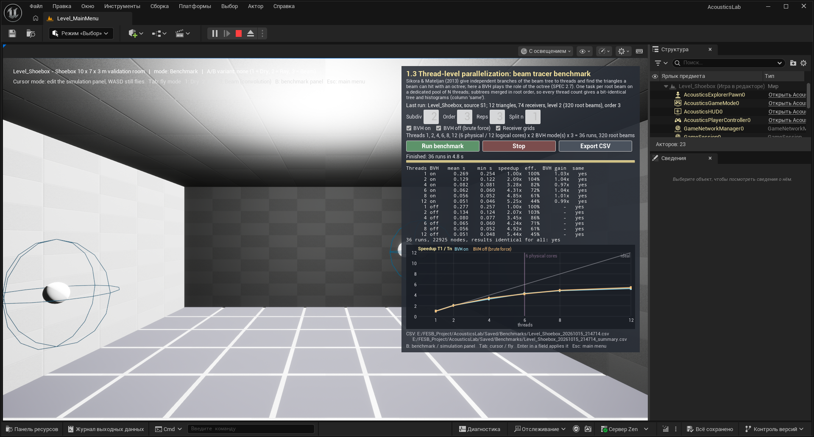

# M7 — thread-level parallelization of the beam tracer, benchmark (SPEC §2.7, §4, §5 experiment 4)

## Plan

1. **Core, the tree build split by root beam** (`Solvers/BeamTracer.cpp`, private header `Solvers/BeamTreeBuild.h`). The M5/M6 build is breadth-first over the whole tree; a root beam and everything it spawns never touch another root's nodes (S3: "branches of the beam tree are independent"). The build becomes: (a) a shared, read-only context (emission directions, triangle → surface map, the emitted roots, escape length); (b) `BuildRootSubtree(root)` — the existing division + reflection / refraction code applied breadth-first to one root's subtree, writing into its own `FBeamTree` (local node indices, own counters, own node budget); (c) `MergeSubtrees` — order by order, root by root (ascending root index), nodes are appended and parent indices remapped. Sequential breadth-first order is "all order-k nodes, grouped by root in root order", so the merged tree is node for node the M5/M6 tree for any number of workers and any scheduling. Node budget: every subtree stops at `MaxBeamNodes`; the merged tree keeps the first `MaxBeamNodes` nodes of the breadth-first order (well defined: a subtree's missing nodes all lie behind that prefix); a shared atomic counter aborts the build at 2 × `MaxBeamNodes` as a memory guard (only then the result depends on scheduling; logged).
2. **Core, `Solvers/ParallelBeamTracer.h/.cpp`** — `FParallelBeamTracer(NumThreads)` owns a dedicated `FQueuedThreadPool` (`FQueuedThreadPool::Allocate()` + `Create(NumThreads, 256 KB stack, TPri_Normal, "AcousticsBeamPool")`, `Runtime/Core/Public/Misc/QueuedThreadPool.h`) with exactly `NumThreads` threads; `ParallelFor` queues `NumThreads` `IQueuedWork` items (`Runtime/Core/Public/Misc/IQueuedWork.h`: `DoThreadedWork` / `Abandon`) that pull root beams from an atomic counter (one task = one root beam; dynamic scheduling, the merge order does not depend on which worker built a root) and the caller waits on an `FEvent` (`FPlatformProcess::GetSynchEventFromPool`, `Runtime/Core/Public/GenericPlatform/GenericPlatformProcess.h`). Receiver queries are distributed the same way (one task = one receiver; every receiver histogram is written by one worker, contributions in node order). `ParallelFor` of the task graph is not used: it cannot fix the thread count. `FBeamTracer::Run / BuildTree` delegate to it (`NumThreads` 1 = inline, no pool; 0 = `FPlatformMisc::NumberOfCoresIncludingHyperthreads()`), so the HUD runs get the parallel build too. Timing: `Timing.SetupSeconds` = tree build, `TraceSeconds` = receiver queries, `TotalSeconds`, `NumWorkers` = threads.
3. **Core, `bUseBVH` everywhere**: frustum candidates (`QueryFrustumBruteForce`), centre / depth rays (`IntersectRayBruteForce`) already switch; the direct-sound occlusion test (`FAcousticScene::IsOccluded`) gets the same switch, so a brute-force run never touches the BVH. Results must be identical, only slower.
4. **Core, `Results/BenchmarkResult.h/.cpp` + `FBeamBenchmark`** (SPEC §3.2 lists `FBenchmarkResult`): the matrix runner (thread counts × {BVH on, off} × repetitions, one `FParallelBeamTracer` per thread count, a warm-up run first, repetitions interleaved so drift spreads over all cells), per run: total / build / query seconds, nodes, a fingerprint of the result (FNV-1a over every histogram bin, the node count and the tree) compared with the first run → `bIdentical`; summary per (threads, BVH): mean / min / max, speedup T1/Tn (mean and min), efficiency, BVH gain; CSV writer (raw runs + summary, `#` header lines with the machine: CPU brand, physical / logical cores, memory). Thread list: powers of two below the logical core count, the physical core count and the logical count ({1, 2, 4, 6, 8, 12} here) — the physical count is added because that is where the scaling is expected to bend. `FAcousticScene::Tessellated(n)` splits every triangle into n² coplanar ones (same room, more triangles) for a heavier scene without new geometry.
5. **Tests** (`Private/Tests/ParallelBeamTests.cpp`): `AcousticsLab.Core.Solvers.BeamThreadCountInvariance` — shoebox (levels 2, order 3) and a pool with a water surface (refraction on): trees `IsIdentical(…, 0.0)`, histograms `IsIdentical`, node / early-reflection counts equal for the sequential tracer and 1 / 2 / 4 / logical-core pool threads; a truncated build (small node budget) is identical for 1 and 4 threads and equals the breadth-first prefix of the full tree. `AcousticsLab.Core.Solvers.BvhToggleInvariance` — the same scenes plus the tessellated shoebox: BVH on / off give identical trees and histograms (1 and 4 threads). The ray-tracer test `ThreadCountInvariance` stays as it is. All 27 earlier tests stay green.
6. **Game, `UI/UBenchmarkWidget`** (C++-built like the other panels): fields subdivision level / max beam order / repetitions / surface split n, refraction and receiver-grid toggles, Run / Stop / Export CSV, progress bar and status ("run 7 of 37: 4 threads, BVH off, repetition 2"), a table (threads, BVH, mean, min, speedup T1/Tn, efficiency, identical) and `UBenchmarkChartWidget` (`NativePaint`, `FSlateDrawElement::MakeLines`: speedup vs threads for BVH on / off, the ideal linear line, the physical-core marker). The matrix runs in a background task (`UE::Tasks::Launch`) on a copy of the extracted scene; Stop cancels between and inside runs. Note in the panel: "The paper (Sikora & Mateljan 2013) uses an octree to find the triangles a beam can hit; here a BVH plays that role (SPEC §2.7)". CSV export to `Saved/Benchmarks/<Level>_<timestamp>.csv` (+ `_summary.csv`), automatic after each finished matrix. `AAcousticSimulationManager` gets `PrepareBeamRun` (extraction + source / receivers + source medium / cone, shared with `Run`) so the benchmark sees exactly the scene a Run sees. `AAcousticsPlayerController`: in `?mode=Benchmark` (menu 1.3) the benchmark panel is shown instead of the simulation panel; key **B** toggles the two panels in every scene level (SPEC: "benchmark panel, any level").
7. **Headless benchmark** (`UAcousticsBenchmarkLibrary::RunBeamBenchmark`, BlueprintCallable, called from `Tools/Benchmark/run_m7_benchmark.py` through the python commandlet with the editor closed): loads the map in the editor world, extracts like PIE, runs the matrix synchronously, writes the CSVs. Scenes (decision for M7, the amphitheatre of SPEC §5 exp. 4 arrives in M10): **A** `Level_Shoebox` (12 triangles, 74 receivers, level 3, order 4) — thread scaling with a trivially small scene; **B** `Level_Shoebox` surfaces split 8 × 8 (768 triangles) — same room, the triangle search matters; **C** `Level_Refraction` (pool + lens, 2124 triangles, refraction on, source Pool) — the heaviest scene available. Levels / orders are calibrated so one single-thread BVH run takes a few seconds. Machine state recorded (other processes, free memory) before the run.
8. **PIE**: menu 1.3 path / `?mode=Benchmark`, the panel runs a short matrix on `Level_Shoebox` through the editor's MCP server, screenshot `docs/milestones/img/M7_benchmark_panel.png`.
9. Build, tests, this document (done / deviations / verification / build tail / tests / benchmark tables and analysis), commit `M7: thread-level parallelization benchmark`, push.

## Done

- **Core, tree build per root beam** (`Private/Solvers/BeamTreeBuild.h`, `BeamTracer.cpp`): `AcousticsBeamBuild::InitContext` (emission directions, triangle → surface map, emitted roots, escape length, limits), `BuildRootSubtree` (the M5 / M6 division, reflection and refraction code applied breadth-first to one root's subtree, local node indices, own counters and budget), `MergeSubtrees` (order by order, root by root, parents remapped — node for node the sequential breadth-first tree), `QueryReceiver` (one receiver). `FBeamTracer::BuildTree / QueryReceivers / Run` keep their API and delegate to `FParallelBeamTracer` (`NumThreads` 1 = inline, 0 = all logical cores), so the HUD runs of the beam tracer are parallel too.
- **Core, `FParallelBeamTracer`** (`Public/Solvers/ParallelBeamTracer.h`): owns a dedicated `FQueuedThreadPool` with exactly N threads (256 KB stacks); `ParallelFor` queues N `IQueuedWork` items that pull items from an atomic counter and the caller waits on an `FEvent`; one task = one root beam (dynamic load balancing), then one task = one receiver. Timing: `SetupSeconds` = tree build, `TraceSeconds` = receiver queries, `NumWorkers` = threads. `bLogResults` off for benchmark repetitions.
- **Core, `bUseBVH`** everywhere: frustum candidates, centre / depth rays and now the direct-sound occlusion (`FAcousticScene::IsOccluded(…, bAllowBVH)`). `FAcousticScene::Tessellated(n)` (n² coplanar triangles per triangle, same materials / media / flags / area).
- **Core, benchmark** (`Public/Results/BenchmarkResult.h`, `Public/Solvers/BeamBenchmark.h`): `FBenchmarkRun / FBenchmarkCell / FBenchmarkInfo / FBenchmarkResult` (summary with mean / min / max / stddev, speedup from means and from minima, efficiency, BVH gain; CSV of runs and of the summary with `#` header lines; Markdown table; FNV-1a fingerprint of the tree and of every histogram), `FBeamBenchmark::Run` (one pool per thread count created before the timed runs, a warm-up run, repetitions interleaved, every run compared with the first one), `FBenchmarkProgress` (atomics, cancel, live list of finished runs).
- **Tests** (`Private/Tests/ParallelBeamTests.cpp`, 3 new, 30 in total): `AcousticsLab.Core.Solvers.BeamThreadCountInvariance` (shoebox and pool with refraction: sequential vs 1 / 2 / 4 / 12 pool threads and a second run on the same pool → bit-identical tree, per-order counts, counters, histograms, arrivals, containing nodes; a node budget of 2/3 of the tree gives the same truncated tree for 1 and 4 threads, equal to the breadth-first prefix of the full tree), `AcousticsLab.Core.Solvers.BvhToggleInvariance` (shoebox, shoebox split 3 × 3, pool with refraction; BVH on / off identical with 1 and 4 threads; tessellation keeps count, area and inward normals), `AcousticsLab.Core.Solvers.BenchmarkMatrix` (default thread lists, 2 × 2 × 2 matrix, summary, CSV, cancel). The ray-tracer `ThreadCountInvariance` is unchanged.
- **Game**: `AAcousticSimulationManager::ApplySourceToBeamSettings` (moved out of `Run`) and `PrepareBeamRun`; `Simulation/AcousticsBenchmarkLibrary` (`FBeamBenchmarkOptions`, `PrepareJob`, `MakeCsvBasePath`, `SaveResult`, BlueprintCallable `RunBeamBenchmark`); `UI/BenchmarkWidget` — `UBenchmarkWidget` (C++-built panel: note about octree → BVH, fields Subdiv / Order / Reps / Split n, BVH on / off / receiver-grid toggles, thread list, Run / Stop / Export CSV, progress + status, live table in a monospaced font, chart, CSV paths) and `UBenchmarkChartWidget` (`NativePaint`, `FSlateDrawElement::MakeLines`: speedup vs threads per BVH mode, ideal line, physical-core marker); `AAcousticsPlayerController` shows the panel for `?mode=Benchmark` (menu 1.3) and toggles the two panels with **B** in every scene level; canvas-HUD hint.
- **Tools**: `Tools/Benchmark/run_m7_benchmark.py` (headless runner through the python commandlet), `Tools/Editor/click_screen.ps1` (real mouse click for UMG checks), `capture_window.ps1` prints the client origin on screen.

## Engine API used (grepped under `C:\Program Files\Epic Games\UE_5.8\Engine\Source\Runtime\Core`)

- `Public/Misc/QueuedThreadPool.h`: `FQueuedThreadPool::Allocate()`, `Create(uint32 InNumQueuedThreads, uint32 StackSize, EThreadPriority, const TCHAR* Name)`, `AddQueuedWork(IQueuedWork*, EQueuedWorkPriority)`, `Destroy()`, `GetNumThreads()`.
- `Public/Misc/IQueuedWork.h`: `IQueuedWork::DoThreadedWork()`, `Abandon()`. `Private/HAL/ThreadingBase.cpp` (`FQueuedThread::Run`, line ~1507): the pool thread does not touch the work object after `DoThreadedWork` returns, so stack-owned work items are safe once the caller's event fires.
- `Public/GenericPlatform/GenericPlatformProcess.h`: `FPlatformProcess::GetSynchEventFromPool / ReturnSynchEventToPool`; `Public/GenericPlatform/GenericPlatformMisc.h`: `NumberOfCores()`, `NumberOfCoresIncludingHyperthreads()`, `GetCPUBrand()`.
- `SlateCore/Private/Styling/CoreStyle.cpp`: the default font has a `"Mono"` typeface (`FCoreStyle::GetDefaultFontStyle("Mono", 10)`) used for the table.

## Deviations

From SPEC §2.7 / the task:
- **No floating-point reduction across workers.** The subtrees are merged in root order (integers and node copies only), and each receiver histogram is filled by exactly one worker in node order. "Every thread writes its own histogram, reduce in a fixed order" would also be deterministic but only bit-identical among parallel runs; this way the parallel result is also bit-identical to the sequential M5 / M6 tracer (checked by the tests and by the fingerprint of every benchmark run).
- **Tasks are root beams handed out dynamically** (atomic counter), not fixed groups; a fixed assignment would let one heavy subtree idle the other threads even earlier. Determinism does not depend on the assignment.
- **Node budget**: each subtree stops at `MaxBeamNodes`; the merged tree keeps the first `MaxBeamNodes` nodes of the breadth-first order (well defined for any thread count). A memory guard stops all subtrees together at 2 × `MaxBeamNodes`; only then the truncated tree depends on the scheduling (warning in the log; seen once in the calibration of the 8 × 8 split shoebox at level 2 / order 3, which therefore uses order 2 below).
- **Thread list** {1, 2, 4, 6, 8, 12}: the powers of two and the logical count as asked, plus the physical core count 6.
- **Speedup** is reported from the means (SPEC) and from the minima (less sensitive to the background load of this laptop); T1 runs on a one-thread pool, the same code path as Tn.
- **Heavier scenes** (decision; the amphitheatre of SPEC §5 exp. 4 arrives in M10): the shoebox split 8 × 8 by `FAcousticScene::Tessellated` (same room, 768 triangles) and `Level_Refraction` with both sources — `Lens` (directional, level 6: 110 root beams, all on the 2112-triangle sphere) and `Pool` (omnidirectional, level 2). The panel offers the split as "Split n".
- `FSolverSettings::NumThreads` keeps its tooltip "0 = all task-graph workers" (ray tracer); for the beam tracer 0 means all logical cores on the dedicated pool. Not changed to avoid rebuilding every file that includes the header; noted here.
- The headless runner uses the editor world of the python commandlet (`-NullRHI`), not a cooked game: the same extraction as PIE, without the renderer competing for the cores.

## Benchmark (headless, `Tools/Benchmark/run_m7_benchmark.py all`, 15.10.2026)

Machine: Intel Core i7-8750H (laptop, 6 cores / 12 threads, 2.2 GHz base, turbo up to 4.1 GHz), 15.9 GB RAM, **2.7 GB free** at the start. The editor was closed; the owner's Chrome, Battle.net and a few other desktop apps stayed open — they add noise, which is why the minima are reported next to the means. Each run = tree build + all receiver queries of the level (point receivers and grids), 3 repetitions per cell, interleaved, one warm-up run. **All 144 timed runs produced the same fingerprint per scene (tree + histograms bit-identical for every thread count and with / without BVH).** Raw and summary CSVs: `docs/milestones/M7_benchmark/` (copies of `Saved/Benchmarks/<Level>_<timestamp>.csv` / `_summary.csv`).

### A. Level_Shoebox — 12 triangles, level 4 (5120 root beams), order 4, 74 receivers, 130 300 nodes
CSV: `M7_benchmark/Level_Shoebox_20261015_211848.csv`

| threads | BVH | mean, s | min, s | build / queries, s | speedup T1/Tn (mean / min) | efficiency | BVH gain | identical |
|---|---|---|---|---|---|---|---|---|
| 1 | on | 1.492 | 1.024 | 1.097 / 0.395 | 1.00 / 1.00 | 100 % | 0.82× | yes |
| 2 | on | 0.661 | 0.489 | 0.449 / 0.212 | 2.26 / 2.09 | 113 % | 0.96× | yes |
| 4 | on | 0.577 | 0.315 | 0.374 / 0.204 | 2.59 / 3.25 | 65 % | 0.73× | yes |
| 6 | on | 0.457 | 0.266 | 0.297 / 0.161 | 3.26 / 3.85 | 54 % | 0.84× | yes |
| 8 | on | 0.405 | 0.224 | 0.301 / 0.104 | 3.68 / 4.57 | 46 % | 0.79× | yes |
| 12 | on | 0.357 | 0.205 | 0.250 / 0.108 | 4.18 / 4.99 | 35 % | 0.85× | yes |
| 1 | off | 1.229 | 0.905 | 0.900 / 0.329 | 1.00 / 1.00 | 100 % | — | yes |
| 2 | off | 0.637 | 0.483 | 0.441 / 0.196 | 1.93 / 1.87 | 96 % | — | yes |
| 4 | off | 0.423 | 0.329 | 0.286 / 0.137 | 2.90 / 2.75 | 73 % | — | yes |
| 6 | off | 0.386 | 0.338 | 0.284 / 0.102 | 3.19 / 2.68 | 53 % | — | yes |
| 8 | off | 0.319 | 0.258 | 0.227 / 0.092 | 3.85 / 3.51 | 48 % | — | yes |
| 12 | off | 0.305 | 0.246 | 0.211 / 0.094 | 4.04 / 3.68 | 34 % | — | yes |

### B. Level_Shoebox split 8 × 8 — 768 triangles, level 2, order 2
CSV: `M7_benchmark/Level_Shoebox_20261015_211912.csv`

| threads | BVH | mean, s | min, s | build / queries, s | speedup T1/Tn (mean / min) | efficiency | BVH gain | identical |
|---|---|---|---|---|---|---|---|---|
| 1 | on | 3.228 | 2.661 | 2.568 / 0.660 | 1.00 / 1.00 | 100 % | 2.06× | yes |
| 2 | on | 2.106 | 1.734 | 1.683 / 0.424 | 1.53 / 1.54 | 77 % | 1.45× | yes |
| 4 | on | 1.436 | 1.149 | 1.150 / 0.286 | 2.25 / 2.32 | 56 % | 1.69× | yes |
| 6 | on | 1.332 | 1.009 | 1.047 / 0.285 | 2.42 / 2.64 | 40 % | 1.26× | yes |
| 8 | on | 1.317 | 1.006 | 1.021 / 0.295 | 2.45 / 2.64 | 31 % | 1.11× | yes |
| 12 | on | 1.118 | 0.771 | 0.906 / 0.213 | 2.89 / 3.45 | 24 % | 1.24× | yes |
| 1 | off | 6.647 | 5.331 | 5.972 / 0.675 | 1.00 / 1.00 | 100 % | — | yes |
| 2 | off | 3.054 | 2.905 | 2.625 / 0.429 | 2.18 / 1.84 | 109 % | — | yes |
| 4 | off | 2.421 | 1.850 | 2.164 / 0.257 | 2.75 / 2.88 | 69 % | — | yes |
| 6 | off | 1.682 | 1.595 | 1.504 / 0.178 | 3.95 / 3.34 | 66 % | — | yes |
| 8 | off | 1.458 | 1.353 | 1.341 / 0.118 | 4.56 / 3.94 | 57 % | — | yes |
| 12 | off | 1.384 | 1.319 | 1.240 / 0.144 | 4.80 / 4.04 | 40 % | — | yes |

### C. Level_Refraction, source Lens — 2124 triangles, refraction, level 6 (110 of 81 920 root beams in the cone), order 3
CSV: `M7_benchmark/Level_Refraction_20261015_212114.csv`

| threads | BVH | mean, s | min, s | build / queries, s | speedup T1/Tn (mean / min) | efficiency | BVH gain | identical |
|---|---|---|---|---|---|---|---|---|
| 1 | on | 11.556 | 9.356 | 5.861 / 5.695 | 1.00 / 1.00 | 100 % | 1.75× | yes |
| 2 | on | 6.581 | 6.246 | 3.278 / 3.302 | 1.76 / 1.50 | 88 % | 2.01× | yes |
| 4 | on | 3.823 | 3.680 | 2.098 / 1.725 | 3.02 / 2.54 | 76 % | 2.00× | yes |
| 6 | on | 3.073 | 2.879 | 1.867 / 1.206 | 3.76 / 3.25 | 63 % | 1.93× | yes |
| 8 | on | 2.682 | 2.563 | 1.622 / 1.059 | 4.31 / 3.65 | 54 % | 2.20× | yes |
| 12 | on | 2.727 | 2.556 | 1.479 / 1.248 | 4.24 / 3.66 | 35 % | 2.21× | yes |
| 1 | off | 20.167 | 18.170 | 14.704 / 5.463 | 1.00 / 1.00 | 100 % | — | yes |
| 2 | off | 13.194 | 11.929 | 9.709 / 3.485 | 1.53 / 1.52 | 76 % | — | yes |
| 4 | off | 7.654 | 7.446 | 6.184 / 1.470 | 2.63 / 2.44 | 66 % | — | yes |
| 6 | off | 5.918 | 5.892 | 4.825 / 1.093 | 3.41 / 3.08 | 57 % | — | yes |
| 8 | off | 5.901 | 5.252 | 4.642 / 1.259 | 3.42 / 3.46 | 43 % | — | yes |
| 12 | off | 6.031 | 5.452 | 4.664 / 1.367 | 3.34 / 3.33 | 28 % | — | yes |

### D. Level_Refraction, source Pool — 2124 triangles, refraction, level 2, order 3
CSV: `M7_benchmark/Level_Refraction_20261015_212549.csv`

| threads | BVH | mean, s | min, s | build / queries, s | speedup T1/Tn (mean / min) | efficiency | BVH gain | identical |
|---|---|---|---|---|---|---|---|---|
| 1 | on | 13.662 | 12.720 | 12.981 / 0.681 | 1.00 / 1.00 | 100 % | 1.15× | yes |
| 2 | on | 13.648 | 12.266 | 13.288 / 0.359 | 1.00 / 1.04 | 50 % | 1.26× | yes |
| 4 | on | 13.498 | 11.743 | 13.297 / 0.201 | 1.01 / 1.08 | 25 % | 1.22× | yes |
| 6 | on | 13.664 | 12.265 | 13.536 / 0.129 | 1.00 / 1.04 | 17 % | 1.10× | yes |
| 8 | on | 14.074 | 11.998 | 13.969 / 0.105 | 0.97 / 1.06 | 12 % | 1.13× | yes |
| 12 | on | 13.783 | 11.858 | 13.675 / 0.107 | 0.99 / 1.07 | 8 % | 1.12× | yes |
| 1 | off | 15.766 | 14.475 | 14.890 / 0.876 | 1.00 / 1.00 | 100 % | — | yes |
| 2 | off | 17.205 | 15.050 | 16.712 / 0.493 | 0.92 / 0.96 | 46 % | — | yes |
| 4 | off | 16.409 | 14.534 | 16.185 / 0.224 | 0.96 / 1.00 | 24 % | — | yes |
| 6 | off | 15.012 | 14.232 | 14.869 / 0.143 | 1.05 / 1.02 | 18 % | — | yes |
| 8 | off | 15.924 | 13.967 | 15.816 / 0.108 | 0.99 / 1.04 | 12 % | — | yes |
| 12 | off | 15.464 | 14.717 | 15.363 / 0.101 | 1.02 / 0.98 | 8 % | — | yes |


### Analysis

- **Thread scaling.** On the shoebox (12 triangles, 5120 root beams, 130 300 nodes, 74 receivers) the speedup grows monotonically to 2.3 / 3.3 / 3.7 / 4.2 at 2 / 6 / 8 / 12 threads (means; 5.0 from the minima). The lens (110 heavy root beams on 2112 triangles) gives 1.8 / 3.0 / 3.8 / 4.3 at 2 / 4 / 6 / 8 threads and stays at 4.2–4.3 with 12. The split shoebox reaches 2.9 (BVH) and 4.8 (brute force).
- **Where it stops and why.** (1) Physical cores: beyond 6 threads the extra 6 are hyperthreads sharing the same execution units, so 8 and 12 threads add 10–30 % at best (lens: 3.76 → 4.31 → 4.24); a laptop CPU also likely drops its turbo clock when all cores are busy, so even 6 threads are not 6× (efficiency 54–63 % at 6). (2) Serial parts: scene context and emission, the merge of the subtrees (copying every node once) and the result fingerprinting are single-threaded; they were not timed separately, but on the shoebox (T1 ≈ 1–1.5 s) a serial share of a fifth would already cap the speedup near 4–5 by Amdahl. (3) **Load balance / critical path**: in the pool scene one root beam of the omnidirectional source sees the 2112-triangle lens sphere 60 m away; dividing that beam against thousands of candidate triangles is one indivisible task of ~12 s, so 1 to 12 threads all take 13–14 s (speedup 1.0). This is the limit of S3's decomposition by root beams: the critical path is the largest subtree. A finer decomposition (tasks per child beam, or the division of one beam split over threads) would be needed — listed as a follow-up.
- **BVH gain.** With 12 triangles the BVH is not faster (0.8–0.96×: the traversal costs more than testing 12 triangles). With 768 triangles (split shoebox) it gains 2.1× single-threaded and 1.1–1.7× with more threads; with 2124 triangles (lens) about 2×. The gain is smaller than for the ray tracer because in beam tracing the triangle search is only a part of the work: the polygon clipping of the division and the per-node receiver queries do not depend on the acceleration structure. Brute force scales better (split: 4.8× vs 2.9×) because its extra work is perfectly parallel arithmetic, while the BVH run is closer to the memory-bound and serial parts — so the two sources of speedup of S3 do not multiply.
- **Determinism** holds in every run (fingerprints), also with refraction.

## How to verify in the editor

1. Main menu → **1.3 Thread-level parallelization (benchmark)**: `Level_Shoebox` opens with the benchmark panel top-right instead of the simulation panel (cursor mode). The note says the paper used an octree and a BVH plays that role here.
2. Defaults come from the simulation manager (shoebox: Subdiv 2, Order 3). Click **Run benchmark**: the status shows "Run k of 36: n threads, BVH on/off, repetition r", the table and the chart fill in after every run; **Stop** cancels; when the matrix finishes the CSVs are written to `Saved/Benchmarks/Level_Shoebox_<timestamp>.csv` / `_summary.csv` (paths in the panel). Set Subdiv 4, Order 4 for the table above; Split n = 8 with Subdiv 2 / Order 2 for the BVH effect.
3. Press **B** in any scene level (e.g. `Level_Refraction`) to switch between the simulation and the benchmark panel; the benchmark uses the source and the refraction setting of the simulation panel.
4. Headless: close the editor, then
   `UnrealEditor-Cmd.exe <project> -run=pythonscript -script="<project>/Tools/Benchmark/run_m7_benchmark.py all" -unattended -nopause -nosplash -NullRHI` (plans `calibrate`, `shoebox`, `shoebox_split`, `lens`, `refraction`; tables appended to `Saved/Benchmarks/m7_tables.md`; the exit code is 1 because of the known `LogGameFeatures` error, look for "M7 benchmark done").

## Checked in PIE (15.10.2026)



PIE on `Level_MainMenu` (`Tools/Editor/pie_control.py start`), real mouse click on **1.3** (`Tools/Editor/click_screen.ps1`, run from the PowerShell tool — see `docs/ENV.md`, "Recorded at M7"): log `LoadMap: /Game/Maps/Level_Shoebox?mode=Benchmark`, `Level Level_Shoebox started, mode=Benchmark`, the benchmark panel opens top-right with the octree/BVH note. **Run benchmark** with the defaults (source S1, 12 triangles, 74 receivers, level 2 = 320 root beams, order 3, 22 925 nodes): 36 runs in 4.8 s, `all results identical: yes`, CSVs written automatically (`Saved/Benchmarks/Level_Shoebox_20261015_214714.csv`, `_summary.csv`). On this small tree a run takes 0.05–0.27 s; speedup 2.09 / 3.28 / 4.31 / 4.85 / 5.25 at 2 / 4 / 6 / 8 / 12 threads with the BVH (brute force 5.44 at 12), BVH gain 0.97–1.04× (12 triangles). The first PIE capture showed the chart legend over the "ideal" label and "threads" over the "12" tick; the legend now continues the title row and the axis title sits under the ticks (rebuild 95 s, `Saved/Logs/M7_build2.log`), the screenshot is from the second PIE session.

## Build log tail (`Build.bat AcousticsLabEditor Win64 Development`, `Saved/Logs/M7_build1.log`)

```
Total time in Unreal Build Accelerator local executor: 356.75 seconds
Output binary: C:\Program Files\Epic Games\UE_5.8\Engine\Binaries\Win64\UnrealEditor.exe

Result: Succeeded
Total execution time: 405.24 seconds
```

After the chart label fix (`Saved/Logs/M7_build2.log`, 0 errors, 0 warnings):

```
Total time in Unreal Build Accelerator local executor: 89.94 seconds
Output binary: C:\Program Files\Epic Games\UE_5.8\Engine\Binaries\Win64\UnrealEditor.exe

Result: Succeeded
Total execution time: 94.91 seconds
```

## Automation tests (`UnrealEditor-Cmd.exe ... -ExecCmds="Automation RunTests AcousticsLab"`, 30 tests, `Saved/Logs/M7_tests2.log`; rerun after the chart fix: 30 of 30 Success, `Saved/Logs/M7_tests3.log`)

```
Test Completed. Result={Success} Name={IRSynthesis} Path={AcousticsLab.Core.Audio.IRSynthesis}
Test Completed. Result={Success} Name={WavRoundTrip} Path={AcousticsLab.Core.Audio.WavRoundTrip}
Test Completed. Result={Success} Name={BvhMatchesBruteForce} Path={AcousticsLab.Core.Geometry.BvhMatchesBruteForce}
Test Completed. Result={Success} Name={BvhQueriesMatchBruteForce} Path={AcousticsLab.Core.Geometry.BvhQueriesMatchBruteForce}
Test Completed. Result={Success} Name={ClipPolygon} Path={AcousticsLab.Core.Geometry.ClipPolygon}
Test Completed. Result={Success} Name={LeastSquaresApex} Path={AcousticsLab.Core.Geometry.LeastSquaresApex}
Test Completed. Result={Success} Name={RayTriangle} Path={AcousticsLab.Core.Geometry.RayTriangle}
Test Completed. Result={Success} Name={ShoeboxExtraction} Path={AcousticsLab.Core.Geometry.ShoeboxExtraction}
Test Completed. Result={Success} Name={ShoeboxScene} Path={AcousticsLab.Core.Geometry.ShoeboxScene}
Test Completed. Result={Success} Name={Snell} Path={AcousticsLab.Core.Geometry.Snell}
Test Completed. Result={Success} Name={LevelHelpers} Path={AcousticsLab.Core.Metrics.LevelHelpers}
Test Completed. Result={Success} Name={SyntheticDecay} Path={AcousticsLab.Core.Metrics.SyntheticDecay}
Test Completed. Result={Success} Name={Constants} Path={AcousticsLab.Core.Smoke.Constants}
Test Completed. Result={Success} Name={BeamEmission} Path={AcousticsLab.Core.Solvers.BeamEmission}
Test Completed. Result={Success} Name={BeamThreadCountInvariance} Path={AcousticsLab.Core.Solvers.BeamThreadCountInvariance}
Test Completed. Result={Success} Name={BeamTreeDeterminism} Path={AcousticsLab.Core.Solvers.BeamTreeDeterminism}
Test Completed. Result={Success} Name={BeamVsImageSource} Path={AcousticsLab.Core.Solvers.BeamVsImageSource}
Test Completed. Result={Success} Name={BenchmarkMatrix} Path={AcousticsLab.Core.Solvers.BenchmarkMatrix}
Test Completed. Result={Success} Name={BvhToggleInvariance} Path={AcousticsLab.Core.Solvers.BvhToggleInvariance}
Test Completed. Result={Success} Name={Deterministic} Path={AcousticsLab.Core.Solvers.Deterministic}
Test Completed. Result={Success} Name={ImageSourceShoebox} Path={AcousticsLab.Core.Solvers.ImageSourceShoebox}
Test Completed. Result={Success} Name={LensFocus} Path={AcousticsLab.Core.Solvers.LensFocus}
Test Completed. Result={Success} Name={PathSampling} Path={AcousticsLab.Core.Solvers.PathSampling}
Test Completed. Result={Success} Name={RayTracerPrimitives} Path={AcousticsLab.Core.Solvers.RayTracerPrimitives}
Test Completed. Result={Success} Name={ReceiverInsideBeam} Path={AcousticsLab.Core.Solvers.ReceiverInsideBeam}
Test Completed. Result={Success} Name={RefractedBeamTreeDeterminism} Path={AcousticsLab.Core.Solvers.RefractedBeamTreeDeterminism}
Test Completed. Result={Success} Name={RefractionEnergy} Path={AcousticsLab.Core.Solvers.RefractionEnergy}
Test Completed. Result={Success} Name={ShoeboxSabine} Path={AcousticsLab.Core.Solvers.ShoeboxSabine}
Test Completed. Result={Success} Name={ThreadCountInvariance} Path={AcousticsLab.Core.Solvers.ThreadCountInvariance}
Test Completed. Result={Success} Name={Helpers} Path={AcousticsLab.Core.Visualization.Helpers}
```
