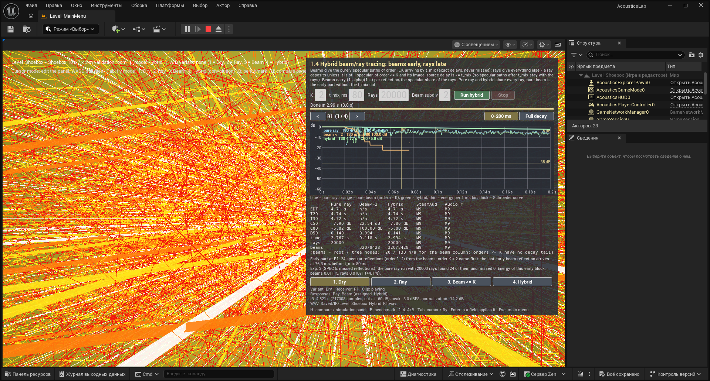
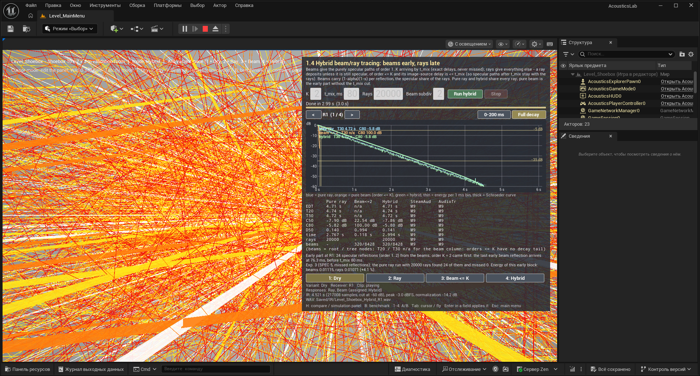

# M8 — hybrid beam/ray tracer, comparison panel (SPEC §2.8, §3.6, §3.7, §4, §5 experiment 3)

## Plan

### The split rule (thought through before coding)

SPEC §2.8: the early part comes from the beams up to order K (default 2) or up to t_mix (default 80 ms), "whichever comes
first"; the late part comes from the stochastic rays, which start depositing only from order K+1 or after their first
diffuse reflection. Taken literally the two limits do not fit together: a purely specular path of order ≤ K that arrives
after t_mix is dropped by the beams (time limit) *and* by the rays (order limit) — it would be lost. The rule is
therefore stated per **path class**, and both parts use the same predicate:

- A contribution is **early-specular** when its path is purely specular (no diffuse reflection), its order k satisfies
  1 ≤ k ≤ K, and its image-source delay to the receiver centre `t_spec = d'/c` satisfies `t_spec ≤ t_mix`
  (t measured from the emission, like every delay of the solvers).
- **Beams** contribute exactly the early-specular paths: every beam reflection of order 1..K with `t ≤ t_mix`.
- **Rays** contribute everything else: a deposit is skipped (moved to a separate "excluded" histogram) only when the ray
  has had no diffuse reflection yet, its order is 1..K and the `t_spec` of its path is ≤ t_mix. A specular ray of order
  ≤ K arriving after t_mix keeps depositing — that is the case the literal rule loses.
- For the ray, `t_spec` is not its own arrival time at the sphere surface (that is up to r/c ≈ 1.5 ms earlier) but the
  delay of the *same* image source the beam uses: in the unfolded (mirrored) space the specular ray is a straight line
  from the image source, so `d'² = (L + a)² + p²`, where L is the path length before the current segment, a the
  projection of (receiver centre − segment origin) on the direction and p the perpendicular distance. Rays and beams
  thus classify a path identically, also when it sits right at t_mix.
- Direct sound (order 0) is analytic in both parts (SPEC §2.2.7) and is counted once (from the ray part, the beam part
  adds reflections only).
- Energy consistency: the stochastic ray reflects specularly with probability (1 − s), so its expected specular energy
  after k reflections is Π(1 − α)(1 − s). The beams of the hybrid therefore carry Π(1 − α)(1 − s) (new beam-tracer
  option `bScatteringLoss`, off by default so M5–M7 stay bit-identical); the scattered fraction s is what the rays
  carry on after their first diffuse reflection. Without the factor the early specular energy would be counted
  1/(1 − s)^k times.

So hybrid = analytic direct + beams(early-specular) + rays(not early-specular), and pure ray = rays(everything) =
rays(not early-specular) + rays(early-specular). Both ray parts come out of **one** ray run (two histograms per receiver),
so hybrid and pure ray share every random number and differ only in the early-specular block.

### Steps

1. **Core, ray tracer** (`Solvers/RayTracer.h/.cpp`): `FRayTracerSettings::ExcludeSpecularMaxOrder` (0 = off),
   `ExcludeSpecularMaxSeconds`, `bRecordSpecularArrivals`; the ray tracks "diffuse yet" and the surface sequence;
   excluded deposits go to `FReceiverResult::ExcludedHistogram` (+ `NumExcludedHits`); purely specular deposits of order
   1..K are grouped per reflection sequence (`FSpecularRayArrival`: sequence key over coplanar surfaces, order, t_spec,
   hits, energy, excluded flag) per chunk and merged in chunk order (deterministic). Helpers `BuildTriangleSurfaceMap`
   (surfaces of `FImageSourceSolver::BuildSurfaces`) and `SurfaceSequenceKey`.
2. **Core, beam tracer**: `FBeamTracerSettings::bScatteringLoss` (reflection factor (1 − α)(1 − s)).
3. **Core, `Solvers/HybridTracer.h/.cpp`**: `FHybridTracerSettings { Ray, Beam, K, MixingTimeSeconds, bScatteringLoss }`,
   `FHybridTracer::Run` → `FHybridResult { Hybrid, PureRay, PureBeam (shared results), LateHistograms, per-receiver stats
   (beam early reflections kept / dropped by t_mix, found / missed by the rays = SPEC §5 exp. 3, energies of the three
   blocks), timings }`. Beam part through `FBeamTracer::Run` (M7 pool, `MaxBeamOrder = K`, omnidirectional, no
   refraction — the ray tracer models neither), ray part through `FRayTracer::Run` with the exclusion; composition per
   receiver in a fixed order; metrics of hybrid and pure ray recomputed. Pure C++, meters / seconds / double.
4. **Tests** (`Private/Tests/HybridTracerTests.cpp`): `AcousticsLab.Core.Solvers.HybridConsistency` (early part = pure
   beam ±0.1 ms / ±1 %, (1 − s)^k factor, T30 within 5 % of pure ray on the shoebox),
   `AcousticsLab.Core.Solvers.HybridNoDoubleCounting` (late + excluded = an independent pure ray run bin by bin; bins
   after t_mix identical; every excluded specular group has a beam counterpart; the t_mix < order-K case keeps the late
   specular paths in the ray part; total and early energies of hybrid vs pure ray), `AcousticsLab.Core.Solvers.HybridDeterminism`
   (1 / 4 / all threads, repeated run: bit-identical), `AcousticsLab.Core.Solvers.HybridMissedReflections` (SPEC §5
   exp. 3: N sweep, table in the log). All 30 earlier tests stay green.
5. **Game**: `FSolverSettings::HybridMixingTimeMs` + `ToHybridTracerSettings`; `AAcousticSimulationManager` runs
   `EAcousticSolver::Hybrid` (no more ray fallback), keeps `GetLastHybridResult()`, feeds the auralization with three
   variant sets (2 Ray = pure ray, 3 Beam = pure beam ≤ K, 4 Hybrid → `Saved/IR/<Level>_Hybrid_<Receiver>.wav`);
   subsystem stores the hybrid bundle per level. HUD: "Hybrid beam/ray" in the solver combo, fields "Hybrid: K" and
   "Hybrid: t_mix, ms", button "4: Hybrid", hybrid timing line. `UAuralizationComponent`: Hybrid is a wet variant.
6. **`UI/UCompareWidget`** (C++-built like the benchmark panel): fields K / t_mix / rays / subdivision, Run / Stop,
   receiver selector, `UIRPlotWidget` with the three curves (pure ray, pure beam ≤ K, hybrid) and an early / full time
   zoom, a monospaced metrics table (EDT, T20, T30, C50, C80, D50, time, rays, beams) with columns built from a list
   (M9 appends Steam Audio / Audio Tracing; their columns show as "M9" placeholders now), the split summary and the
   exp. 3 line ("rays found m of n early reflections"), A/B buttons 1–4. `AAcousticsPlayerController` shows it for
   `?mode=Hybrid` (menu 1.4) and `?mode=Compare` (menu 3) with the solver set to Hybrid; key **H** toggles compare /
   simulation panel in every scene level.
7. Build, tests, PIE on `Level_Shoebox` through the editor MCP (menu 1.4 and 3, run, screenshots in
   `docs/milestones/img/`), this document (done / deviations from SPEC and from the Euronoise 2018 abstract / how to
   verify / build tail / tests / results), commit `M8: hybrid beam/ray tracer`, push.

## Done

- **Core, ray tracer** (`Public/Solvers/RayTracer.h`, `Private/Solvers/RayTracer.cpp`): `FRayTracerSettings::ExcludeSpecularMaxOrder` / `ExcludeSpecularMaxSeconds` / `bRecordSpecularArrivals`. Every ray tracks whether it has been reflected diffusely and the surfaces it reflected from; a deposit is early-specular when the ray is still specular, its order is 1..K and `FRayTracer::ImageSourceDistance` (the unfolded distance image source → receiver centre) / c ≤ t_mix. Early-specular deposits go to `FReceiverResult::ExcludedHistogram` (+ `NumExcludedHits`); per chunk the excluded histograms only reach t_mix (the entry time of such a deposit is never later than its image delay). Purely specular deposits of order 1..K are grouped per reflection sequence into `FSpecularRayArrival` (sequence key over coplanar surfaces, order, image delay, image source, hits, energy, excluded flag), merged in chunk order. Helpers `BuildTriangleSurfaceMap` (surfaces of `FImageSourceSolver::BuildSurfaces`), `CombineSequenceKey` / `SurfaceSequenceKey` (FNV-1a). With K = 0 nothing changes (the 30 earlier tests are untouched).
- **Core, beam tracer**: `FBeamTracerSettings::bScatteringLoss` — the reflection factor becomes (1 − α)(1 − s) (default off, M5–M7 bit-identical).
- **Core, hybrid** (`Public/Solvers/HybridTracer.h`, `Private/Solvers/HybridTracer.cpp`): `FHybridTracerSettings { Ray, Beam, K = 2, MixingTimeSeconds = 0.080, bScatteringLoss = true, bCountMissedReflections = true }` with `MakeBeamSettings` (MaxBeamOrder = K, omnidirectional, no refraction, histogram layout / receiver radius / air absorption taken from the ray part) and `MakeRaySettings` (the split); `FHybridTracer::Run` = `FBeamTracer::Run` (M7 pool) + `FRayTracer::Run` + composition per receiver on the calling thread: hybrid histogram = ray part (direct + not early-specular) + beam reflections of order 1..K with t ≤ t_mix; pure ray = ray part + excluded histogram (same run); pure beam = the beam run itself. `FHybridResult { Hybrid, PureRay, PureBeam (shared results), LateHistograms, Stats per receiver, K, t_mix, timings, Describe() }`; `FHybridReceiverStats`: early beam reflections kept / dropped by t_mix, found / missed by the rays (SPEC §5 exp. 3), ray groups excluded / late / without beam, energies of the three blocks, last early arrival. Rays and beams are matched by **image source** (order + position within 0.1 mm), not by the surface sequence: reflections off two perpendicular walls commute (A→B and B→A share the image), and the receiver sphere is reached through both while the beam reports the one valid at its centre (the first test run flagged exactly these pairs).
- **Tests** (`Private/Tests/HybridTracerTests.cpp`, 4 new, 34 in total): `HybridConsistency`, `HybridNoDoubleCounting`, `HybridDeterminism`, `HybridMissedReflections` (what each asserts and the numbers: "Tests" and "Results" below).
- **Game**: `FSolverSettings::HybridMixingTimeMs` (80) + `ToHybridTracerSettings()` + a hybrid line in `ToString`; `AAcousticSimulationManager` runs `EAcousticSolver::Hybrid` (no more ray fallback; the source medium is applied to the beam part), keeps `GetLastHybridResult()`, stores the bundle in `UAcousticSimulationSubsystem::StoreHybridResult` and feeds three auralization sets from one run: 2 = pure ray (`<Level>_RayTracer_<R>.wav`), 3 = pure beam ≤ K (`<Level>_BeamTracerK2_<R>.wav`), 4 = hybrid (`Saved/IR/<Level>_Hybrid_<R>.wav`, heard last). `UAuralizationComponent`: Hybrid is a wet variant like Ray / Beam, `VariantForSolver` accepts `BeamTracer*`. Simulation panel: "Hybrid" in the solver combo, fields "Hybrid: beams up to order K" and "Hybrid: t_mix, ms", button "4: Hybrid", a hybrid timing line (early reflections kept / dropped, found / missed by the rays, beam and ray times).
- **`UI/UCompareWidget`** (C++-built like the benchmark panel, top-right): title by mode (1.4 / 3), the split rule as a note, fields K / t_mix / Rays / Beam subdiv + Run hybrid / Stop, status + progress, receiver `<` `>` (also switches the auralized receiver), `UIRPlotWidget` with three curves (pure ray blue, pure beam ≤ K orange, hybrid green) and a time zoom (0–200 ms / full decay), a monospaced metrics table (EDT, T20, T30, C50, C80, D50, time, rays, beams) whose columns come from a list — Steam Audio and Audio Tracing are listed already and show "M9" —, the split summary (which limit came first) and the exp. 3 line (found / missed by the rays, energy of the early block beams vs rays), A/B buttons 1 Dry / 2 Ray / 3 Beam ≤ K / 4 Hybrid with the auralization state. Table and summary are also logged after every run. `AAcousticsPlayerController`: `?mode=Hybrid` (menu 1.4) and `?mode=Compare` (menu 3) select the hybrid solver and show the panel; **H** toggles comparison / simulation panel in every scene level (B still toggles the benchmark); canvas HUD hints updated.
- **Tools**: `Tools/Editor/verify_m8_pie.py` (prepare / run / capture / log / stop / restore through the editor MCP).

## Deviations

From SPEC §2.8 / the task:
- **The split rule is stated per path class** (see Plan): early-specular = purely specular, order 1..K, image delay ≤ t_mix. The literal "rays deposit only from order K+1 or after the first diffuse reflection" would lose the specular paths of order ≤ K arriving after t_mix whenever t_mix comes first; here they stay with the rays (test case K = 3, t_mix = 30 ms: 52 / 40 beam reflections of order ≤ 3 dropped at R1 / R2, the same paths found among the late specular ray groups, none double, none lost).
- **t_mix is measured from the emission**, like every delay of the solvers (not from the direct-sound arrival like C50 / C80). The ray classifies by the beam delay d'/c (image source → receiver centre), not by its own arrival at the sphere surface (up to r/c earlier), so both parts agree at the boundary.
- **Beams carry (1 − α)(1 − s)** in the hybrid (new beam-tracer option, off for the pure beam tracer of M5–M7): the stochastic ray reflects specularly with probability 1 − s, and the beams replace exactly that specular share. Without the factor the early specular energy (shoebox, s = 0.1) would be counted 1/0.9^k too high. The "pure beam ≤ K" curve of the panel is the beam part of the hybrid run (with the factor).
- **The beams of the hybrid are omnidirectional and do not refract**: the ray tracer models neither, and both parts must describe the same physics. A directional source or refraction (Level_Refraction) is ignored by the hybrid (the beam tracer keeps both).
- **Direct sound** is analytic and taken from the ray part (the beam part adds reflections only).
- **One ray run gives both ray curves**: pure ray = late + excluded histogram of the same run, so hybrid and pure ray differ only in the early-specular block (which is why their T30 agree to the millisecond).
- **Receiver sphere vs point**: rays enter a sphere of radius r, beams test the centre. A specular zone whose boundary crosses the sphere could leave a ray group without a beam counterpart (counted in `NumRayGroupsWithoutBeam`); in the shoebox every image source of the rectangular lattice is valid everywhere, so the count is 0.
- Menu items 1.4 and 3 both open `Level_Shoebox` with the same panel (title differs); the industry columns are placeholders until M9.

From the Euronoise 2018 abstract (S4). The CROSBI record https://www.bib.irb.hr/941403 now redirects to CroRIS, which answered this session only with a bot-check page, so the abstract was not re-read; the points below follow SPEC §1 and the reading recorded by the documentation session:
- S4 uses beams for the early part and rays for the late part including diffuse reflections, aimed at curved surfaces modelled by triangle meshes (ancient theatres). This implementation keeps that division but splits by **path class** (specular, order ≤ K, by t_mix vs everything else) inside one ray run instead of switching between two simulations at one time.
- According to the documentation session, S4 turns each beam into one ray with an equivalent detector radius; here beams and rays are two independent solvers combined in the histogram, and the beam receiver is a point (energy r²/(4d²)), as in M5.
- Diffuse reflections are not traced inside the beams: the scattered share s leaves the beams (factor 1 − s) and is carried by the rays after their first diffuse reflection.
- Validation is on the shoebox; the amphitheatre arrives in M10.

## How to verify by hand in the editor

1. Open `Level_MainMenu`, Play. Item **1.4 Hybrid beam/ray tracing** opens `Level_Shoebox?mode=Hybrid`, item **3 Compare** opens `Level_Shoebox?mode=Compare`; both show the comparison panel at the top right (the title says which). In any scene level **H** toggles comparison / simulation panel, **B** the benchmark panel.
2. Set K (2), t_mix (80 ms), Rays (20000), Beam subdiv (2), press **Run hybrid**. Status shows the progress, then `Done in ... s`. The plot shows three curves: blue = pure ray, orange = pure beam ≤ K, green = hybrid; **0–200 ms** zooms on the early part (the orange steps sit on the blue ray peaks up to 80 ms, the green curve follows the orange one before t_mix and the blue one after), **Full decay** shows the whole Schroeder curves (green and blue coincide).
3. The table below the plot lists EDT / T20 / T30 / C50 / C80 / D50 / time / rays / beams per method; Steam Audio and Audio Tracing columns show "M9". The two lines under it give the split (which limit came first, last early beam arrival) and SPEC §5 exp. 3: how many of the early specular reflections the pure ray run found / missed and the energy of the early block, beams vs rays.
4. Set Rays = 20 (or 250 / 1000) and run again: the exp. 3 line reports most of the 24 early reflections missed by the rays, the hybrid still has all of them (beams).
5. `<` `>` switches the receiver (R1..R4) for plot, table and auralization; buttons / keys **1–4** select Dry / Ray / Beam ≤ K / Hybrid (`Saved/IR/Level_Shoebox_Hybrid_<R>.wav` is written after the run).
6. Simulation panel (H): solver combo **Hybrid** with the fields "Hybrid: beams up to order K" and "Hybrid: t_mix, ms"; the run line shows beam / ray / composition times.
7. Scripted: `python Tools/Editor/verify_m8_pie.py prepare`, `run --shot X.png`, `log "Hybrid K="`, `stop`, `restore` (editor started with the MCP flags of docs/ENV.md).

## Checked in PIE

Editor with the MCP flags, `Level_MainMenu` → 1.4 and → 3 by real mouse clicks (`Tools/Editor/click_screen.ps1`). Log: `Main menu: opening /Game/Maps/Level_Shoebox?mode=Hybrid`, `... ?mode=Compare`, `Level Level_Shoebox started, mode=Compare`.

Run of menu 1.4 (K = 2, t_mix 80 ms, 20000 rays, subdivision 2), receiver R1:

| | EDT, s | T20, s | T30, s | C50, dB | C80, dB | D50 | time, s | rays | beams |
|---|---|---|---|---|---|---|---|---|---|
| Pure ray | 4.71 | 4.74 | 4.72 | −7.90 | −5.82 | 0.140 | 2.767 | 20000 | – |
| Beam ≤ 2 | n/a | n/a | n/a | 22.54 | 100.00 | 0.994 | 0.118 | – | 320 / 8428 |
| Hybrid | 4.71 | 4.74 | 4.72 | −7.86 | −5.80 | 0.141 | 2.994 | 20000 | 320 / 8428 |

(T20 / T30 n/a for the beam column: orders ≤ 2 have no decay tail; C80 = 100 dB is the "no late energy" cap.) Exp. 3 line: 24 early specular reflections, 24 found / 0 missed by 20000 rays, early block beams 0.01115 vs rays 0.01071 (+4.1 %). T30 4.722 s at R1 vs Eyring 4.587 s (+2.9 %) and Sabine 4.657 s (+1.4 %). Key 4 → "A/B variant 4 (Hybrid) selected", submix wet 1. Direct PIE run (`verify_m8_pie.py run`): beams 0.127 s (8428 nodes), rays 3.052 s.

Compare mode with 20 rays: 0 of 24 early reflections found by the rays, all 24 missed; pure ray C50 −23.72 dB vs hybrid −14.19 dB, T30 5.13 s for both (20 rays are far too few for a decay, the point is the early block).





Notes: `LogAutomationTest: Error: Condition failed` (17 lines) at editor start are engine self-tests, as in M7. `SendKeys` letters (H, B) do not reach PIE while digits do, so the panel was checked through the menu routes; H works from a real keyboard.

## Results (automation tests, shoebox 10 × 7 × 3 m, α = 0.1)

- **Consistency** (K = 2, t_mix 80 ms): T30 hybrid = pure ray to the millisecond (R1 1.499 / 1.499 s at s = 0.1; 1.359 / 1.359 s at s = 0.5); energy of the early specular block beams vs rays within 1–2 %; every hybrid bin after t_mix equals the pure-ray bin.
- **No double counting**: late + excluded histogram = an independent ray run bin by bin; the image sets of the beam part and of the late ray groups are disjoint; with K = 3, t_mix = 30 ms 52 (R1) / 40 (R2) beam reflections of order ≤ 3 are dropped by t_mix and found among the 58 / 44 late specular ray groups, none without a beam counterpart.
- **Determinism**: 8000 rays, identical hybrid / pure ray / pure beam histograms for 1 thread, 4 threads, all cores and a repeated 4-thread run.
- **SPEC §5 exp. 3** (24 early specular reflections of order ≤ 2 per receiver):

| rays N | 250 | 1000 | 4000 | 16000 | 64000 | 256000 |
|---|---|---|---|---|---|---|
| R1 missed | 20 | 14 | 3 | 0 | 0 | 0 |
| R2 missed | 17 | 14 | 2 | 0 | 0 | 0 |
| R1 + R2 hits of the early block | 11 | 21 | 107 | 444 | 1745 | 7018 |

The beams give all 24 at any N; the ray count needed to find every early reflection grows with the order and the room size (here ≈ 16000).

## Tests

34 of 34 green (`Saved/Logs/M8_tests1.log`, `Automation RunTests AcousticsLab`): Audio.IRSynthesis, Audio.WavRoundTrip, Geometry.BvhMatchesBruteForce, Geometry.BvhQueriesMatchBruteForce, Geometry.ClipPolygon, Geometry.LeastSquaresApex, Geometry.RayTriangle, Geometry.ShoeboxExtraction, Geometry.ShoeboxScene, Geometry.Snell, Metrics.LevelHelpers, Metrics.SyntheticDecay, Smoke.Constants, Solvers.BeamEmission, Solvers.BeamThreadCountInvariance, Solvers.BeamTreeDeterminism, Solvers.BeamVsImageSource, Solvers.BenchmarkMatrix, Solvers.BvhToggleInvariance, Solvers.Deterministic, **Solvers.HybridConsistency**, **Solvers.HybridDeterminism**, **Solvers.HybridMissedReflections**, **Solvers.HybridNoDoubleCounting**, Solvers.ImageSourceShoebox, Solvers.LensFocus, Solvers.PathSampling, Solvers.RayTracerPrimitives, Solvers.ReceiverInsideBeam, Solvers.RefractedBeamTreeDeterminism, Solvers.RefractionEnergy, Solvers.ShoeboxSabine, Solvers.ThreadCountInvariance, Visualization.Helpers (prefix `AcousticsLab.Core.`).

## Build log tail (`Saved/Logs/M8_build2.log`)

```
[1/6] Compile [x64] AcousticSimulationManager.cpp
[2/6] Compile [x64] CompareWidget.cpp
[3/6] Compile [x64] SimulationHUDWidget.cpp
[4/6] Link [x64] UnrealEditor-AcousticsLab.lib
[5/6] Link [x64] UnrealEditor-AcousticsLab.dll
[6/6] WriteMetadata AcousticsLabEditor.target [NoUba]
Result: Succeeded
Total execution time: 25.75 seconds
```
(Build #1 compiled the whole change for 342 s and stopped on three small errors, fixed: a ternary between `MakeShared` and `nullptr`, the protected `UUserWidget::Invalidate`, a broken `TEXT` literal.)
